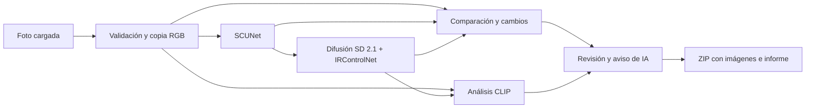

# AstroRestore AI

> Aplicación experimental para intentar reducir el ruido de fotos astronómicas y revisar qué cambia durante su reconstrucción con IA.

## Descripción

El ruido dificulta apreciar estrellas tenues y estructuras difusas. Una reconstrucción puede mejorar la apariencia de una foto y, al mismo tiempo, borrar información o generar formas plausibles que no estaban registradas. AstroRestore AI conserva el archivo cargado y ayuda a revisar esas modificaciones antes de compartir el resultado.

La aplicación está pensada para Julia, profesora de Física y aficionada a la astrofotografía. Utiliza **DiffBIR v2** —SCUNet seguido de SD 2.1 Base + IRControlNet— para limpieza y reconstrucción, y **CLIP** para una lectura general de las imágenes. Gradio permite cargar, comparar regiones, mostrar diferencias y descargar imágenes con un aviso de IA. El alcance es **reducción de ruido, sub-tarea B**: no entrenamiento ni superresolución.

**Estado:** las funciones están implementadas y el ensayo DiffBIR completo tiene evidencia en un caso. Esa tubería mejoró métricas globales frente a la entrada, pero empeoró frente a SCUNet solo y alteró galaxias. No se demostró un aporte favorable de la etapa generativa ni fidelidad científica. Faltan la validación completa de la revisión actual en Colab, capturas y video.

## Persona Usuaria

**Nombre:** Julia, 34 años, profesora de Física y aficionada a la astrofotografía.

**Contexto:** prepara clases y talleres; utiliza Siril, DeepSkyStacker y Photoshop, sin especialización en modelos generativos.

**Problema:** quiere revisar fotos con ruido sin perder estrellas tenues ni presentar detalles generados como observaciones reales.

**Solución:** validar su foto, seguir el procesamiento, comparar las mismas regiones de entrada, limpieza y reconstrucción, y compartir con contexto. La app no verifica autenticidad.

Julia orienta las decisiones de diseño, pero la interfaz y el informe están escritos para cualquier persona aficionada: no requieren conocimientos de modelos ni asumen que se vaya a usar la imagen en una clase.

## Demo

**Pendiente:** capturas o GIF de la interfaz actual y enlace al video de cinco minutos. La autora está probando la app en Colab; todavía no se conserva una validación completa del último diseño.

El video deberá mostrar problema, carga, estado del procesamiento, comparación, lectura CLIP, descarga y reflexión sobre lo real y lo generado. Si se recorta la espera, debe indicarse. El [ensayo histórico de Tile y CLIP](assets/ejemplos/etapa3_tile/README.md) contiene resultados reales, pero no sustituye capturas de la app actual.

## Qué es real y qué es inventado

**Restaurar no es recuperar.** Se conserva el archivo cargado y se prepara una copia RGB pequeña para trabajar. SCUNet intenta limpiar; la difusión reconstruye usando patrones aprendidos. Ambas etapas pueden modificar información: suavizar, borrar estrellas tenues, cambiar colores o generar estructuras. No separan dato e invención píxel a píxel ni garantizan recuperar lo perdido.

**Cómo se ve en la app.** Tres miniaturas identifican entrada, limpieza y reconstrucción. El visor compara entrada/resultado o cualquier otro par, con región y ampliación compartidas. El amarillo marca diferencias del par elegido, no invenciones; una región sin marca tampoco garantiza fidelidad. CLIP solo compara la apariencia con frases predefinidas. Un detalle nuevo queda **no verificado**.


*Resultado histórico conservado; no es una captura de la nueva interfaz. Crédito: NASA, ESA, and J. Comerford (University of Colorado-Boulder), [potw1803a](https://esahubble.org/images/potw1803a/), CC BY 4.0. Captura actual: pendiente.*

**Advertencia:** «Más nítido no significa más real. La IA puede agregar detalles o borrar estrellas tenues. Compará los cambios antes de compartir; tu archivo original se conserva». El ZIP incluye una copia con la banda **Reconstruida con IA**, además de la salida sin marcas.

**Fallo concreto:** en el ensayo DiffBIR de `potw1803a`, la galaxia superior adquirió trazos espirales más regulares y distintos de la referencia, y empeoraron sus métricas locales. La mejora global del fondo no demuestra conservación de estructuras.

**Verificación y riesgo:** comparar localiza modificaciones; confirmar un detalle requiere otra observación independiente del mismo campo. Una apariencia creíble no es evidencia verificable. Julia debe mostrar entrada y resultado identificando la IA. No usar como descubrimiento, medición, archivo histórico fiel o prueba periodística. Rostros, textos, matrículas y documentos quedan fuera del alcance; sus detalles generados no son identificaciones ni transcripciones.

## Características

- Motor predeterminado **DiffBIR v2 en local y Colab**, con idéntica interfaz y configuración. En Windows se habilita vista previa y validación; la inferencia de esta integración requiere Linux y CUDA.
- Carga PNG/TIFF compatible, validación previa y conservación del original.
- Estado persistente con etapa y tiempo; porcentaje solo para pasos medidos de reconstrucción DiffBIR, no para ruido eliminado ni avance total.
- Visor principal, miniaturas de etapas, regiones compartidas y ampliación de píxeles ×2 sin otra inferencia.
- Capa amarilla opcional y diferencias absolutas en la descarga; no se presentan como detección de invenciones.
- Lectura visual breve en lenguaje cotidiano, generada a partir de CLIP: presenta impresiones generales de ambas imágenes y una guía para revisar, sin nombres de modelos, puntuaciones ni referencias a la docencia en el informe público.
- ZIP con original, entrada preparada, salida, limpieza intermedia, condición reducida, diferencias, copia con aviso de IA, informe, parámetros y hashes.
- Reintento de lectura y descarga sin repetir difusión.
- Siete pares gaussianos reproducibles, [procedencia y atribución](assets/ejemplos/README.md) y [catálogo de ruido](assets/ruido_gaussiano/README.md). Son imágenes de Hubble, no capturas crudas de aficionados. `potw1849a` se añadió desde la versión TIFF de publicación 4K.
- SD 1.5 + Tile y el laboratorio quedan como variantes históricas explícitas, sin sustitución automática de DiffBIR.

## Tecnologías Utilizadas

**Entorno:** Python **3.12**, uv, `tool.uv.package = false`. Se versionan `uv.lock` y `colab/diffbir/uv.lock`.

**Interfaz:** Gradio **6.31.0**.

**Modelos de IA:**

- [DiffBIR v2](https://github.com/XPixelGroup/DiffBIR), revisión `5c2d6c177c3f2965e6d33a32931248d242ef7b3d`: SCUNet-PSNR → SD 2.1 Base + IRControlNet v2. DiffBIR y SCUNet: **Apache 2.0**; SD 2.1: **CreativeML Open RAIL++-M**. Configuración fija: 50 pasos, sampler `spaced`, CFG 4, control 1, semilla 42, prompt positivo vacío y captioner desactivado. El control 1 no equivale a `strength=1` de img2img. La salida conserva el tamaño de trabajo, hasta 256 píxeles de lado.
- [CLIP ViT-B/32](https://huggingface.co/openai/clip-vit-base-patch32), revisión `3d74acf9a28c67741b2f4f2ea7635f0aaf6f0268`: **MIT**, lectura con seis frases fijas, en CPU. La revisión exacta utilizada se declara en [analysis.py](src/analysis.py).
- Variante histórica: [SD 1.5](https://huggingface.co/stable-diffusion-v1-5/stable-diffusion-v1-5), revisión `451f4fe16113bff5a5d2269ed5ad43b0592e9a14`, y [ControlNet Tile](https://huggingface.co/lllyasviel/control_v11f1e_sd15_tile), revisión `3f877705c37010b7221c3d10743307d6b5b6efac`: **CreativeML OpenRAIL-M**, img2img con DDIM.

**Procesamiento:** entorno principal con PyTorch **2.15.0**, Diffusers **0.42.1**, Transformers **5.22.2**, Accelerate **1.15.0**, Pillow **12.3.0**, NumPy **2.5.4** y scikit-image **0.26.0**, según `uv.lock`. DiffBIR se ejecuta en un proceso separado: Torch **2.2.2 + CUDA 11.8**, NumPy **1.26.4** y setuptools **80.9.0**, según su bloqueo aislado. No se mezclan esos entornos.

**Pesos:** SCUNet desde KAIR v1.0; IRControlNet desde [lxq007/DiffBIR-v2](https://huggingface.co/lxq007/DiffBIR-v2), revisión `fd6263503564bfbfa156665a90832e1b729434f4`; SD 2.1 desde el [respaldo de terceros](https://huggingface.co/ckpt/stable-diffusion-2-1-base), revisión `80b44465963d65d12b35d07a2ea789545df260b9`, porque el enlace original respondió 401. Se verifican tamaño y SHA-256 antes de cargar. Fuentes y hashes están en [diffbir_trial.py](src/diffbir_trial.py). Unos 6,7 GB de pesos, además de dependencias y cachés; no están en Git.

**Hardware probado:** Windows 11, 16 GB RAM y RX 580 2048SP de 8 GB. Los ensayos históricos locales utilizaron CPU; no se validó aceleración con esa GPU. El ensayo completo DiffBIR se ejecutó en **Tesla T4 de Colab**. La RAM exacta de la sesión no quedó documentada. Esto no equivale a probar el último diseño integrado en GPU.

## Arquitectura del Sistema



`app.py` contiene la interfaz, estado y revisión; `src/diffusion.py` prepara imágenes y ejecuta difusión; `src/diffbir_bridge.py` mantiene el proceso aislado; `src/analysis.py` calcula la lectura CLIP; `src/honesty.py` produce diferencias y avisos; `src/export.py` conserva resultados y registros. No se cargan modelos al importar módulos. DiffBIR amplía internamente la condición, reconstruye, corrige color con wavelets y reduce al tamaño de trabajo; sus cambios no se atribuyen únicamente a difusión.

```text
astro-restauracion/
├── app.py
├── pyproject.toml, uv.lock, .python-version
├── README.md, AGENTS.md, .gitignore
├── src/                       # Difusión, análisis, honestidad y utilidades
├── assets/
│   ├── ejemplos/              # Procedencia y evidencia; TIFF originales ignorados
│   ├── ruido_gaussiano/       # Referencias, entradas ruidosas y registros
│   └── interfaz/tema.css
├── colab/
│   ├── ejecutar_en_colab.ipynb
│   ├── preparar_app.py        # Notebook y paquete local reproducible
│   └── diffbir/               # pyproject.toml y uv.lock aislados
├── laboratorio.py            # Recorrido experimental histórico
└── tests/
```

`outputs/`, `logs/`, `.cache/` y `.venv/` están ignorados. Todos los `.log` se guardan en `logs/`. Los README de activos conservan procedencia, modificaciones y evidencia; el historial de desarrollo queda en Git.

## Instalación y Ejecución

### Requisitos

- Git, [uv](https://docs.astral.sh/uv/getting-started/installation/) y Python **3.12**, seleccionado por `.python-version`.
- Internet y espacio para dependencias y varios GB de pesos durante el primer uso.
- Para inferir con DiffBIR: **Linux, GPU NVIDIA con CUDA y ambos entornos uv**. La ruta probada es Colab con T4; no se afirma compatibilidad con cualquier GPU. Windows/RX 580 permite abrir esta interfaz y validar archivos, pero no ejecutar este motor.
- PNG/TIFF de hasta 8 bits por canal; RAW, FITS y TIFF de 16/32 bits no se convierten automáticamente.
- No se exige token para la configuración pública utilizada; no versionar credenciales.

### Pasos

```bash
git clone https://github.com/Sabri-Nang/astro-restauracion.git
cd astro-restauracion
uv sync --locked
uv run app.py
```

Abrir la dirección indicada por Gradio, habitualmente `http://127.0.0.1:7860`. Para exigir el bloqueo: `uv run --locked python app.py`. Detener con `Ctrl+C`. El motor predeterminado es **DiffBIR**, igual que en Colab. La app muestra el motor activo; en Windows informa el límite y deshabilita procesar, conservando carga y vista previa.

En una máquina **Linux con CUDA compatible**, instalar además el entorno de DiffBIR antes de procesar:

```bash
uv sync --project colab/diffbir --locked --python 3.12
uv run --locked python app.py --engine diffbir
```

Para reproducir la variante anterior de forma explícita: `uv run --locked python app.py --engine sd_tile`. Cambia motor y controles; no es la misma restauración que DiffBIR. `ASTRORESTORE_ENGINE` también permite seleccionar un motor. El argumento `--engine` tiene prioridad sobre esa variable; sin ambos se utiliza DiffBIR. No hay fallback automático a CPU u otro modelo.

### Alternativa: Google Colab

1. Abrir el [notebook del repositorio](https://colab.research.google.com/github/Sabri-Nang/astro-restauracion/blob/main/colab/ejecutar_en_colab.ipynb), desde el navegador, y seleccionar GPU T4 si está disponible.
2. Mantener `ORIGEN = 'github'`, `MODO = 'aplicacion'` y `MOTOR = 'diffbir'`. Ejecutar las celdas en orden: clonan el proyecto, instalan ambos entornos y comprueban imports y CUDA.
3. Abrir el enlace temporal `https://…gradio.live`. La dirección local pertenece a Colab, no a tu computadora. Dejar la celda del servidor ejecutándose.
4. Subir una imagen compatible y descargar los resultados antes de cerrar la sesión.

Para probar cambios sin publicarlos: `uv run --locked python colab/preparar_app.py`. Subir la copia local de [ejecutar_en_colab.ipynb](colab/ejecutar_en_colab.ipynb), elegir `ORIGEN = 'paquete_local'` y cargar `outputs/astrorestore_app_colab.zip`. El paquete excluye pesos, entornos y credenciales y verifica hashes. Los originales locales no se transfieren automáticamente.

### Cómo comprobar que local y Colab usan la misma versión

Ambas rutas llaman a `launch_app()`, con el mismo código, CSS, lectura CLIP y bloqueos. Al iniciar se imprime **Identidad de la aplicación**, con motor activo y SHA-256 del texto de módulos, estilos y locks, normalizando los saltos de línea a LF para comparar Windows y Linux. También se puede consultar sin modelos:

```bash
uv run --locked python -c "import json; from app import runtime_identity; print(json.dumps(runtime_identity(), indent=2))"
```

Mismos hashes y mismo motor verifican paridad de esos archivos y selección; no garantizan imágenes idénticas entre hardware diferente. Colab clona `main` al ejecutar la preparación: un servidor ya abierto no se actualiza por hacer push. Para cargar cambios, detenerlo y preparar una copia nueva; si se utiliza ZIP, regenerarlo y volver a subirlo.

Para comprobaciones sin pesos ni GPU: `uv run --locked python -m unittest discover -s tests -v`. Se verificaron estados transmitidos por HTTP, comparación, regiones, ampliación, reintento y ZIP con motor simulado. La instalación desde cero de la revisión final, la apariencia en navegador y el flujo GPU completo siguen pendientes.

## Uso

1. Abrir la app y confirmar el motor indicado. En Windows, la vista local no procesa DiffBIR; usar Colab.
2. Subir la foto y esperar su validación y vista previa. Se utiliza una copia de hasta **256 píxeles de lado**; el original se conserva.
3. Pulsar **Procesar foto**. Seguir etapa y tiempo en el panel. El porcentaje de reconstrucción cuenta pasos medidos; no estima limpieza ni avance total. La preparación no muestra porcentajes ficticios. No se ofrece duración estimada ni cancelación del servidor.
4. Revisar entrada/reconstrucción en el visor. **Ver qué cambió después de la limpieza** selecciona el otro par. Elegir región aplica el mismo recorte a ambos lados. Ampliar ×2 repite píxeles, no genera detalle nuevo.
5. Activar opcionalmente **Mostrar cambios en amarillo**. Se marca la imagen de la derecha; las diferencias se calculan antes de recortar. Revisar estrellas, contornos y fondo. Las marcas no certifican invención ni fidelidad.
6. Abrir **Lectura general de la imagen · no verifica autenticidad** si se necesita. El informe **Una mirada a tu imagen** describe la apariencia sugerida para la foto y el resultado; si se mantiene, reúne ambas en una sola lectura. No es una medición de limpieza. **Dónde mirar** invita a revisar las mismas estrellas, contornos y fondo. La explicación del modelo y sus puntuaciones se conserva en la documentación y el registro descargable.
7. Descargar el ZIP. Compartir `para_compartir_con_aviso.png` junto a la entrada. Su mapa corresponde a entrada/resultado completos, independientemente del par y región elegidos en pantalla. Si falla lectura o descarga, reintentarlas sin repetir difusión.

La configuración DiffBIR es fija. No hay ejemplos ni parámetros técnicos en la vista principal. Las capturas de estos pasos están pendientes.

### Qué contiene la descarga

`original.*` conserva los bytes del archivo cargado; `entrada_preparada.png`, la copia de trabajo; `salida_ia.png`, la reconstrucción sin marcas; `diferencias.png` y `zonas_para_revisar.png`, los cambios entre entrada y resultado completos. `para_compartir_con_aviso.png` añade una banda visible de IA. Con DiffBIR se incluyen además `limpieza_previa.png` y `condicion_reducida.png`. `informe.md` contiene la lectura y la advertencia; `parametros.json`, modelos, configuración, afinidades y hashes; `LEEME.txt` explica los límites y los archivos. Los datos técnicos no se presentan como una descripción libre de la escena. La copia con banda no debe usarse para métricas.

Si falla el análisis, las imágenes se conservan y se intenta preparar su descarga con un aviso. Si también falla la exportación, el ZIP no se ofrece como disponible. El reintento no ejecuta otra difusión. Un resultado ya descargado conserva su informe original: actualizar la app no reescribe ejecuciones anteriores.

## Decisiones de Diseño

### Por qué Gradio

Permite cargar, comparar y descargar sin código para Julia. El flujo distingue preparar, esperar con información y revisar. El estado permanece fuera del bloque de resultados oculto; un fallo deja un aviso persistente y restaura los controles. El contador de tiempo no es una confirmación independiente de actividad GPU; los avisos de desconexión del navegador dependen de Gradio.

### Por qué DiffBIR v2

Se adoptó después de los resultados desfavorables de SD/Tile. La tubería completa tuvo mejor parecido global en un caso, pero la reconstrucción empeoró frente a SCUNet y alteró estructuras. Por eso se conserva visible la limpieza intermedia. No se declara especializado en astronomía ni validado para todas las imágenes. El proceso persistente evita recargar modelos entre fotos. La instrumentación del sampler observa pasos y restaura su método al salir; no cambia pesos ni parámetros, y requiere validar el recorrido actual con GPU.

### Por qué CLIP

Cumple el análisis visual con un modelo de Hugging Face sin entrenar otro. Compara embeddings con seis frases en inglés, sin convertirlos en probabilidades. Usa CPU y recorte central a 224 píxeles, que puede omitir bordes. El informe público ofrece una impresión general en lenguaje cotidiano, sin nombres de modelos, puntuaciones ni explicaciones técnicas, y sin asumir que la persona sea docente. Si se mantienen las descripciones, agrupa la lectura de ambas imágenes sin afirmar que sean iguales. Una apariencia poco natural no se presenta como detección de invenciones. Los valores exactos y la identidad del modelo quedan en el ZIP.

### Principios de Human-AI Interaction aplicados

- **Transparencia:** motor visible, etapas identificadas, registro y original conservado.
- **Control:** pares, región, ampliación y marcas sin otra inferencia; configuración DiffBIR fija y sin slider ficticio de limpieza.
- **Explicabilidad:** lectura breve de apariencia sin jerga ni explicaciones de CLIP para usar la app. Un fondo que parece uniforme no demuestra ausencia de ruido; unas texturas poco naturales no certifican invención. Los detalles técnicos quedan en el README y el ZIP.
- **Honestidad:** un detalle nuevo queda no verificado y necesita evidencia independiente.
- **Errores:** validación previa, estado persistente y reintento sin perder imágenes.

**Sistema visual:** azul `#1d4ed8` para acciones, selección, progreso y foco; superficies grises neutras y visor `#262626`; ámbar para cambios y rojo para errores. Texto base 16 px y controles principales de al menos 44 px. Las combinaciones principales de texto superan 4,5:1 en el cálculo de contraste; no constituye una auditoría WCAG completa ni una prueba con Julia.

**Benchmark documental:** [Topaz](https://docs.topazlabs.com/topaz-photo/cloud-rendering), estado separado de revisión; [Lightroom](https://helpx.adobe.com/lightroom-classic/help/enhance-details.html), intensidad distinta de ejecución; [Siril](https://siril.readthedocs.io/en/stable/processing/denoising.html), revisión a escala de píxel; [GraXpert en Siril](https://siril.readthedocs.io/en/stable/processing/graxpert.html), operaciones explícitas. También se aplicó [reconocimiento frente a recuerdo](https://www.nngroup.com/articles/recognition-and-recall/). Se revisó documentación, sin pruebas prácticas comparativas ni estudio con usuarias. La paleta es una propuesta, no una preferencia validada de Julia.

**Historias y criterio de aceptación:** Julia debe reconocer qué se está ejecutando y distinguir espera, preparación y reconstrucción; identificar las dos imágenes comparadas y la misma región; explicar que amarillo no significa inventado; y compartir una salida identificada con IA junto a la entrada. Validar estas tareas con Julia, teclado, móvil y lector de pantalla está pendiente.

## Conceptos de Procesamiento Digital Aplicados

- **RGB y profundidad:** validación en `src/diffusion.py`; se rechazan más de 8 bits para evitar conversión silenciosa.
- **Interpolación:** LANCZOS para reducir sin recorte ni ampliación; dimensiones múltiplos de ocho. La revisión ×2 usa vecino más cercano; no es superresolución. DiffBIR incluye remuestreo interno y corrección wavelet.
- **Ruido gaussiano aditivo:** `src/noise.py`, media 0, sigma 0,03 y semilla 123 después de reducir, con recorte y cuantización registrados. No simula físicamente un sensor astronómico.
- **Diferencias y filtrado espacial:** media RGB de diferencias absolutas y promedio local 5 × 5, escala fija 0–255, en `src/honesty.py`. El amarillo usa umbral 12 y opacidad 0,6.
- **Restauración generativa:** DiffBIR y, en el recorrido histórico, img2img SD/Tile con DDIM.
- **Evaluación con referencia:** PSNR/SSIM en `src/evaluation.py`, sin usarlas como autenticidad.

## Uso de Agentes de IA

- **Herramienta:** Codex, con [AGENTS.md](AGENTS.md), para inspección, propuestas, implementación, pruebas y documentación.
- **Decisiones de la autora:** caso astronómico, Julia, foco en ruido, etapas y commits pequeños; prueba DiffBIR tras Tile, comparación honesta, simplificación de interfaz, cambio cromático y revisión del informe.
- **Propuestas del agente:** ruido reproducible, diferencias en escala fija, procesos aislados, progreso, regiones sincronizadas, lectura CLIP y pruebas. Se contrastaron propuestas con artefactos y ensayos de la autora, incluidos resultados desfavorables.
- **Opciones pospuestas:** cambio a SDXL, varios modelos, filtro bilateral y ampliaciones de alcance. No se presentan como evaluadas. Publicar cambios requiere autorización; aceptar código no sustituye revisar sus resultados.

## Limitaciones Conocidas

- La restauración se evaluó con referencia en un solo caso DiffBIR. Mejora global frente al ruido, pero pérdida de fidelidad frente a SCUNet y alteraciones locales. SD/Tile tampoco superó la entrada en el ensayo conservado.
- La integración DiffBIR no procesa en Windows/RX 580; la vista local no es inferencia GPU. Linux/CUDA es requisito del motor actual, no una capacidad garantizada por abrir Gradio.
- Entrada de al menos 64 píxeles por lado y salida de hasta 256. Ciertas relaciones de aspecto no cumplen ese mínimo después del ajuste. Sin RAW, FITS, TIFF de mayor profundidad, desenfoque ni superresolución.
- Siete pares gaussianos preparados; seis aún sin restauración evaluada. No hay colección validada de capturas crudas de aficionados ni referencia perfecta para fotos reales dañadas.
- No se promete un tiempo actual: los ensayos CPU históricos de SD registraron 102–223 s por imagen y no predicen DiffBIR ni incluyen sus descargas. Colab usa sesiones y recursos temporales.
- CLIP no localiza cambios, no mide ruido ni verifica autenticidad. Su recorte puede omitir bordes. El informe adapta a lenguaje cotidiano las dos descripciones principales de cada imagen; no es una descripción libre ni un análisis detallado de cada región seleccionada. Cambiar de región en el visor no recalcula esa lectura.
- El pipeline oficial DiffBIR no incluye el filtro de contenido de la variante SD/Tile; no se desactivó el filtro de esta última.
- Capturas, demo, instalación final desde cero y revisión con usuarias pendientes. No se declara fidelidad científica ni conformidad de accesibilidad completa.

## Métricas de Calidad (opcional)

**PSNR** compara el error de píxeles; más alto indica mayor parecido. **SSIM** compara estructura; más alto indica mayor semejanza estructural. Necesitan referencia confiable, no prueban autenticidad y no se calculan para una foto propia sin referencia. LPIPS no está implementado.

En `potw1803a`, referencia preparada de 256 × 192 y ruido gaussiano sigma 0,03/semilla 123, el ensayo completo DiffBIR registró:

- Entrada: **31,2381 dB / 0,637538** (PSNR/SSIM).
- SCUNet: **35,4260 dB / 0,839822**.
- DiffBIR final: **32,4664 dB / 0,793575**.
- Galaxia superior: entrada **30,4902 dB / 0,835860**; final **26,3997 dB / 0,724564**.

Para Julia: el parecido global mejoró frente a la foto ruidosa, pero la etapa generativa no superó la limpieza y cambió una galaxia. No es una garantía de restauración. Se revisaron las salidas del [notebook del ensayo](https://colab.research.google.com/drive/1vW7TnjBkn7vfzi9VFE-8Z55BYg83E1Ya#scrollTo=ejecutar-diffbir) y se recalcularon métricas de los paneles conservados, coincidentes dentro de 1e-12. El SHA del PNG final original todavía requiere cotejo con su ZIP completo; recodificar PNG puede cambiar sus bytes sin cambiar píxeles. Artefactos locales bajo `outputs/prueba_diffusion/`, excluidos de Git.

El [ensayo histórico Tile](assets/ejemplos/etapa3_tile/README.md) registró **28,4258 dB / 0,552753** a intensidad 0,10, peor que su entrada. Las cinco pruebas técnicas de `src/validation.py` acreditan funcionamiento, no reducción de ruido demostrada.

La evaluación usa RGB publicado en [0,1], `data_range=1`, SSIM gaussiano con ventana 11 × 11 y sigma 1,5 por canales, sin alinear ni ajustar contraste. La referencia publicada puede contener ruido propio: es objetivo de esta degradación artificial, no verdad científica perfecta. Laboratorio: `uv run laboratorio.py`; preparación, reproducción y evaluación: `--help` en `src.experiment`, `src.noise_assets` y `src.evaluation`.

## Trabajo Futuro

### Estado frente a la consigna

**Implementado:** persona y proyecto declarados; repositorio e historial de commits; Python 3.12 y uv con bloqueos; interfaz Gradio; difusión de Hugging Face; análisis visual con CLIP; comparación; avisos y diferencias; exportación con identificación de IA; conceptos de procesamiento y uso de agentes documentados. La ejecución real del ensayo DiffBIR existe en un caso. Implementar estas funciones no sustituye validar la versión final de punta a punta.

**Cinco imágenes de la etapa 2:** `outputs/etapa2/resumen.json` registra cinco ejecuciones técnicas correctas con SD 1.5: `potw1803a`, `potw1428a`, `heic0503a`, `heic1520a` y `potw1408a`. El registro y sus imágenes son locales, no se incluyen al clonar. Acreditan ese prototipo histórico; no son cinco pruebas del motor DiffBIR actual ni una evaluación de eliminación de ruido. Para entregar la versión final, registrar al menos cinco casos de la app actual en Colab y conservar comparaciones y parámetros.

### Para cerrar la entrega

- [ ] Ejecutar y registrar en Colab al menos cinco imágenes distintas con la revisión final: carga, progreso real, comparación, análisis y ZIP. Incluir un acierto o mejora observada y un fallo, sin afirmar fidelidad donde no se demuestra.
- [ ] Validar comprensión con Julia, teclado, contraste visual, móvil y lector de pantalla.
- [ ] Incorporar capturas actuales del uso y de la sección **Qué es real y qué es inventado**, y enlazar el video demo de cinco minutos con problema, flujo completo, resultados y reflexión.
- [ ] Probar instalación desde cero de la revisión final en otra carpeta o máquina.
- [ ] Completar reflexión personal de la autora y elegir licencia del código.
- [ ] Preparar defensa y completar el formulario de entrega con los enlaces finales.

### Mejoras y comprobaciones adicionales

- [ ] Ampliar evaluación a los otros seis pares y, posteriormente, fotos de aficionados con procedencia y permisos.
- [ ] Cotejar el PNG final original del ensayo completo contra su ZIP.

PSNR/SSIM/LPIPS, línea base clásica, lotes, historial, varios modelos y despliegue público son opcionales; no bloquean los criterios mínimos. No se necesita entrenar un modelo ni incorporar RAW/FITS para cumplir el alcance acordado. Posponer funciones complejas hasta cerrar la evidencia de entrega.

## Reflexiones y Aprendizajes

El proyecto permitió distinguir una inferencia correcta de una reducción de ruido demostrada. Una imagen convincente puede perder fidelidad; incluso una métrica global favorable puede ocultar alteraciones locales. También se distinguió tener VRAM de contar con un motor compatible, y compartir interfaz de poder ejecutar el mismo procesamiento en todo hardware.

**Reflexión personal de Sabrina: pendiente.** La autora completará con sus palabras aprendizajes, desafíos, revisión de propuestas del agente y cómo cambió su mirada sobre imágenes reconstruidas. No se le atribuye una experiencia todavía no registrada.

## Recursos y Referencias

- [DiffBIR](https://github.com/XPixelGroup/DiffBIR), [SCUNet/KAIR](https://github.com/cszn/KAIR), [CLIP](https://huggingface.co/openai/clip-vit-base-patch32) y [licencia CLIP](https://github.com/openai/CLIP/blob/main/LICENSE).
- [Diffusers](https://huggingface.co/docs/diffusers/), [Gradio](https://www.gradio.app/docs), [uv](https://docs.astral.sh/uv/) y [métricas scikit-image](https://scikit-image.org/docs/stable/api/skimage.metrics.html).
- [NASA: imágenes crudas](https://science.nasa.gov/solar-system/multimedia/what-are-raw-images/) y [ESA/Hubble: procesamiento](https://esahubble.org/projects/hiddentreasures/imageprocessing/).
- [Procedencia de ejemplos](assets/ejemplos/README.md), [ruido gaussiano](assets/ruido_gaussiano/README.md) y [evidencia Tile/CLIP](assets/ejemplos/etapa3_tile/README.md).
- [Consigna del docente](https://colab.research.google.com/drive/1PjBnThBhDF8x5gYSmbROR_vO7y7AUltV#scrollTo=1racjP4M9DZH).

## Autor

**Sabrina Sanches**

Estudiante de Tecnicatura Superior en Ciencia de Datos e Inteligencia Artificial — IFTS 24.

Materia: Procesamiento Digital de Imágenes e Introducción a Visión por Computadora.

Año: 2026.

[GitHub](https://github.com/Sabri-Nang) · [Repositorio](https://github.com/Sabri-Nang/astro-restauracion).

## Licencia

**Código:** pendiente de elección por la autora e incorporación de un archivo de licencia. No se declara MIT, Apache u otra sin esa decisión.

**Modelos:** DiffBIR/SCUNet, Apache 2.0; SD 2.1, CreativeML Open RAIL++-M; CLIP, MIT; SD 1.5/Tile, CreativeML OpenRAIL-M. Sus condiciones son independientes de las del código.

**Imágenes:** mantener fuente, crédito, CC BY 4.0 y modificaciones según los registros de activos. El ZIP de una foto propia no le otorga una licencia nueva. No se versionan originales TIFF, credenciales, pesos ni entornos.

---

**Trabajo Integrador N.º 2 — IFTS 24 — 2026**
