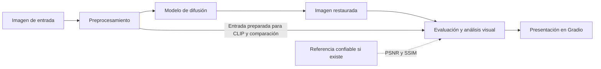

# AstroRestore AI

> Aplicación experimental para explorar la reducción de ruido en imágenes astronómicas y examinar los cambios introducidos por difusión.

**Trabajo Integrador N.º 2 · IFTS 24 · 2026.** Sub-tarea B: eliminación de ruido y desenfoque; el MVP se limita a **reducción de ruido**. La eficacia de restauración todavía no está demostrada.

**Estado:** etapa 3 implementada y documentada; etapa 4 en curso. La interfaz integra SD 1.5 + ControlNet Tile, comparación, diferencias, análisis CLIP y descarga del resultado. Hay evidencia real de difusión en Colab y análisis CLIP en CPU; la prueba interactiva de la interfaz integrada se prepara en etapa 4. Ninguna configuración ensayada demostró mejor fidelidad que conservar la entrada ruidosa.

**Última variante evaluada:** SD 1.5 + ControlNet Tile se ejecutó en Colab sobre la misma entrada gaussiana. Las intensidades 0,10 y 0,15 produjeron salidas; 0,20 y 0,25 fueron bloqueadas por el filtro de contenido. Tile mejora ligeramente PSNR y SSIM frente a SD sin Tile, pero ambas salidas válidas siguen por debajo de la entrada ruidosa. La referencia y la entrada gaussiana se conservan en [`assets/ruido_gaussiano`](assets/ruido_gaussiano/README.md), con metadata y verificación de reproducción.

**Diagnóstico VAE/sigma cero ejecutado:** el ZIP compartido de Colab contiene cinco controles válidos sin bloqueos. La reconstrucción VAE ya introduce diferencias sin ejecutar UNet ni scheduler; aplicada a la copia ruidosa empeora PSNR y SSIM frente a conservar esa entrada. SD y Tile también alteran la referencia sin ruido artificial añadido. Las métricas globales y regionales fueron recalculadas y verificadas; no se ha encontrado una configuración de restauración validada.

[Repositorio en GitHub](https://github.com/Sabri-Nang/astro-restauracion) · [Notebook de ejecución](colab/ejecutar_en_colab.ipynb) · [Procedencia de las imágenes](assets/ejemplos/README.md)

## Descripción

Las fotografías astronómicas pueden conservar ruido asociado al sensor, la temperatura y las condiciones de adquisición incluso después de la alineación y el apilamiento. Los filtros agresivos pueden eliminar estrellas tenues y estructuras difusas de nebulosas o galaxias junto con el ruido.

Las herramientas generativas plantean otro problema: pueden introducir detalles plausibles que no correspondan a la observación original. Una imagen visualmente más atractiva no constituye, por sí sola, una observación científicamente más confiable.

AstroRestore AI propone explorar la reducción de ruido y ofrecer herramientas para examinar los cambios introducidos por la IA, especialmente antes de utilizar las imágenes con fines educativos o de divulgación.

La aplicación está dirigida a Julia, una profesora de Física aficionada a la astrofotografía. El prototipo transforma imágenes con SD 1.5 + Tile y permite inspeccionar modificaciones mediante comparación, diferencias y afinidades descriptivas CLIP, con límites explícitos.

### Objetivos del proyecto

#### Objetivo general

Desarrollar una aplicación que permita reducir el ruido de imágenes astronómicas mediante un modelo de difusión preentrenado de Hugging Face, incorporando herramientas de comparación y análisis para evaluar las modificaciones introducidas por el procesamiento.

El proyecto busca estudiar hasta qué punto las transformaciones conservan la información astronómica original, además de explorar la mejora de la apariencia visual.

#### Objetivos específicos

- Evaluar un modelo preentrenado para reducción de ruido sin entrenar un modelo desde cero.
- Permitir la carga de imágenes PNG o TIFF y el ajuste de la intensidad de restauración.
- Facilitar la comparación entre imagen original y procesada mediante vistas antes/después, un deslizador y mapas de diferencias.
- Como mejora opcional, calcular PSNR y SSIM cuando exista una referencia confiable.
- Como mejora opcional, comparar el modelo con un filtro bilateral de OpenCV como línea base clásica.
- Incorporar un modelo de visión que analice ambas imágenes y describa modificaciones y posibles artefactos.
- Comunicar las limitaciones del procesamiento generativo y favorecer experimentos reproducibles.

Estos objetivos no representan funcionalidades ya implementadas ni garantías de conservación de información.

## Persona Usuaria

### Perfil y contexto tecnológico

**Julia tiene 34 años**, es profesora de Física en una escuela secundaria, aficionada a la astrofotografía y participante activa en talleres de divulgación científica.

Posee conocimientos tecnológicos intermedios-avanzados: utiliza Siril, DeepSkyStacker y Photoshop, puede ejecutar scripts básicos de Python y usar aplicaciones web. No cuenta con conocimientos especializados sobre arquitecturas de aprendizaje profundo ni modelos de difusión.

### Problema y solución actual

Julia dedica varias horas a capturar y procesar fotografías del cielo nocturno. Utiliza Siril o DeepSkyStacker para alinear y apilar sus tomas y luego aplica filtros de reducción de ruido, ajustes de contraste y modificaciones del histograma.

El proceso requiere tiempo y ajustes manuales para decidir cuánto ruido eliminar sin perder información relevante. Le preocupa borrar estrellas tenues o estructuras difusas, y también presentar detalles generados artificialmente como si fueran observaciones verificadas en sus clases y talleres.

### Frustraciones

- Pérdida de detalles astronómicos al aplicar filtros agresivos.
- Falta de transparencia de las herramientas generativas.
- Tiempo excesivo dedicado al procesamiento manual.
- Dificultad para distinguir estructuras reales de posibles artefactos.
- Incertidumbre sobre la confiabilidad de las imágenes empleadas en divulgación científica.

### Objetivos de Julia

- Reducir el ruido y preservar, en la medida de lo posible, estrellas y estructuras originales.
- Reducir el tiempo de procesamiento.
- Comparar visualmente la imagen original con la restaurada.
- Identificar regiones modificadas por la IA.
- Comprender las limitaciones del resultado antes de utilizarlo con fines educativos.

### Contexto de uso previsto

Desde su computadora personal, después de una sesión de observación o mientras prepara material educativo, Julia cargaría una imagen previamente procesada y apilada, seleccionaría la intensidad y ejecutaría la restauración. Luego compararía ambas imágenes, consultaría el mapa de diferencias y revisaría el análisis visual y sus advertencias antes de decidir si comparte el resultado.

La interfaz ofrece carga, difusión con Tile, comparación, análisis CLIP y descarga. El ensayo gaussiano controlado se mantiene separado en consola y notebook; no se inventa una referencia limpia para las imágenes del usuario.

## Demo

Las pruebas CPU y T4 registradas se detallan en **Evidencias técnicas y evaluación**. Los resultados generados se conservan localmente en `outputs/` y no se descargan al clonar el repositorio.

**Pendiente para la entrega:** capturas o GIF de la interfaz actual y enlace al video demo de cinco minutos. La actualización con deslizador y mapa tiene pruebas automatizadas de integración; falta completar su revisión visual en el navegador.

## Qué es real y qué es inventado

**Restaurar no es recuperar.** Conservamos el archivo cargado sin modificar. Para comparar, preparamos una copia RGB reducida. La difusión reconstruye píxeles usando esa copia y patrones aprendidos: puede alterar colores, borrar estrellas tenues o generar texturas plausibles. No recupera información perdida con garantía ni separa dato e invención píxel a píxel.

**Cómo lo ve Julia.** El deslizador compara entrada y reconstrucción. **Zonas para revisar** superpone amarillo en cambios locales; puede desactivarse sin otra inferencia. También puede marcar ruido modificado o detalles perdidos: no detecta invenciones. Las zonas sin marca tampoco están certificadas como fieles. El informe orientativo explica las asociaciones de CLIP; sus cifras quedan en la descarga y no son porcentajes de limpieza.


*Derivada del ensayo guardado, sin nueva inferencia; no es una captura de interfaz. Crédito: NASA, ESA, and J. Comerford (University of Colorado-Boulder), [ESA/Hubble potw1803a](https://esahubble.org/images/potw1803a/), CC BY 4.0. Captura real de la nueva interfaz: pendiente.*

**Aviso y archivo compartido.** «Tu original se conserva. Esta imagen fue reconstruida por IA y puede contener detalles generados o haber perdido otros. Revisá los cambios antes de compartirla». La interfaz aclara que la limpieza no está demostrada. El ZIP conserva original, salida sin marcas, resaltado, informe y registro; una copia para compartir lleva la banda **Reconstruida con IA** y no se usa para métricas.

**Fallo concreto.** En `heic1520a.tif`, etapa 2, intensidad 0,5, se observaron filamentos engrosados y trazos distintos de la entrada. En el [ensayo Tile versionado](assets/ejemplos/etapa3_tile/README.md), PSNR y SSIM empeoran frente a conservar la entrada ruidosa. No se presentan como estructuras astronómicas verificadas.

**Verificación y riesgo.** Real se refiere a la escena; ficticio, a lo generado; creíble, a su apariencia; verificable exige evidencia independiente. Para confirmar estructuras hacen falta otras observaciones. Julia puede mostrar original y reconstrucción en clases, indicando la intervención. No usar la salida como descubrimiento, medición, archivo histórico fiel o prueba periodística. Rostros, textos, matrículas y documentos quedan fuera del alcance: los detalles generados no son identificaciones ni transcripciones verificadas. Publicarlos sin aclaración puede inducir conclusiones falsas. Ni CLIP ni las métricas prueban autenticidad.

## Características

### Implementado o configurado

- Estructura con `app.py`, los módulos de `src/`, `assets/ejemplos/` y `colab/`.
- Metadatos de versión y autoría en `pyproject.toml`.
- Selección local de Python 3.12 y requisito de Python `>=3.12`.
- Gestión con uv sin empaquetado instalable y archivo `uv.lock`.
- Dependencias directas enumeradas en la sección de tecnologías.
- Interfaz Gradio con subida de PNG/TIFF, parámetros y comparación de entrada preparada y salida.
- Carga diferida de Stable Diffusion 1.5 con revisión fijada y prueba imagen a imagen.
- Exportación por consola de entrada preparada, salida y parámetros reproducibles.
- Deslizador de comparación y mapa de diferencias absolutas entre entrada preparada y salida; advertencia explícita de reconstrucción por IA.
- Generación gaussiana reproducible en `src/noise.py` y ensayo de dos fases en `src/experiment.py`, con hashes, semilla propia y registros separados.
- Evaluación del barrido con PSNR y SSIM contra la referencia sintética verificada en `src/evaluation.py`; exporta JSON, CSV y recortes ampliados opcionales sin ejecutar inferencia.
- Variante opcional SD 1.5 + ControlNet Tile en `src/diffusion.py`, barrido de cuatro intensidades y notebook específico; ejecutada en Colab con dos salidas válidas y dos bloqueos, evaluada contra la misma referencia.
- Conservación del par gaussiano en `assets/ruido_gaussiano/` y reproducción verificable por `src/noise_assets.py`.
- Controles de identidad, reconstrucción VAE y SD/Tile con sigma cero en `src/diagnostics.py`, ejecutados en Colab y revisados mediante hashes, métricas recalculadas y recortes comunes.
- Análisis comparativo CLIP con revisión fija, informe en español y recuperación sin repetir difusión; exportación ZIP desde Gradio.
- Notebook de Colab con una prueba GPU registrada por la autora y acceso a Gradio desde el enlace público confirmado por ella.
- Instrucciones para agentes en `AGENTS.md` y registro previsto de permisos de imágenes.
- Exclusión del entorno virtual y archivos generados mediante `.gitignore`.
- Remoto GitHub configurado.

### Pendiente de implementación o validación

- Ampliar la evaluación a otras imágenes y condiciones; el primer barrido no mejoró PSNR ni SSIM respecto de la entrada ruidosa y el caso 0,25 quedó bloqueado por el filtro de seguridad.
- Optimización de calidad pospuesta: continuar con SD + Tile para la entrega, conservando los resultados desfavorables observados.
- Evaluación de la eficacia de Stable Diffusion para este problema; no se garantiza que sea adecuado.
- Completar la validación interactiva, capturas y demo de la aplicación integrada en Colab.
- Filtro bilateral como mejora opcional; PSNR y SSIM ya disponibles por consola para el barrido con referencia conocida.
- Revalidar la versión actual desde una copia nueva y comprobar la interfaz actualizada en Colab; las pruebas CPU y T4 previas están registradas.
- Experimentos de reducción de ruido; las cinco pruebas técnicas de procesamiento ya están registradas.

### Evolución de la estructura

El nombre público **AstroRestore AI** convive con el nombre técnico del proyecto `astro-restauracion`. Se eliminó el antiguo paquete `src/astro_restauracion/` y su comando de saludo para adoptar la disposición solicitada. Se preservaron autoría, versión, selección de Python y dependencias directas; la descripción de `pyproject.toml` ahora refleja el objetivo del proyecto. El archivo `uv.lock` se actualizó para representar la aplicación sin empaquetado.

## Tecnologías Utilizadas

### Configuración existente

- **Python:** `.python-version` selecciona `3.12`; `pyproject.toml` declara `requires-python = ">=3.12"`.
- **uv:** gestión del entorno y las dependencias, con versiones resueltas en `uv.lock`.
- **Modalidad:** aplicación sin empaquetado instalable, con `tool.uv.package = false`.
- **Proyecto:** `astro-restauracion`, versión `0.1.0`; punto de entrada `app.py`.
- **Control de versiones:** Git y remoto de GitHub configurado.

Las dependencias directas declaradas actualmente son:

- `accelerate>=1.15.0`
- `diffusers>=0.42.1`
- `gradio>=6.31.0`
- `numpy>=2.5.4`
- `pillow>=12.3.0`
- `scikit-image>=0.26.0`
- `torch>=2.15.0`
- `transformers>=5.22.2`

PyTorch está declarado como dependencia directa. Pillow, PyTorch y Diffusers se utilizan en la prueba de procesamiento; Gradio integra la interfaz. Las versiones exactas están resueltas en `uv.lock`.

### Uso previsto

- **PyTorch y Hugging Face Diffusers:** inferencia del modelo de difusión.
- **Hugging Face Transformers:** CLIP ViT-B/32 integrado, carga diferida en CPU y preprocesamiento PIL fijo.
- **OpenCV:** procesamiento y filtro bilateral de referencia; pendiente de incorporación a las dependencias.
- **Pillow y NumPy:** lectura y manipulación de imágenes y arreglos.
- **scikit-image:** cálculo de PSNR y SSIM con referencia sintética, integrado como dependencia y disponible por consola.
- **Gradio:** interfaz web y presentación de comparaciones.
- **Google Colab:** experimentos que requieran una GPU compatible.
- **Visual Studio Code:** entorno principal de desarrollo.

Se conservan la selección de Python y uv como gestor. Se retiraron el backend `uv_build` y el comando de consola del antiguo paquete para adoptar la estructura solicitada. scikit-image ya se incorporó para las métricas; OpenCV queda pendiente para la línea base opcional.

### Modelos de IA

Se propone una aplicación web desarrollada en Gradio que integre carga de imágenes, restauración mediante difusión, comparación, evaluación y descarga del resultado.

El modelo de la prueba inicial es [`stable-diffusion-v1-5/stable-diffusion-v1-5`](https://huggingface.co/stable-diffusion-v1-5/stable-diffusion-v1-5), revisión fija `451f4fe16113bff5a5d2269ed5ad43b0592e9a14`, bajo licencia **CreativeML OpenRAIL-M**. Se utiliza `StableDiffusionImg2ImgPipeline` con scheduler DDIM, pesos `fp16` en formato Safetensors y precisión de ejecución `bfloat16` en CPU o `float16` en CUDA. Se emplea precisión reducida para limitar la memoria de los pesos; su rendimiento depende del hardware.

La variante agrega [`lllyasviel/control_v11f1e_sd15_tile`](https://huggingface.co/lllyasviel/control_v11f1e_sd15_tile), revisión `3f877705c37010b7221c3d10743307d6b5b6efac`, bajo **CreativeML OpenRAIL-M** según su ficha. Usa `StableDiffusionControlNetImg2ImgPipeline` con la misma imagen ruidosa como entrada y condición, sin acceso a la referencia para generar. El checkpoint oficial ofrece `diffusion_pytorch_model.bin`, sin variante Safetensors en esa revisión; se carga desde el repositorio oficial fijado y queda en la caché excluida de Git. La implementación se verificó inicialmente sin descargar pesos, mediante simulaciones; posteriormente la autora compartió una ejecución real de Colab, revisada mediante sus imágenes y registros. Su incorporación no garantiza conservación de estructuras ni mejora de denoising.

**No es un modelo especializado en restauración astronómica** y su utilidad para este problema debe demostrarse experimentalmente. El parámetro de intensidad controla la transformación generativa; no expresa directamente cuánto ruido astronómico se elimina. Una intensidad baja no garantiza la conservación de las estructuras originales. La primera prueba de carga e inferencia no equivale a validar el denoising.

Se integra [`openai/clip-vit-base-patch32`](https://huggingface.co/openai/clip-vit-base-patch32), revisión `3d74acf9a28c67741b2f4f2ea7635f0aaf6f0268`, bajo licencia MIT del [proyecto CLIP](https://github.com/openai/CLIP/blob/main/LICENSE). Compara similitudes coseno con seis frases fijas en inglés. El informe en español utiliza una plantilla determinista, sin generar descripciones libres ni verificar autenticidad. [Método, límites y validación](docs/analisis_visual.md).

El análisis visual es descriptivo y exploratorio. Sus afinidades no son medidas de ruido eliminado ni probabilidades de calidad. El recorte central estándar puede omitir los bordes.

### Hardware con el que se probó

Equipo disponible, según la información del proyecto:

- **Sistema operativo:** Windows.
- **GPU:** AMD Radeon RX 580 2048SP.
- **VRAM dedicada:** 8 GB.
- **RAM:** 16 GB.
- **Python de desarrollo:** 3.12.
- **IDE:** Visual Studio Code.
- **Gestor de dependencias:** uv.

#### Limitaciones de ejecución local

La GPU AMD no permite utilizar directamente una distribución de PyTorch destinada a GPU NVIDIA mediante CUDA. El soporte de aceleración AMD depende de la combinación de GPU, sistema operativo y versiones del entorno. La RX 580 no figura en la [matriz de compatibilidad de Radeon para PyTorch en Windows con ROCm 7.2.1](https://rocmdocs.amd.com/projects/radeon-ryzen/en/latest/docs/compatibility/compatibilityrad/windows/windows_compatibility.html); esta referencia no garantiza compatibilidad con otras versiones.

El proyecto no incluye una configuración validada de aceleración para este equipo. Los 8 GB de VRAM no garantizan que un pipeline sea compatible o pueda ejecutarse con cualquier resolución. Se completó una prueba en CPU con PyTorch `2.15.0+cpu` y precisión `bfloat16`: entrada preparada de 256 × 192 píxeles y dos pasos efectivos de DDIM. La inferencia midió 174,832 segundos y la carga con pesos ya descargados, 18,127 segundos. Son tiempos de esa ejecución, no una estimación general. Un intento inicial en `float32` falló por falta de memoria; la configuración final utiliza precisión reducida.

El desarrollo principal se realizará localmente en VS Code, con GitHub como repositorio central. Para experimentos que requieran GPU se utiliza Google Colab, sujeto a disponibilidad de recursos y compatibilidad de las versiones. El notebook `colab/ejecutar_en_colab.ipynb` incluye preparación, comprobación de CUDA, prueba de difusión y lanzamiento de la interfaz. La autora registró una prueba de inferencia en T4; la autora confirmó que la aplicación funciona desde el enlace público de Gradio. El enlace local corresponde al servidor remoto de Colab.

## Arquitectura del Sistema

Flujo implementado en la interfaz; la evaluación con referencia se mantiene en los experimentos por consola:



Las responsabilidades se distribuyen entre `app.py` y los módulos de `src/` para reutilizar el código localmente y en Google Colab. `src/diffusion.py` implementa la carga diferida del modelo y una prueba imagen a imagen; `src/honesty.py` calcula el mapa absoluto, su amplificación visual opcional y centraliza las advertencias. `laboratorio.py` contiene una interfaz experimental independiente; la interfaz de Julia permanece en `app.py`. `src/noise.py` genera ruido gaussiano y `src/experiment.py` prepara el ensayo y ejecuta su restauración bajo petición. `src/analysis.py` implementa CLIP y el informe; `src/export.py` conserva las imágenes y registros de la descarga. Los modelos se cargan solo al procesar, no al importar módulos.

La prueba admite PNG/TIFF de 8 bits por canal, convierte a RGB y reduce la imagen con LANCZOS sin recortar ni ampliar. Ajusta los lados a múltiplos de ocho y limita el mayor a 256 o 512 píxeles; el redondeo puede alterar ligeramente la relación de aspecto. Rechaza imágenes de alta profundidad para evitar una conversión silenciosa. El archivo de origen se conserva. El deslizador y el mapa comparan esa entrada preparada con la salida, con dimensiones idénticas.

El mapa en escala de grises calcula, por píxel, la media de las diferencias absolutas de los tres canales RGB y la redondea a 8 bits. Usa enteros con signo para evitar desbordamientos y una escala fija de 0 a 255, sin amplificar el contraste por imagen: negro significa ausencia de cambios y blanco, diferencia máxima. Rechaza modos distintos de RGB y tamaños diferentes, sin convertir ni redimensionar silenciosamente. No distingue ruido eliminado, detalles perdidos o estructuras inventadas y no mide la eficacia del denoising. Los componentes de comparación se entregan en PNG para evitar pérdidas de compresión.

Se verificaron las cabeceras de los seis TIFF descargados: `heic1702a.tif` tiene 16 bits por canal y requiere una copia de trabajo con conversión explícita antes de usar esta prueba. Los otros cinco tienen 8 bits por canal. El tratamiento de alta profundidad se definirá en la fase de preparación y ruido.

### Estructura real del repositorio

```text
astro-restauracion/
├── app.py
├── laboratorio.py
├── AGENTS.md
├── .gitignore
├── .python-version
├── pyproject.toml
├── README.md
├── uv.lock
├── src/
│   ├── diffusion.py
│   ├── export.py
│   ├── analysis.py
│   ├── honesty.py
│   ├── validation.py
│   ├── noise.py
│   ├── experiment.py
│   ├── evaluation.py
│   ├── noise_assets.py
│   └── diagnostics.py
├── assets/
│   ├── interfaz/tema.css
│   ├── ejemplos/
│   │   ├── README.md
│   │   ├── etapa3_tile/
│   │   └── originales/
│   └── ruido_gaussiano/
│       ├── README.md
│       └── potw1803a_sigma0.03_seed123_size256/
│           ├── referencia_preparada.png
│           ├── entrada_ruidosa.png
│           ├── experimento.json
│           └── reproduccion.json
├── tests/
│   ├── test_honesty.py
│   ├── test_noise.py
│   ├── test_laboratorio.py
│   ├── test_evaluation.py
│   ├── test_controlnet.py
│   ├── test_noise_assets.py
│   └── test_diagnostics.py
└── colab/
    ├── ejecutar_en_colab.ipynb
    ├── experimento_ruido_gaussiano.ipynb
    ├── laboratorio_ruido.ipynb
    ├── experimento_controlnet_tile.ipynb
    ├── controles_sigma0_vae.ipynb
    └── preparar_controlnet.py
```

Las comprobaciones de diferencias e integración están en `tests/test_honesty.py`; el ruido, sus estadísticas, recorte y registros se comprueban en `tests/test_noise.py`. Se ejecutan desde la raíz con `uv run --locked python -m unittest discover -s tests -v`; no descargan pesos ni ejecutan inferencias. El laboratorio y la ganancia visual se comprueban en `tests/test_laboratorio.py`. Estas pruebas son independientes de las cinco ejecuciones técnicas de etapa 2 registradas por `src/validation.py`.

La suite completa cuenta con **55 pruebas**. Las ocho de `tests/test_evaluation.py` verifican identidad, error conocido de un nivel RGB, escala fija, tamaños incompatibles, hashes de referencia y salida, exclusión de casos bloqueados y conservación de registros. `tests/test_controlnet.py` y `tests/test_noise_assets.py` agregan once comprobaciones del pipeline y su revisión fija, condicionamiento con la entrada ruidosa, parámetros fijos, bloqueos, reproducción y protección de archivos. Las ocho de `tests/test_diagnostics.py` verifican posterior VAE determinista o muestreado, semilla, ausencia de UNet/scheduler en el control VAE, filtro activo y trazabilidad del protocolo sigma cero. Estas pruebas no descargan pesos ni evalúan la eficacia del modelo. Las cuatro pruebas adicionales cubren similitudes conocidas, entradas incompatibles, recuperación de CLIP sin repetir difusión e integridad del ZIP.

Existe además un entorno local `.venv/`, excluido del control de versiones. `app.py` construye la interfaz sin cargar modelos; la carga se realiza al solicitar una prueba. La carpeta local `assets/ejemplos/originales/` contiene seis imágenes TIFF de ESA/Hubble, excluidas de Git mediante `.gitignore`; sus fuentes, créditos, licencias e instrucciones de descarga manual están documentados en `assets/ejemplos/README.md`. Esta carpeta y sus imágenes no se obtienen al clonar el repositorio. Los pesos se guardan en `.cache/huggingface/`, las imágenes y parámetros de las pruebas en `outputs/` y todos los archivos `.log` del proyecto en `logs/`. Las tres carpetas están ignoradas por Git. Guardar los nuevos registros de ejecución en `logs/`. `AGENTS.md` establece las instrucciones para agentes en todo el repositorio.

## Instalación y Ejecución

### Requisitos

- Python 3.12 para reproducir la versión seleccionada en `.python-version`.
- uv disponible en la terminal.
- Para utilizar las imágenes de ejemplo, descargar los TIFF manualmente según la [documentación de ejemplos](assets/ejemplos/README.md). No están incluidos en Git ni se requiere Git LFS.
- Una copia del repositorio y acceso a las dependencias, mediante red o caché local.

### Pasos

Clonar el repositorio y entrar en su carpeta:

```powershell
git clone https://github.com/Sabri-Nang/astro-restauracion.git
cd astro-restauracion
```

Desde la raíz del repositorio, sincronizar el entorno respetando el archivo de bloqueo:

```powershell
uv sync --locked
```

Ejecutar la aplicación desde la raíz:

```powershell
uv run app.py
```

Gradio muestra una dirección local en la terminal. Abrirla en el navegador, subir un PNG o TIFF de 8 bits y pulsar **Ejecutar prueba de difusión**. La primera prueba descarga varios GB de pesos; las siguientes reutilizan la caché. Se muestran la entrada preparada, la salida generativa, el deslizador de comparación, el mapa de diferencias y los parámetros. Detener el servidor con `Ctrl+C`. También puede utilizarse `uv run --locked python app.py` para exigir el archivo de bloqueo actualizado. El comando exacto `uv run app.py` se verificó con HTTP 200, control de subida, botón de proceso y ambos paneles de comparación. El comando anterior `astro-restauracion` fue retirado al eliminar el paquete anidado.

### Alternativa: Google Colab

1. Abrir [Google Colab](https://colab.research.google.com/) y seleccionar **Archivo → Subir notebook** para cargar la copia local de `colab/ejecutar_en_colab.ipynb`. Esta opción permite usar el notebook actualizado aunque aún no esté publicado en GitHub.
2. En **Entorno de ejecución → Cambiar tipo de entorno de ejecución**, seleccionar GPU (por ejemplo T4, si está disponible) y conectar. Los recursos dependen de la disponibilidad de Colab.
3. Ejecutar la preparación: se comprueba `nvidia-smi`, se clona el código publicado en GitHub, se registra su revisión y se instala uv `0.12.3`. `uv sync --locked --python 3.12` crea el entorno del proyecto; el kernel del notebook y ese entorno son independientes.
4. Ejecutar primero la celda auxiliar `ejecutar_con_salida`, que transmite los mensajes de los subprocesos a la salida del notebook, y después la comprobación de PyTorch. Debe mostrar Python 3.12, GPU y VRAM. Si CUDA no está disponible, el notebook se detiene para evitar ejecutar la prueba involuntariamente en CPU.
5. Ejecutar la celda del selector **Subir TIFF**, seleccionar el archivo local `assets/ejemplos/originales/potw1803a.tif` y esperar a que termine la transferencia. Después, ejecutar la celda de prueba. El selector usa `ipywidgets.FileUpload`, alternativa recomendada para [Colab desde VS Code](https://github.com/googlecolab/colab-vscode/wiki/Known-Issues-and-Workarounds#filesupload-and-filesupload_file), donde `google.colab.files.upload()` no está soportado. La preparación instala ipywidgets 8.1.7 en el kernel del notebook, separado del entorno uv de la aplicación. Se verifica el SHA-256 y se reutiliza el archivo si ya está disponible en la sesión. La descarga directa desde ESA/Hubble puede responder **HTTP 403**; queda como opción mediante `ORIGEN_IMAGEN = 'descargar'`, utilizando el archivo del selector si falla la conexión. Se emplean la misma semilla 42, cuatro pasos configurados, intensidad 0,5 y tamaño máximo 256 que en CPU. Se muestran la entrada preparada, la salida y los tiempos reales; no se presupone una mejora de rendimiento ni de calidad.
6. Descargar el ZIP de resultados mediante la celda correspondiente antes de finalizar la sesión. Incluye las imágenes y el registro con revisión del proyecto y hardware GPU.
7. Opcionalmente, ejecutar la última celda para abrir Gradio mediante un enlace público temporal y subir imágenes propias. **La celda permanece ejecutándose mientras el servidor está activo**; esperar el enlace `https://...gradio.live` en su salida y abrirlo en el navegador. El modelo se vuelve a cargar en el proceso de la interfaz, reutilizando los pesos descargados. Interrumpir la celda al terminar; el auxiliar detiene también los procesos secundarios en Colab.

El notebook clona el código que ya está publicado en GitHub; los cambios locales de la aplicación deberán publicarse para que estén disponibles en Colab. Los TIFF locales no se transfieren automáticamente al entorno remoto. La prueba solicita únicamente la imagen indicada y rechaza un archivo cuyo SHA-256 no coincida.

El [nivel gratuito de Colab](https://research.google.com/colaboratory/faq.html) puede finalizar sesiones cuyo uso principal sea una interfaz web externa; se prioriza la prueba interactiva dentro del notebook. Los resultados temporales se pierden al eliminarse el entorno. La descarga automática falló con HTTP 403 y se incorporó la subida mediante ipywidgets. No se realizó ninguna publicación automática.

**Prueba GPU registrada por la autora el 11 de noviembre de 2026:** las salidas conservadas del notebook muestran una Tesla T4, Python 3.12.3, dispositivo `cuda:0` y precisión `float16`. Con la misma entrada y parámetros de la prueba CPU, se registraron **45,825 segundos de carga** y **2,294 segundos de inferencia**, y se mostraron las dos imágenes. La ejecución local en CPU había medido 174,832 segundos de inferencia. Estos valores corresponden a dos ejecuciones en entornos y precisiones distintos; no constituyen un benchmark general ni una evaluación de denoising. La autora confirmó posteriormente el acceso y funcionamiento de la interfaz desde su enlace público. La salida en vivo de subprocesos se añadió después para que los registros y el enlace sean visibles desde VS Code.
**Actualizar una sesión ya iniciada:** la preparación solo clona el repositorio si la carpeta no existe. Si se publicaron cambios después de iniciar la sesión, interrumpir Gradio y ejecutar esta celda antes de volver a lanzarlo:

```python
ejecutar_con_salida(
    ["git", "pull", "--ff-only", "origin", "main"],
    cwd=proyecto,
)
```

Si Git informa conflictos o cambios locales, revisar el mensaje antes de continuar; no descartar archivos automáticamente. Al reiniciar Gradio puede cambiar el enlace público.

## Uso

1. Ejecutar `uv run app.py` o, en Colab, iniciar la celda de Gradio.
2. Abrir la dirección indicada en la salida. Localmente suele ser `http://127.0.0.1:7860`; si está ocupada puede cambiar. En Colab usar el enlace público temporal `https://…gradio.live`.
3. Subir una foto astronómica PNG o TIFF. La ayuda de compatibilidad explica la profundidad de color; los archivos de más de 8 bits requieren una copia RGB exportada explícitamente, sin reemplazar el original. No se ofrecen ejemplos en la vista principal.
4. Ajustar «Cuánto puede cambiar la IA tu foto». La intensidad no es un porcentaje de ruido eliminado. Los otros parámetros se mantienen en los valores reproducibles del ensayo y se guardan en el ZIP; el laboratorio técnico conserva sus controles aparte.
5. Pulsar **Procesar y comparar**. Se ejecutan SD + Tile y luego CLIP. La primera ejecución descarga los pesos y puede demorar; se recomienda probar en Colab con GPU. CLIP usa CPU para reservar memoria de GPU.
6. Mover el deslizador y alternar las zonas amarillas para revisar los mismos detalles. El amarillo indica cambios locales de píxeles, no invenciones detectadas. No interpretar una mejora estética como conservación científica.
7. Leer el informe orientativo y descargar el ZIP: original, entrada ajustada, salida sin marcas, zonas resaltadas, copia con aviso visible de IA, mapa absoluto, informe y registro. Los parámetros y números CLIP se consultan en esa descarga, no en la vista principal. «Reintentar informe y descarga» no repite difusión.

Las capturas del recorrido se incorporarán al completar la revisión visual de la interfaz.

### Paso 2 de etapa 3: ensayo gaussiano

Se conserva el par de referencia y ruido para comparar variantes de difusión sobre los mismos datos. La siguiente variante preparada incorpora ControlNet Tile.

### Imágenes gaussianas conservadas y metadata

Las imágenes del ensayo se guardan en **`assets/ruido_gaussiano/`**, fuera de `outputs/`. Esta carpeta no está ignorada por Git y permite conservar los PNG con el proyecto cuando se publiquen los cambios. Las cuatro intensidades del primer barrido comparten una única copia ruidosa, por lo que no se duplican los mismos datos.

El conjunto ya incluye los seis ejemplos con sigma 0,03, semilla 123 y lado máximo 256: [catálogo y conversiones](assets/ruido_gaussiano/README.md). Cada carpeta conserva referencia, entrada ruidosa y registros verificables. Las cinco nuevas entradas están preparadas para probar; todavía no tienen una restauración evaluada. Para subirlas a la app se utiliza `entrada_ruidosa.png`. El TIFF de `heic1702a` necesitó una copia RGB de 8 bits previa, con pérdida de precisión tonal documentada y sin modificar el original.

| Imagen conservada | Referencia y preparación | Dimensiones | Media y sigma añadidas | Semilla y generador | Metadata de reproducción |
| --- | --- | --- | --- | --- | --- |
| [Referencia preparada](assets/ruido_gaussiano/potw1803a_sigma0.03_seed123_size256/referencia_preparada.png) | `potw1803a.tif`, RGB de 8 bits, LANCZOS; lado máximo 256, lados múltiplos de 8, sin recorte ni ampliación | 256 × 192 | Sin ruido artificial añadido | No corresponde | [Experimento](assets/ruido_gaussiano/potw1803a_sigma0.03_seed123_size256/experimento.json) |
| [Entrada con ruido gaussiano](assets/ruido_gaussiano/potw1803a_sigma0.03_seed123_size256/entrada_ruidosa.png) | La referencia de la fila anterior; ruido agregado después del redimensionamiento | 256 × 192, RGB de 8 bits | Media 0; sigma 0,03 en [0, 1], equivalente a 7,65 niveles antes del recorte | 123; NumPy `Generator(PCG64(123))`, independiente por píxel y canal | [Todos los parámetros y hashes](assets/ruido_gaussiano/potw1803a_sigma0.03_seed123_size256/reproduccion.json) |

| Parámetro común necesario para reproducir el ruido | Valor |
| --- | --- |
| Fuente y original | [ESA/Hubble potw1803a](https://esahubble.org/images/potw1803a/), `potw1803a.tif`, TIFF RGB de 933 × 700 |
| Crédito y licencia | NASA, ESA, and J. Comerford (University of Colorado-Boulder); [CC BY 4.0](https://creativecommons.org/licenses/by/4.0/) según [ESA/Hubble](https://esahubble.org/copyright/) |
| Orientación y conversión | `ImageOps.exif_transpose` y `convert('RGB')` |
| Escala y tamaño | `escala=min(1,256/max(ancho,alto))`; cada lado `int(lado_original*escala)//8*8`; LANCZOS |
| Arreglo y color | Alto × ancho × RGB, orden C; `float64 / 255`, sin linealización ni normalización por imagen |
| Distribución y muestreo | Normal aditiva N(0; 0,03²); `rng.normal(0.0, 0.03, size=(192,256,3))`; semilla 123, PCG64 |
| Recorte y cuantización | `np.rint(np.clip(referencia_normalizada+ruido,0,1)*255).astype(np.uint8)`; empate al par |
| Recorte inferior / superior observado | 0,13201904296875 / 0,000047471788194444445 de las muestras RGB |
| Versiones | Python 3.12.10, NumPy 2.5.4, Pillow 12.3.0; zlib 1.3.1 en la verificación local |
| Archivo final | PNG, compresión 6, `optimize=False`, sin metadata PNG adicional |
| SHA-256 del original | `9bc563fef8171c749cc455ad9b0b140652cd26c28187eff4983686bf74f147a2` |
| SHA-256 del PNG de referencia | `71482fdf9473d832f5e2effb3873c8987e441874798df65e9f48f7ef5ad5818e` |
| SHA-256 del PNG ruidoso | `cc4ee54d8e6247933e2c9c9afd8310e27820fbcd534a9a821b4b691018b92c58` |
| SHA-256 de píxeles RGB del ruido | `3139866480700bd5dd0e67055636173dc0a689063700993683b1e116a6496434` |

El [catálogo detallado](assets/ruido_gaussiano/README.md) incluye también el hash de píxeles de la referencia, atribución y algoritmo completo. Para reproducir el ruido no se necesita difusión ni el TIFF: se utiliza la referencia preparada conservada. Se verificó reproducción idéntica tanto en píxeles como en bytes PNG en el entorno local. En otro codificador, los píxeles pueden coincidir aunque cambien los bytes PNG.

```powershell
uv run --locked python -m src.noise_assets reproduce --metadata assets/ruido_gaussiano/potw1803a_sigma0.03_seed123_size256/reproduccion.json --output outputs/reproduccion_gaussiana/nueva_entrada_ruidosa.png
```

La salida debe ser nueva. El original y los activos no se sobrescriben. Intensidad, pasos y semilla del modelo no intervienen en la generación del ruido y se registran por separado en cada restauración.

### SD 1.5 + ControlNet Tile — ejecutado y evaluado en un caso

El primer barrido evaluó **SD 1.5 img2img sin ControlNet**. Posteriormente se ejecutó la variante Tile en Colab y la autora compartió `ensayo_controlnet_tile.zip`. La revisión confirmó los hashes de entrada y salida, recalculó las métricas y comparó con el ensayo anterior. El ZIP registra código de la revisión `e4c6ba6121feafa362d9d8ab9a98e247e9177ab8`; los hashes de ocho archivos de código y dependencias coinciden con esa revisión. La variante está implementada en `src/diffusion.py` y conectada con `src.experiment restore` y `sweep`.

Se mantienen sigma 0,03, semilla de ruido 123, referencia de 256 × 192, 30 pasos configurados, semilla del modelo 42, DDIM, guidance 1 e intensidades **0,10 / 0,15 / 0,20 / 0,25**. ControlNet usa fuerza **1,0**, inicio **0**, fin **1** y `guess_mode=False`. La condición es la misma imagen ruidosa, sin prefiltrado ni redimensionamiento adicional; la referencia se usa exclusivamente para evaluar. No se realiza superresolución ni entrenamiento. Estos valores son un punto inicial para comparar, sin eficacia validada.

**Resultados verificados de Tile**, calculados contra la misma referencia sintética:

- Entrada ruidosa: PSNR **31,2381 dB**, SSIM **0,637538**.
- Tile 0,10: PSNR **28,4258 dB**, SSIM **0,552753**. Frente a SD sin Tile a 0,10: **+0,3356 dB** y **+0,008634** de SSIM. Frente a la entrada ruidosa: **−2,8123 dB** y **−0,084784** de SSIM.
- Tile 0,15: PSNR **27,6885 dB**, SSIM **0,533936**. Frente a SD sin Tile a 0,15: **+0,4586 dB** y **+0,011346** de SSIM. Frente a la entrada ruidosa: **−3,5495 dB** y **−0,103602** de SSIM.
- Tile 0,20 y 0,25: salidas bloqueadas por el filtro de seguridad; sin imágenes válidas ni métricas. Sin Tile, solo 0,25 había quedado bloqueada en este barrido.

**Interpretación:** Tile 0,10 es la más cercana a la referencia entre las salidas de difusión probadas, pero su MSE sigue siendo **1,91 veces** el de la entrada ruidosa. Tile mejora ligeramente las dos métricas frente a SD sin Tile también en los cuatro recortes, pero sigue por debajo de la entrada ruidosa en todos ellos. La inspección muestra cambios de textura de fondo, contorno y brillo en las galaxias y alargamiento de la fuente puntual. No se acredita reducción de ruido con conservación de señal en estas condiciones ni se atribuye autenticidad científica a las estructuras. La comparación abarca una imagen, una fuerza de control y unas semillas; no constituye una validación general ni una comparación estadística de modelos.

Las métricas recalculadas coinciden con las del ZIP dentro de una tolerancia absoluta de 1e−12; los PNG de entrada coinciden con los activos y sus píxeles con los del ensayo sin Tile. El ZIP registra CUDA y `torch.float16`; no incluye el nombre concreto de la GPU, por lo que no se atribuye un hardware idéntico entre sesiones. Los estados históricos «evaluación pendiente» de los registros originales se preservan y la revisión se guarda por separado.

Evidencias locales: [revisión y diferencias de métricas](outputs/etapa3/controlnet_tile_colab_20261115T033837Z/revision_local/comparacion.json) y [recortes comparativos SD/Tile](outputs/etapa3/controlnet_tile_colab_20261115T033837Z/revision_local/comparacion_sd_tile_regiones.png). La carpeta conserva el ZIP original y sus archivos extraídos, sin ejecutar contenido del archivo adjunto. SHA-256 del ZIP: `61b7be1b422a5add57821de5d57d6d515b2d6e4df55de0459b8f2bd325102697`.

En una sesión CUDA con los archivos del proyecto:

```powershell
uv run --locked python -m src.experiment sweep --experiment-dir assets/ruido_gaussiano/potw1803a_sigma0.03_seed123_size256 --output-dir outputs/etapa3/controlnet_tile --controlnet-tile --controlnet-scale 1.0 --device cuda
uv run --locked python -m src.evaluation --sweep-dir outputs/etapa3/controlnet_tile --output-dir outputs/etapa3/controlnet_tile/evaluacion --regions-potw1803a
```

El barrido verifica los hashes y copia las mismas entradas a una carpeta nueva. Guarda cada salida y sus parámetros por separado, con identificador y revisión del modelo base y de Tile, hash de la condición, fuerza y período de control. Si el filtro de seguridad bloquea una salida, registra ese caso y continúa con las otras intensidades sin asignarle métricas. Un error distinto —por ejemplo falta de memoria— interrumpe el barrido y conserva el registro parcial. No se cambia automáticamente de CUDA a CPU.

**Ejecución en Colab desde el navegador, con el proyecto publicado en GitHub:**

1. Abrir el [notebook de ControlNet Tile en Colab](https://colab.research.google.com/github/Sabri-Nang/astro-restauracion/blob/main/colab/experimento_controlnet_tile.ipynb).
2. Seleccionar GPU T4 si está disponible e interrumpir otros servidores antes de utilizar la GPU.
3. Ejecutar las celdas en orden dejando `ORIGEN = 'github'`. El notebook clona `main` en una carpeta nueva, comprueba los archivos necesarios, registra la revisión Git y hashes del código y los activos, instala uv y Python 3.12 con el bloqueo y exige CUDA. Los PNG gaussianos se obtienen del repositorio; no hace falta subir el TIFF ni un ZIP.
4. Revisar referencia y ruido; ejecutar el barrido Tile. Solo esa celda carga y descarga los modelos. La primera carga puede ser lenta y requiere más memoria y descarga que SD sin ControlNet.
5. Ejecutar la evaluación y revisar los recortes. El notebook muestra también la evaluación previa cuando está incluida y verifica que usa la misma referencia y entrada. Descargar el ZIP final antes de cerrar Colab.

**Alternativa para cambios aún no publicados:** desde la raíz, ejecutar `uv run --locked python colab/preparar_controlnet.py`. Genera `outputs/controlnet_tile_colab.zip` y actualiza el hash esperado del notebook. El paquete incluye solo código, dependencias bloqueadas, activos gaussianos públicos y, si está disponible localmente, la evaluación previa de SD 1.5; no incluye tokens, entornos ni pesos. Subir a Colab la copia local del notebook, cambiar a `ORIGEN = 'paquete_local'` y subir el ZIP cuando lo solicite. Se verifica su SHA-256 y el de cada archivo. El selector `google.colab.files.upload()` de esta alternativa está dirigido al navegador de Colab.

La preparación local comprueba la sintaxis de todas las celdas; no sustituye una ejecución completa con GPU. La interfaz de `app.py` y los controles actuales de `laboratorio.py` conservan SD 1.5 sin Tile; esta variante se prueba inicialmente por consola y notebook.

### Controles de sigma cero y VAE — ejecutados y revisados

**Estado:** cinco controles reales ejecutados en Colab y revisados localmente; resultados y límites registrados a continuación.

El VAE codifica la imagen en una representación latente comprimida y la decodifica de nuevo. En SD img2img, la codificación habitual muestrea el posterior; por eso se comparan tanto un control determinista con su moda como uno con muestreo y semilla 42. Se utilizan la misma revisión, precisión y preprocesamiento del pipeline, con su escalado latente y filtro de seguridad. El pipeline completo se carga para reutilizar componentes, pero los controles VAE no ejecutan UNet, scheduler ni ControlNet. [Documentación de AutoencoderKL](https://huggingface.co/docs/diffusers/en/api/models/autoencoderkl).

Controles ejecutados sobre el par conservado:

1. Referencia contra sí misma y entrada gaussiana contra la referencia: puntos de partida sin procesamiento IA.
2. Referencia → VAE usando la moda del posterior, sin muestreo.
3. Referencia → VAE usando muestreo posterior con semilla 42.
4. Entrada gaussiana de sigma 0,03 → VAE usando muestreo posterior con semilla 42.
5. Referencia sin ruido añadido → SD 1.5 sin Tile, intensidad 0,10, 30 pasos configurados y semilla 42.
6. Misma entrada sigma cero → SD 1.5 + Tile, con los mismos parámetros y fuerza de control 1,0.

**Sigma cero no significa fotografía sin ruido real ni intensidad cero:** la referencia publicada puede tener ruido propio y procesamiento previo. En ambos controles de difusión se conserva `strength=0.1`, equivalente a tres pasos efectivos de DDIM con 30 pasos configurados. En Tile sigma cero, la referencia preparada es explícitamente la propia entrada y condición; el registro lo identifica para no confundirlo con restaurar la copia ruidosa usando una guía limpia externa.

```powershell
uv run --locked python -m src.diagnostics --asset-dir assets/ruido_gaussiano/potw1803a_sigma0.03_seed123_size256 --output-dir outputs/etapa3/controles_sigma0_vae --device cuda
```

La carpeta debe ser nueva. Se verifican hashes, se conserva cada entrada y se guardan salidas, PSNR, SSIM y recortes contra la referencia y, cuando corresponde, también métricas contra la propia entrada del control. Los bloqueos se registran sin imagen ni métricas; otros errores conservan el registro parcial. La identidad tiene PSNR infinito, representado en JSON mediante `psnr_db=null` y `psnr_infinito=true`.

Para ejecutar en Colab, abrir el [notebook de controles VAE y sigma cero](https://colab.research.google.com/github/Sabri-Nang/astro-restauracion/blob/main/colab/controles_sigma0_vae.ipynb), seleccionar GPU T4 si está disponible e interrumpir otros servidores. Ejecutar las celdas en orden y descargar `controles_sigma0_vae.zip` al terminar. Se clona el código publicado y se registra la revisión Git y hashes; si existe una caché del ensayo Tile en esa misma sesión, se reutiliza sin copiar ni versionar pesos. CUDA es explícita y no se cambia automáticamente a CPU.

**Resultados sobre la referencia sin ruido artificial añadido**, siempre comparados contra esa referencia:

- Identidad: MSE **0**, PSNR infinito y SSIM **1**.
- VAE con moda: PSNR **32,2794 dB**, SSIM **0,773996**.
- VAE con muestreo y semilla 42: PSNR **32,2792 dB**, SSIM **0,774010**.
- SD sin Tile, intensidad 0,10: PSNR **29,9498 dB**, SSIM **0,727774**.
- SD + Tile, intensidad 0,10: PSNR **30,3092 dB**, SSIM **0,733375**.

El VAE altera la representación aun sin ejecutar difusión. Moda y muestreo son casi iguales en este caso y semilla, sin probar que ocurra en otros casos. SD y Tile aplicados a sigma cero quedan más lejos de la referencia que la reconstrucción VAE sola, según ambas métricas.

**Comparación sobre la misma entrada ruidosa de sigma 0,03**, con métricas contra la referencia preparada:

- Conservar la entrada ruidosa: PSNR **31,2381 dB**, SSIM **0,637538**.
- VAE con muestreo, sin difusión: PSNR **30,0305 dB**, SSIM **0,595138**.
- SD sin Tile, intensidad 0,10, ensayo anterior: PSNR **28,0902 dB**, SSIM **0,544119**.
- SD + Tile, intensidad 0,10, ensayo anterior: PSNR **28,4258 dB**, SSIM **0,552753**.

El MSE de VAE sobre la entrada ruidosa es **1,32 veces** el de conservar la entrada. Por lo tanto, parte del deterioro ya se observa en codificación/decodificación VAE, antes de la UNet. Las salidas completas de difusión quedan aún más alejadas de la referencia en los ensayos observados. No se debe interpretar el PSNR de VAE sobre sigma cero como una mejora de denoising frente a una entrada distinta con sigma 0,03.

**Inspección y límites:** las ampliaciones muestran suavizado y modificación de estructuras finas en VAE y cambios adicionales de contorno, brillo y textura al ejecutar difusión. Los errores de estos procesos no lineales no son aditivos: no se pueden restar sus MSE ni asignar porcentajes causales exactos al VAE o a la difusión. Tampoco se demuestra que toda configuración o modelo basado en VAE falle en restauración. Este diagnóstico corresponde a una imagen de 256 × 192, unas semillas y una precisión concretas; la referencia publicada puede tener ruido propio y no verifica autenticidad científica. Estos controles son complementarios al cierre obligatorio de etapa 3 con análisis visual e informe para Julia.

Evidencias locales: [revisión recalculada](outputs/etapa3/controles_sigma0_vae_colab_20261115T041012Z/revision_local/revision.json), [recortes de VAE](outputs/etapa3/controles_sigma0_vae_colab_20261115T041012Z/revision_local/comparacion_vae_regiones.png) y [recortes de difusión con sigma cero](outputs/etapa3/controles_sigma0_vae_colab_20261115T041012Z/revision_local/comparacion_sigma0_regiones.png). Se preserva el ZIP original y los registros históricos de interpretación pendiente. SHA-256 del ZIP: `9d45e3b43fa8e4bcf6451c683ca46370dd57b9924c876e8b43fc687b41ddc692`.

### Preparación inicial del ensayo gaussiano

Abrir el [notebook de ruido gaussiano](colab/experimento_ruido_gaussiano.ipynb). Mantiene dos fases separadas: primero genera y muestra la referencia y la entrada ruidosa sin IA; después permite ejecutar difusión expresamente. El notebook inicial conserva su recorrido fijo; para otras imágenes y control interactivo se agregó el laboratorio separado descrito a continuación. La preparación y las pruebas son livianas; la inferencia se reserva para Colab con CUDA.

Para preparar el mismo ensayo desde la raíz, sin descargar ni cargar modelos:

```powershell
uv run --locked python -m src.experiment prepare --input assets/ejemplos/originales/potw1803a.tif --output-dir outputs/etapa3/gaussiano_sigma0.03_seed123_size256 --sigma 0.03 --noise-seed 123 --size 256
```

La carpeta debe ser nueva: no se sobrescriben ensayos. Se guardan `referencia_preparada.png`, `entrada_ruidosa.png`, `comparacion_referencia_ruido.png`, `diferencias_referencia_ruido.png` y `experimento.json`. Este último identifica fuente, hashes, dimensiones, versiones, generador y recorte. `--provenance ruta.json` permite registrar fuente, crédito y licencia declarados; el notebook ya los incluye para `potw1803a.tif`.

Se suma una muestra gaussiana independiente por píxel y canal en RGB normalizado a [0, 1], con media 0 y sigma 0,03 (7,65 niveles en 8 bits antes del recorte). Se usa PCG64 con semilla de ruido 123. El ruido se agrega después de preparar el tamaño, se recorta a [0, 1] y se redondea a 8 bits. Se registran por separado las fracciones de muestras RGB recortadas por debajo de cero y por encima de uno. Cerca de negro y blanco, esa operación altera la distribución y puede introducir sesgo. La simulación se aplica sobre RGB publicado, sin linealización ni calibración física de electrones o ADC. La [documentación de NumPy](https://numpy.org/doc/stable/reference/random/generated/numpy.random.Generator.normal.html) define `scale` como la desviación estándar.

Inspeccionar primero el grano del fondo, estrellas tenues y estructuras difusas. Para ensayar otro nivel, cambiar solo sigma y la carpeta de salida, manteniendo semilla y tamaño. La referencia solo define el objetivo de esta degradación; no se supone libre de ruido original.

Después de inspeccionar, el comando de restauración para una sesión CUDA es:

```powershell
uv run --locked python -m src.experiment restore --experiment-dir outputs/etapa3/gaussiano_sigma0.03_seed123_size256 --output-dir outputs/etapa3/gaussiano_sigma0.03_seed123_size256/difusion_strength0.2_steps30_seed42 --strength 0.2 --steps 30 --model-seed 42 --device cuda
```

En el notebook, la celda de difusión está desactivada por defecto mediante `EJECUTAR_DIFUSION = False`; activarla solo después de inspeccionar el ruido. Verifica CUDA y utiliza intensidad 0,2, 30 pasos configurados y semilla del modelo 42, independiente de la semilla del ruido: seis pasos efectivos con nuestro DDIM. Son parámetros iniciales de exploración, sin eficacia validada. Antes de inferir se verifican hashes de referencia y ruido; la entrada preparada por el pipeline debe coincidir píxel a píxel con la ruidosa guardada.

La restauración guarda `salida.png`, `comparacion_triple.png`, dos mapas y `resultado.json` con el registro original y los parámetros del modelo. El mapa **ruido–salida** muestra modificaciones del modelo; **referencia–salida** muestra diferencias frente al objetivo sintético. Ninguno determina autenticidad. No se calculan métricas automáticamente.

**Verificación realizada:** se generó localmente el par de `potw1803a.tif` a 256 × 192 y se inspeccionó su comparación. Posteriormente se probaron cuatro intensidades por la API del laboratorio de Colab, con tres salidas válidas y una bloqueada, como se detalla a continuación. El original y sus créditos se conservan; las nuevas derivadas se documentan en el [registro de ejemplos](assets/ejemplos/README.md). Las pruebas automatizadas cubren reproducibilidad, sigma cero, estadística en una imagen sintética uniforme, recorte, preservación del original y rechazo de entradas modificadas, además de una restauración simulada. Esas pruebas automatizadas no son resultados de denoising.

### Barrido inicial de intensidades — ejecutado y evaluado en un caso

Se probaron intensidades **0,10 / 0,15 / 0,20 / 0,25** sobre `potw1803a.tif` mediante una sesión independiente de la API del laboratorio Gradio alojado en Colab. Se mantuvieron fijos sigma 0,03, semilla de ruido 123, referencia RGB de 256 × 192 (lado máximo 256), semilla del modelo 42, 30 pasos configurados, scheduler DDIM, `guidance_scale=1` y el prompt `astronomical photograph, stars and galaxies`. Se usó la revisión de SD 1.5 fijada en `src/diffusion.py`. No se entrenó el modelo.

- **0,10:** salida válida, 3 pasos efectivos, 0,308 s de inferencia registrados.
- **0,15:** salida válida, 4 pasos efectivos, 0,355 s de inferencia registrados.
- **0,20:** salida válida, 6 pasos efectivos, 0,440 s de inferencia registrados.
- **0,25:** el pipeline informó «El filtro de seguridad bloqueó la salida; no se guardó como prueba válida». No hay salida descargada ni tiempo de inferencia registrado para ese caso; se preveían 7 pasos efectivos.

Las tres salidas válidas registran `cuda:0`, `torch.float16`, Python 3.12.3, PyTorch 2.15.0, Diffusers 0.42.1 y Transformers 5.22.2. Los tiempos son los informados por esa ejecución y no incluyen toda la transferencia de archivos; no son un benchmark general. La API no expone la revisión Git del servidor y no se le atribuye la revisión local.

Antes de inferir se verificó que referencia y ruido remotos coinciden píxel a píxel con la preparación local. Las tres inferencias válidas registran el mismo SHA-256 de entrada del modelo y sus archivos descargados se verificaron contra los hashes de salida. El bloqueo de 0,25 proviene del clasificador de contenido del pipeline; el registro no expone conceptos ni puntuaciones, por lo que no permite determinar su causa visual ni confirmar un falso positivo. No se modificó el filtro ni las condiciones acordadas.

Evidencias locales, excluidas de Git: [registro del barrido](outputs/etapa3/barrido_potw1803a_20261115T023534122516Z/barrido.json), [comparación de las cinco vistas disponibles](outputs/etapa3/barrido_potw1803a_20261115T023534122516Z/comparacion_cinco_vistas.png) y [ZIP de los ensayos](outputs/etapa3/barrido_potw1803a_20261115T023534122516Z/ensayos_completos.zip). Cada carpeta de intensidad válida conserva comparación triple, mapas absolutos, imágenes y JSON. La preparación local y la remota pueden diferir en la codificación del PNG y sus hashes de archivo aunque sus píxeles coincidan; se conservan ambos registros.

**Alcance:** se fijaron condiciones y se exploraron las cuatro intensidades. Posteriormente se calcularon PSNR y SSIM contra la referencia y se revisaron cuatro recortes comunes. Ninguna salida válida supera la entrada ruidosa en esas métricas; 0,10 es la mejor de las salidas SD, sin acreditar una mejora de restauración. Método y resultados: **Métricas de Calidad**. Los controles posteriores de VAE y sigma cero ya se ejecutaron y revisaron; las pruebas a 50 pasos y la selección generalizable de parámetros quedan pendientes.

### Laboratorio Gradio independiente de la app de Julia

El [notebook del laboratorio](colab/laboratorio_ruido.ipynb) inicia una interfaz separada definida en `laboratorio.py`. No modifica el recorrido ni los controles de `app.py` y no requiere una imagen ni un SHA-256 de ejemplo fijo.

Para abrirlo localmente desde la raíz:

```powershell
uv run --locked python laboratorio.py
```

Generar y examinar el ruido es liviano; se recomienda Colab con GPU para difusión. En Colab, ejecutar las celdas del notebook de laboratorio y abrir su enlace público temporal. La celda del servidor debe permanecer activa. El clon necesita los módulos publicados; en una sesión previa, interrumpir el servidor, actualizar con `git pull --ff-only origin main` y volver a iniciarlo. No se publican cambios automáticamente.

1. Subir un PNG o TIFF de 8 bits propio. El panel de original y procedencia muestra la imagen en RGB sin reducir y permite indicar fuente, crédito y licencia declarados. Estos campos son opcionales para ejecutar el ensayo; si no se completan, se guardan vacíos sin atribuir una licencia. Antes de compartir resultados hay que verificar y completar la procedencia. Las mismas restricciones de profundidad y tamaño mínimo de `prepare_image` se mantienen.
2. Ajustar sigma (0–0,2), semilla del ruido y lado máximo (256 o 512). El ruido se actualiza con el control, sin ejecutar difusión. Se muestran la referencia preparada y su copia ruidosa; cualquier salida anterior se descarta al cambiar imagen, sigma, semilla o tamaño.
3. Pulsar **Aplicar difusión a la copia ruidosa** para cargar y ejecutar el modelo. Se procesa la misma copia mostrada, verificada antes de inferir. CUDA es explícita y no cambia silenciosamente a CPU. Durante inferencia conviene esperar antes de mover controles; la cola serializa las operaciones para conservar la correspondencia entre vistas.
4. Comparar **referencia preparada → ruido → salida**. El comparador muestra referencia/ruido antes de inferir y ruido/salida después. Los parámetros de la última ejecución quedan registrados.
5. Elegir el par del mapa: referencia/ruido, ruido/salida o referencia/salida. Se presentan el mapa absoluto de escala fija y una vista multiplicada por una ganancia entre 1 y 64, con recorte a 255. La ganancia modifica solo la presentación; no regenera ruido, no ejecuta difusión y no cambia las imágenes ni el mapa absoluto. Se muestran mínimo, máximo, media y fracciones de píxeles no nulos y recortados. Son estadísticas descriptivas del mapa redondeado, no métricas de calidad de restauración.
6. Descargar el ZIP después de inferir. Incluye referencia, ruido, salida, mapas absolutos y los registros. Las carpetas únicas de cada ejecución quedan en `outputs/laboratorio/`; no se sobrescriben ensayos ni se publica la procedencia declarada automáticamente.

**Verificación:** 24 pruebas automatizadas aprobadas, incluyendo cambios de sigma, limpieza de resultados anteriores, protección frente a una entrada desactualizada, ganancia visual y ZIP, con difusión simulada. También se comprobó el servidor real por HTTP con subida de imagen sintética, sigma cero, cambio de ganancia y limpieza de vistas. No se ejecutó inferencia real para verificar estos cambios ni se realizó todavía una revisión visual del laboratorio en el navegador de Colab.

### Ensayos posteriores solicitados — todavía no implementados

1. **Poisson:** definir escala de conteos antes de muestrear. Para señal normalizada `I` y escala `c`, una opción sintética es `Poisson(c * I) / c`; no equivale directamente a conteos físicos sobre RGB ya procesado. Mantener el resto de condiciones del ensayo.
2. **Impulsivo blanco (salt):** reemplazar píxeles RGB completos por blanco con probabilidad inicialmente entre 0,001 y 0,005. Conservar la máscara de píxeles alterados para examinar si el modelo los elimina, mantiene o convierte en estructuras parecidas a estrellas. Las “estrellas fantasma” son una hipótesis a contrastar, no una causa o resultado demostrado. No confundir salt con salt-and-pepper.
3. **Desenfoque por convolución:** especificar sigma espacial, núcleo y tratamiento de bordes; examinar ensanchamiento y cambios de geometría. Es una degradación espacial distinta de sumar ruido. Se reserva como ampliación experimental fuera del MVP de reducción de ruido, manteniendo las dimensiones; no implica superresolución. No se afirma que un núcleo gaussiano reproduzca todo el seeing atmosférico.

Primero se cerrará la inspección del ensayo gaussiano; no se mezclarán degradaciones inicialmente. Se documentarán los resultados desfavorables con el mismo cuidado que cualquier mejora aparente.

## Decisiones de Diseño

### Por qué Gradio

Se eligió una interfaz web para cargar archivos, ajustar parámetros y comparar imágenes en un mismo lugar. Esto favorece el control y la inspección que necesita Julia sin exigirle escribir código para cada imagen.

### Por qué Stable Diffusion 1.5

Se adoptó inicialmente como prueba img2img por su integración con Diffusers y la posibilidad de ensayarlo con precisión reducida y entradas pequeñas. La prueba CPU y la ejecución T4 están registradas; la selección definitiva depende de la evaluación de denoising. La consigna admite pipelines img2img y propone SDXL como ejemplo; no exige cambiar de modelo. Tile ya se ensayó y se integra provisionalmente por decisión de la autora; la mejora de calidad se investigará después de completar la entrega.

### Por qué CLIP como análisis descriptivo

Compara ambas imágenes con frases fijas sin entrenar un modelo adicional. Sus afinidades dependen de las frases y no son mediciones de ruido ni evidencia de autenticidad. La revisión y el preprocesamiento están fijados. El informe separa parámetros de difusión de afinidades visuales.

### Principios de Human-AI Interaction aplicados

- **Transparencia:** se identifica la salida como generativa y se muestran parámetros y límites.
- **Control:** intensidad, pasos, semilla y tamaño son ajustables; la entrada se conserva para comparar.
- **Explicabilidad:** la interfaz explica qué representa el mapa. El informe CLIP explica las afinidades y sus límites.
- **Honestidad:** aviso explícito de reconstrucción por IA y documentación de casos con alteraciones.
- **Manejo de errores:** se comunica la falta de imagen, formatos o profundidad incompatibles y parámetros inválidos. Los indicadores de progreso pueden mejorarse durante la etapa 4.

## Conceptos de Procesamiento Digital Aplicados

### Implementados

- **Espacio de color RGB y profundidad:** conversión explícita a RGB de 8 bits para el pipeline; rechazo de alta profundidad para evitar pérdida silenciosa.
- **Remuestreo e interpolación:** reducción con LANCZOS, sin recorte ni ampliación, y ajuste de lados a múltiplos de ocho. Puede modificar ligeramente la relación de aspecto.
- **Diferencia absoluta:** comparación de canales RGB usando enteros con signo para evitar desbordamientos, media por píxel y redondeo a una imagen de 8 bits.
- **Representación en escala de grises:** diferencias en escala fija de 0 a 255, sin normalizar el contraste por imagen.
- **Transformación generativa por difusión:** pipeline img2img con scheduler DDIM; se distingue su funcionamiento de una restauración de señal validada.

### Pendientes o experimentales

Ruido gaussiano reproducible y comparación triple implementados para el ensayo; el barrido inicial produjo tres salidas válidas y un bloqueo del filtro de seguridad. PSNR y SSIM ya se calcularon en ese caso y no muestran mejora frente a la entrada ruidosa. El filtro bilateral sigue pendiente. Poisson, salt y desenfoque se documentan como ensayos posteriores, sin resultados atribuidos.

## Uso de Agentes de IA

**Herramienta utilizada en esta colaboración:** Codex. Se usa para inspeccionar el repositorio, proponer e implementar cambios, verificar código y apoyar la documentación. Las instrucciones del proyecto están en `AGENTS.md`.

**Decisiones expresadas o aceptadas por la autora:** caso astronómico y persona Julia, sub-tarea B con foco exclusivo en reducción de ruido, continuidad por etapas y commits pequeños. La autora aceptó el primer avance de comparación y autorizó sus commits y publicación. También confirmó el funcionamiento de la app desde el enlace de Colab.

**Propuestas e implementaciones del agente:** cálculo de diferencias con escala fija, centralización de advertencias, conexión con Gradio, pruebas sin inferencia y reorganización de este README. El agente propuso evaluar primero SD 1.5 con ruido controlado y considerar ControlNet Tile si las estructuras se alteran demasiado. El modelo inicial SD 1.5 estaba documentado como propuesta a evaluar; no se atribuye su elección original a una persona sin evidencia adicional.

**Revisión y límites:** se registraron cinco pruebas técnicas con observaciones visuales y cinco pruebas automatizadas del avance de comparación. La aceptación de cambios no sustituye la revisión visual pendiente de la nueva interfaz. La autora debe poder explicar el código entregado y completar su reflexión personal.

**Opciones pospuestas:** cambio directo a SDXL y múltiples modelos. Las métricas se incorporaron posteriormente para evaluar el barrido autorizado por la autora. Los modelos alternativos no se presentan como probados ni descartados por resultados experimentales.

## Limitaciones Conocidas

### Incluido en el alcance previsto del MVP

- Reducción de ruido en imágenes astronómicas PNG o TIFF.
- Uso de un modelo de difusión preentrenado de Hugging Face.
- Modelo de visión para análisis comparativo.
- Comparación antes/después y mapas de diferencias.
- Como mejora opcional, métricas de evaluación con referencia confiable.
- Interfaz Gradio y descarga del resultado.
- Documentación y reproducibilidad experimental.

### Fuera del alcance inicial

- Entrenamiento de modelos desde cero.
- Superresolución.
- Reconstrucción de regiones faltantes.
- Procesamiento de archivos FITS.
- Corrección de desenfoque.
- Verificación astrométrica automática.
- Garantía de autenticidad científica de las estructuras restauradas.

### Interpretación de los resultados futuros

La restauración visual y la verificación científica son tareas distintas. El procesamiento generativo puede alterar o inventar estructuras; ni la inspección visual, ni un modelo de visión, ni una mejora en PSNR o SSIM prueban por sí solos la autenticidad astronómica de cada detalle. La imagen original deberá conservarse como referencia para la comparación.

## Métricas de Calidad (opcional)

Se calcularon PSNR y SSIM para la entrada ruidosa y las tres salidas válidas del barrido de `potw1803a.tif`. LPIPS no está implementado. PSNR compara errores de píxeles y SSIM compara aspectos de estructura; ambos requieren una referencia confiable para el experimento y una escala de datos documentada. Una fotografía ruidosa real sin referencia limpia no permite usarlos como evidencia de recuperación de señal.

En el experimento gaussiano, la referencia es la imagen preparada anterior a agregar ruido artificial. Esa referencia solo define el objetivo del ensayo sintético: las imágenes publicadas ya están procesadas y no son observaciones perfectas libres de ruido. Las métricas no prueban autenticidad y siguen siendo opcionales.

**Método reproducible:** `src/evaluation.py` verifica hashes de la referencia, entrada y salidas y exige correspondencia píxel a píxel de las copias usadas por cada ensayo. Opera en RGB publicado sin linealizar, convertido a float64 en [0, 1], con `data_range=1`. SSIM usa los tres canales (`channel_axis=-1`), ventana gaussiana de 11 × 11, sigma 1,5, covarianza poblacional (`use_sample_covariance=False`), K1=0,01 y K2=0,03. No alinea imágenes ni ajusta su contraste. La configuración queda registrada en JSON. [Documentación de las métricas de scikit-image](https://scikit-image.org/docs/stable/api/skimage.metrics.html).

Resultados globales, todos contra la misma referencia; valores mayores de PSNR y SSIM indican mayor similitud:

- **Entrada ruidosa:** PSNR **31,24 dB**, SSIM **0,6375**.
- **SD intensidad 0,10:** PSNR **28,09 dB**, SSIM **0,5441**.
- **SD intensidad 0,15:** PSNR **27,23 dB**, SSIM **0,5226**.
- **SD intensidad 0,20:** PSNR **25,33 dB**, SSIM **0,4683**.
- **Intensidad 0,25:** sin métricas, porque la salida fue bloqueada y no se conservó como imagen válida.

**Interpretación:** 0,10 es la más cercana de las tres salidas SD, pero empeora 3,15 dB de PSNR y 0,0934 de SSIM respecto de la entrada ruidosa. Su error cuadrático medio global pasa de 0,00075196 a 0,00155232, aproximadamente 2,06 veces el inicial. Este resultado no avala llamar «mejor limpieza» a la salida. Las intensidades mayores empeoran ambos indicadores en este caso. No se concluye que todo modelo de difusión falle en restauración ni que estas condiciones sean representativas de otras imágenes.

Se inspeccionaron cuatro recortes fijos de 64 × 64 píxeles: fondo, galaxia superior, galaxia inferior y una región puntual. Se ampliaron ×3 con vecino más cercano solo para visualizarlos, sin modificar los datos de cálculo. Se observa textura añadida en el fondo, cambios de contorno y brillo en las galaxias y una forma más alargada de la fuente puntual, especialmente a 0,20. En los cuatro recortes, las tres salidas SD también tienen PSNR y SSIM inferiores a los de la entrada ruidosa. Son observaciones relativas a la referencia publicada, sin clasificación científica de cada estructura. Los recortes sirven de diagnóstico y no constituyen un conjunto independiente de validación.

Para repetir la evaluación, conservando una carpeta de salida nueva:

```powershell
uv run --locked python -m src.evaluation --sweep-dir outputs/etapa3/barrido_potw1803a_20261115T023534122516Z --output-dir outputs/etapa3/barrido_potw1803a_20261115T023534122516Z/evaluacion_nueva --regions-potw1803a
```

Los archivos del barrido deben existir localmente; no se descargan al clonar. La evaluación no descarga pesos ni ejecuta inferencia. Artefactos locales: [métricas y método en JSON](outputs/etapa3/barrido_potw1803a_20261115T023534122516Z/evaluacion/evaluacion.json), [CSV](outputs/etapa3/barrido_potw1803a_20261115T023534122516Z/evaluacion/metricas.csv) y [recortes ampliados](outputs/etapa3/barrido_potw1803a_20261115T023534122516Z/evaluacion/regiones_ampliadas.png). Los registros originales de las inferencias se conservan intactos y su campo histórico de evaluación pendiente no se reescribe; esta evaluación se registra por separado.

## Trabajo Futuro

### Funcionalidades previstas del MVP

El alcance final comprende las funcionalidades siguientes. La prueba actual permite cargar PNG/TIFF de 8 bits, ajustar parámetros, ejecutar difusión, visualizar la entrada preparada y la salida, compararlas mediante un deslizador y consultar el mapa de diferencias. CLIP y la exportación con parámetros ya están implementados; la eficacia de reducción de ruido sigue sin demostrarse. Las funcionalidades del MVP son:

- Cargar imágenes astronómicas PNG o TIFF.
- Aplicar un modelo de difusión preentrenado de Hugging Face para reducción de ruido.
- Ajustar la intensidad de restauración.
- Visualizar las imágenes original y restaurada.
- Compararlas mediante un deslizador antes/después.
- Generar mapas de diferencias.
- Como mejora opcional, calcular métricas de calidad cuando exista una imagen de referencia confiable.
- Analizar las modificaciones mediante un modelo de visión con acceso a ambas imágenes.
- Mostrar advertencias sobre posibles artefactos generativos.
- Descargar la imagen procesada.

### Plan según las etapas del docente

Las fechas siguientes corresponden al cronograma propuesto por el docente. Las pruebas técnicas de etapa 2 se registraron el 11 de noviembre de 2026; el primer avance de comparación de etapa 3 se verificó posteriormente. No se atribuyen retrospectivamente a las fechas previstas.

#### Etapa 1 — Fundamentos (4–5 de noviembre) — completada

- [x] Persona Julia definida y documentada.
- [x] Proyecto, problema y alcance declarados: sub-tarea B, con denoising como foco del MVP.
- [x] Repositorio creado, estructurado y publicado con historial de commits.
- [x] Entorno Python 3.12 y uv funcionando.
- [x] Hardware y limitaciones documentados; modelo cargado e imagen de prueba generada en CPU y en una T4 de Colab.

**Evidencia:** registros locales de la prueba CPU y salidas de la prueba T4 conservadas en el notebook. El modelo tiene revisión y licencia identificadas. No se entrenó un modelo desde cero.

#### Etapa 2 — Prototipo básico (6–9 de noviembre) — completada el 11 de noviembre de 2026

- [x] Interfaz Gradio con carga de PNG/TIFF de 8 bits.
- [x] Procesamiento real con Stable Diffusion 1.5.
- [x] Entrada preparada y salida en la misma pantalla, sin modificar el archivo de origen.
- [x] Arranque con el comando exacto `uv run app.py`, verificado por HTTP.
- [x] Aplicación accesible en Colab desde el enlace público, según confirmación de la autora.
- [x] Commits pequeños que muestran la evolución y las correcciones.
- [x] Pruebas técnicas completas con cinco imágenes distintas y revisión de sus comparaciones; registro local en `outputs/etapa2/resumen.json`.

**Criterio de cierre:** cinco ejecuciones correctas sobre entradas distintas, con salida y registro por caso. Se verifican dimensiones, salidas no uniformes, hashes y comparación visual. El procesamiento básico acredita la integración del modelo; no se presenta como reducción de ruido demostrada. La generación de ruido, el análisis visual y la comparación triple no son prerrequisitos para cerrar esta etapa.

**Entregable:** aplicación que procesa imágenes mediante `uv run app.py`, ejecución alternativa en Colab y resultados reproducibles de las cinco pruebas mediante `src/validation.py`.

#### Etapa 3 — Análisis visual y honestidad (10–13 de noviembre) — implementada y documentada

Integración completada el 15 de noviembre de 2026: CLIP ViT-B/32 e informe comprensible con afinidades de frases fijas. Se mantiene SD + Tile como decisión provisional; optimizar los resultados queda para después.

- [x] Integrar el análisis de imágenes original y procesada con un modelo de Hugging Face.
- [x] Mostrar un informe en lenguaje natural y comunicar sus límites.
- [x] Documentar ejemplos reales de aciertos y de fallos o alteraciones de estructuras.
- [x] Mantener elementos de honestidad ya disponibles: comparación, control de intensidad y advertencias de reconstrucción.
- [x] Incorporar un mapa de diferencias en `honesty.py`, deslizador en Gradio y advertencias sobre la reconstrucción por IA.

**Cierre implementado:** SD + Tile → comparación → análisis CLIP → informe y descarga. La difusión real del ensayo Colab y el análisis CLIP real sobre sus imágenes están preservados en el [ejemplo versionado](assets/ejemplos/etapa3_tile/README.md). Las pruebas de integración usan difusión simulada; no se presentan como una nueva ejecución GPU. Los dos barridos y los controles VAE muestran límites: ninguna salida válida supera la entrada ruidosa en PSNR/SSIM. Se documenta el acierto técnico y el fallo de restauración, sin inventar un éxito de limpieza. La prueba interactiva del recorrido completo corresponde a la demo de etapa 4.

**Experimento acotado de ruido:** conservar el TIFF y preparar una referencia común; agregar inicialmente un nivel de ruido gaussiano con NumPy y una semilla propia. Procesar esa versión manteniendo fija la semilla del modelo y comparar **referencia preparada → imagen ruidosa → salida procesada**. Registrar dimensiones, canales, normalización, saturación y parámetros. Cambiar un parámetro por vez al explorar pasos e intensidad. Esto evalúa el modelo preentrenado; no lo entrena. La referencia publicada no es una observación científica perfecta y el ruido sintético no representa todo ruido real.

Para una imagen que ya tiene ruido, sin referencia limpia, mostrar entrada y salida sin inventar una referencia. Si el modelo borra o inventa detalles, registrar el fallo y revisar su adecuación. El mapa de diferencias indica modificaciones, no autenticidad.

**Criterio de cierre:** carga → difusión → análisis visual → resultados, con explicaciones comprensibles y ejemplos documentados. El análisis visual es obligatorio para la entrega final; las métricas y una línea base clásica son opcionales.

- [x] Recordatorio retomado al cerrar la etapa 3: revisar la interfaz pensando en Julia y evaluar un sistema de diseño. Se aborda en etapa 4.

#### Etapa 4 — Documentación y demo (14–16 de noviembre) — en curso

- [x] Incorporar pasos de uso, ayudas de parámetros, progreso, reintento de CLIP y limpieza de resultados al cambiar de entrada. Revisión visual pendiente.
- [x] Organizar el README según el template del docente, conservando modelos, licencias y hardware probado.
- [ ] Completar capturas, video, reflexión de la autora y licencia del código antes de la entrega.
- [ ] Incorporar capturas y ejemplos reales de uso.
- [x] Documentar decisiones desde HAI e identificar decisiones expresadas por la autora y propuestas del agente.
- [ ] Incorporar la captura pendiente a **Qué es real y qué es inventado** y revisar el texto con los resultados finales.
- [x] Instalación bloqueada y arranque desde una copia nueva local, con descarga del ensayo guardado comprobada; sin nueva inferencia. [Registro y alcance](docs/verificacion_etapa4.md). La ejecución completa en Colab sigue pendiente.
- [ ] Grabar y enlazar la demo de cinco minutos: problema, uso completo, resultados y reflexión sobre la reconstrucción.
- [ ] Revisar todos los requisitos técnicos y documentales obligatorios.

**Criterio de cierre:** otra persona puede seguir el README y completar el pipeline, con documentación y video accesibles. Los resultados deben ser observados y registrados, nunca supuestos.

#### Etapa 5 — Contingencia y buffer (17–18 de noviembre) — reservada

Resolver errores finales, completar el formulario de entrega con tiempo y preparar la defensa de las decisiones y conceptos aplicados. No agregar funciones complejas, cambiar los modelos principales ni rehacer el proyecto durante esta etapa.

#### Estrategia de trabajo

**Consigna de referencia:** [Trabajo Integrador 2, notebook original — arquitectura y stack](https://colab.research.google.com/drive/1PjBnThBhDF8x5gYSmbROR_vO7y7AUltV#scrollTo=DRET79IqJzQt). Revisada nuevamente para mantener el alcance: el procesamiento principal debe usar un modelo de difusión de Hugging Face y completar carga → difusión → análisis visual → resultados. Para la sub-tarea B, la guía propone SD/SDXL img2img de baja intensidad y ControlNet Tile como referencias; no exige un modelo específico ni entrenamiento. Los métodos sin difusión solo sirven como comparación y no sustituyen ese requisito. La etapa 3 ya integra el análisis visual y su informe comprensible; los nuevos experimentos de optimización y las líneas base son complementarios y no deben desplazar ese cierre. Los resultados desfavorables del ensayo se conservan como evidencia de límites, sin atribuirles reducción de ruido lograda.

Mantener siempre una versión que funcione. Priorizar difusión y análisis, honestidad sobre las modificaciones, documentación y demo. PSNR, SSIM, LPIPS, filtros clásicos, múltiples modelos, historial, lotes y despliegue público son opcionales. Evitar bloqueos técnicos de más de dos horas: simplificar tamaño o alcance, buscar alternativas y consultar al docente o al grupo cuando corresponda. Antes de ampliar el alcance, revisar: **si se entrega hoy, ¿cumple los requisitos obligatorios?**

## Reflexiones y Aprendizajes

### Aprendizajes técnicos registrados

El desarrollo permitió distinguir una inferencia correcta de una reducción de ruido demostrada. Las cinco pruebas técnicas produjeron resultados, pero sus alteraciones visuales obligan a evaluar la conservación de detalles. También se documentó la diferencia entre disponer de VRAM y contar con aceleración compatible: se usa CPU local para comprobaciones y Colab con GPU para inferencias.

### Reflexión de la autora — pendiente

La autora completará con sus propias palabras qué aprendió, qué dificultades encontró, cómo revisó las propuestas del agente y cómo cambió su interpretación de una imagen restaurada. Este texto no atribuye una experiencia personal que todavía no fue registrada.

## Recursos y Referencias

- [Consigna y template del docente](https://colab.research.google.com/drive/1PjBnThBhDF8x5gYSmbROR_vO7y7AUltV#scrollTo=1racjP4M9DZH).
- [Stable Diffusion 1.5](https://huggingface.co/stable-diffusion-v1-5/stable-diffusion-v1-5) y [guía img2img de Diffusers](https://huggingface.co/docs/diffusers/using-diffusers/img2img).
- [Scheduler DDIM](https://huggingface.co/docs/diffusers/api/schedulers/ddim).
- [ControlNet Tile, variante ejecutada y evaluada sobre el ensayo gaussiano](https://huggingface.co/lllyasviel/control_v11f1e_sd15_tile).
- [CLIP ViT-B/32, análisis implementado](https://huggingface.co/openai/clip-vit-base-patch32) y [licencia del proyecto CLIP](https://github.com/openai/CLIP/blob/main/LICENSE).
- [Gradio](https://www.gradio.app/docs) y [uv](https://docs.astral.sh/uv/).
- [Notebook de ejecución del proyecto](colab/ejecutar_en_colab.ipynb).
- [Registro de imágenes, fuentes, créditos y licencias](assets/ejemplos/README.md).

## Autor

**Sabrina Sanches**, según los metadatos del proyecto.

Tecnicatura Superior en Ciencia de Datos e Inteligencia Artificial · IFTS 24. Materia: Procesamiento Digital de Imágenes e Introducción a Visión por Computadora. Año: 2026.

[GitHub del proyecto](https://github.com/Sabri-Nang/astro-restauracion).

## Licencia

**Código del proyecto:** pendiente de que la autora seleccione una licencia y agregue el archivo correspondiente. No se declara MIT, Apache ni otra licencia de distribución sin esa decisión.

**Modelos:** Stable Diffusion 1.5 se identifica bajo CreativeML OpenRAIL-M. Para CLIP integrado se referencia la licencia MIT de su proyecto. Las licencias de los modelos son independientes de la del código de esta aplicación.

**Imágenes:** los originales de ESA/Hubble y sus derivadas deben conservar las atribuciones, enlaces y condiciones documentadas en el [registro de ejemplos](assets/ejemplos/README.md); allí se identifica CC BY 4.0 según las condiciones de la fuente. No se versionan TIFF originales, pesos, credenciales ni resultados locales.

## Evidencias técnicas y evaluación

### Revisión de resultados guardados en Colab

Se revisó el [ensayo compartido](https://colab.research.google.com/drive/1iuKBK8DO_-ZDcP_MiUfW5TyaFHTRQOr9#scrollTo=difusion-gaussiano). El notebook guardado usa la revisión `d049aa3`, sigma 0,03, semilla de ruido 123 y referencia de 256 × 192. La celda de difusión conserva `EJECUTAR_DIFUSION = False` y su salida registra **Difusión omitida**. Por lo tanto, esas salidas no permiten evaluar eficacia de restauración ni comportamiento del modelo.

En la comparación guardada se aprecia más grano, especialmente en el fondo. El mapa referencia–ruido es oscuro, pero no está vacío: mínimo 0, máximo 18, media 5,42155 y 49.067 de 49.152 píxeles del mapa con valores no nulos. Estas cantidades corresponden a la media RGB absoluta redondeada a 8 bits. Su baja intensidad en escala 0–255 explica el aspecto casi negro; no indica que las imágenes sean iguales. Las fracciones de muestras RGB recortadas por el generador fueron aproximadamente 13,20 % por debajo de cero y 0,00475 % por encima de uno.

Se produjo una vista del mapa con ganancia ×16, sin cambiar sus valores originales; aproximadamente 0,0651 % de sus píxeles se recorta a blanco en esa presentación. El laboratorio permite cambiar la ganancia y mantiene la vista absoluta al lado. Artefactos locales, excluidos de Git: `outputs/revision_colab_gaussiano/` con notebook recuperado, imágenes, vista amplificada y registro descriptivo. Procedencia y modificaciones: [registro de ejemplos](assets/ejemplos/README.md).

### Dataset y estrategia de evaluación

Se seleccionaron seis imágenes de observaciones publicadas por ESA/Hubble. Sus archivos se conservan localmente y su procedencia, licencias y créditos se registran en el [README de ejemplos](assets/ejemplos/README.md). Son imágenes de divulgación ya procesadas, no datos crudos ni referencias científicas libres de ruido. Todavía falta definir y ejecutar el protocolo de evaluación sobre este conjunto.

#### Evaluación controlada

1. Seleccionar imágenes astronómicas de buena calidad como referencias.
2. Agregar ruido artificial controlado, documentando su tipo, intensidad y semilla.
3. Procesar las versiones ruidosas mediante difusión; opcionalmente, incorporar el filtro bilateral como línea base.
4. Mostrar juntas la referencia preparada, la versión con ruido y la salida del modelo. Comenzar con inspección visual de estrellas y estructuras difusas y mapas de diferencias; opcionalmente calcular PSNR (*Peak Signal-to-Noise Ratio*) y SSIM (*Structural Similarity Index*).

El ruido artificial se utilizará exclusivamente para evaluar la restauración; no implica generar imágenes astronómicas nuevas. Se deberá registrar la escala de valores empleada en las métricas y mantener condiciones comparables entre métodos. La evaluación controlada no garantiza que el comportamiento se generalice a todo ruido de adquisición real.

#### Evaluación con imágenes ruidosas reales

Se procesarán imágenes que ya contengan ruido y se compararán visualmente los resultados, los mapas de diferencias y las observaciones del modelo de visión para identificar posibles artefactos.

Sin una referencia confiable, no se reportarán PSNR o SSIM como evidencia de recuperación de la señal original ni se podrá verificar de manera concluyente la autenticidad de todos los detalles restaurados. Un mapa de diferencias muestra dónde cambió la imagen, pero no determina si esos cambios son correctos.

#### Línea base clásica y reproducibilidad

Como mejora opcional, se podrá implementar un **filtro bilateral de OpenCV** para comparar un método tradicional con el modelo de difusión, sin asumir que la difusión ofrecerá mejores resultados.

Se prevé registrar imágenes de origen, degradaciones sintéticas, parámetros del filtro, identificador y revisión del modelo, intensidad de restauración, semillas, versiones y entorno de ejecución. Esto complementará el archivo de dependencias `uv.lock`.

**Ya existe una evaluación inicial del ensayo gaussiano**, descrita en **Métricas de Calidad**: las tres salidas válidas del barrido empeoran PSNR y SSIM respecto de la entrada ruidosa. La evaluación del conjunto y la generalización siguen pendientes. La prueba técnica de etapa 2 verifica integración e inferencia y no debe presentarse como un resultado de restauración validado.

### Prueba técnica por consola

Después de descargar `potw1803a.tif` según las instrucciones de ejemplos:

```powershell
uv run --locked python -m src.diffusion --input assets/ejemplos/originales/potw1803a.tif --output-dir outputs/prueba_diffusion --device cpu --steps 4 --strength 0.5 --size 256
```

Este comando solicita dos pasos efectivos con DDIM y guarda `entrada_preparada.png`, `salida.png` y `parametros.json`. Este último registra modelo, revisión, licencia, semilla, parámetros, dimensiones, SHA-256 de la entrada, versiones y tiempos medidos. Los archivos quedan excluidos de Git. La semilla facilita repetir el experimento en un entorno equivalente, sin garantizar igualdad bit a bit entre hardware o versiones distintas.

La prueba usa una imagen publicada sin agregarle ruido artificial: verifica integración e inferencia. La evaluación de denoising será un experimento posterior. `--device auto` selecciona CUDA cuando está disponible y CPU en caso contrario; también se puede solicitar `--device cuda` en un entorno compatible.

### Verificación realizada

En el entorno local existente, con uv `0.12.3`, se verificaron satisfactoriamente los siguientes comandos utilizando la caché disponible:

```powershell
uv sync --locked --offline
uv run --locked --offline python -c "from app import create_app; print(type(create_app()).__name__)"
```

La sincronización respeta `uv.lock`; el segundo comando comprueba la construcción de la interfaz sin iniciar un servidor. La opción `--offline` requiere las dependencias en caché; esta comprobación no equivale a validar una instalación desde cero ni la inferencia en GPU.

El **11 de noviembre de 2026** se verificó además el comando de prueba técnica con `potw1803a.tif`, semilla 42, intensidad 0,5 y cuatro pasos configurados (dos efectivos). Se cargó la revisión fijada de Stable Diffusion 1.5 y se generó una salida de 256 × 192 píxeles sin bloqueo del filtro de seguridad. La ejecución utilizó Windows 11, Python 3.12.10, PyTorch 2.15.0 en CPU, Diffusers 0.42.1, Transformers 5.22.2 y Pillow 12.3.0.

Los artefactos locales son [entrada preparada](outputs/prueba_diffusion/entrada_preparada.png), [salida de prueba](outputs/prueba_diffusion/salida.png) y [registro de parámetros](outputs/prueba_diffusion/parametros.json). No se publican en Git; esos enlaces solo funcionan después de ejecutar la prueba localmente. La entrada tiene SHA-256 `9bc563fef8171c749cc455ad9b0b140652cd26c28187eff4983686bf74f147a2`. La prueba usa una derivada de la imagen acreditada a **NASA, ESA, and J. Comerford (University of Colorado-Boulder)**; la conversión, el redimensionamiento y la salida generativa son modificaciones del proyecto. No se agregó ruido sintético ni se midió eficacia de restauración.

### Validación de cinco imágenes — etapa 2

Con los cinco TIFF de 8 bits descargados según el [registro de ejemplos](assets/ejemplos/README.md), ejecutar:

```powershell
uv run --locked python -m src.validation --device auto
```

La validación procesa `potw1803a.tif`, `potw1428a.tif`, `heic0503a.tif`, `heic1520a.tif` y `potw1408a.tif`, con semilla 42, cuatro pasos configurados, intensidad 0,5 y tamaño máximo 256. Excluye `heic1702a.tif` porque es de 16 bits por canal. Puede solicitarse `--device cuda` si existe una GPU compatible o `--device cpu` para ejecutarla localmente; esta última opción puede tardar varios minutos por imagen.

Se reutiliza el modelo en memoria y se crea una carpeta por imagen en `outputs/etapa2/`, con entrada preparada, salida, parámetros y `comparacion.png` (entrada a la izquierda y salida a la derecha). `resumen.json` se actualiza después de cada caso y solo marca la ejecución completa cuando hay cinco resultados correctos con hashes de entrada diferentes. Se registran errores individuales sin declararlos como pruebas exitosas. Los resultados permanecen locales, excluidos de Git.

Esta comprobación acredita el procesamiento técnico de cinco imágenes distintas. No mide reducción de ruido ni demuestra autenticidad científica; las comparaciones deben revisarse visualmente.

### Resultados registrados de la etapa 2

El 11 de noviembre de 2026 se completaron cinco ejecuciones en CPU con PyTorch 2.15.0, precisión bfloat16, Python 3.12.10, Diffusers 0.42.1, semilla 42, intensidad 0,5 y dos pasos efectivos de DDIM. Cada caso tiene una entrada distinta, original intacto y salida no uniforme. Se generaron y revisaron las comparaciones contra la entrada preparada, no contra el TIFF a resolución completa.

- **potw1803a.tif:** 256 × 192 píxeles; 161.042 s de inferencia. Cambios notorios en las formas, colores y brillos de las galaxias; no acredita limpieza de ruido.
- **potw1428a.tif:** 256 × 248 píxeles; 222.833 s de inferencia. Aparecen patrones curvos y brillos alargados que no se aprecian en la referencia preparada; cambia la apariencia del cúmulo.
- **heic0503a.tif:** 248 × 248 píxeles; 223.288 s de inferencia. Se alteran las estructuras del polvo y la distribución de colores y brillos alrededor de V838 Mon.
- **heic1520a.tif:** 256 × 168 píxeles; 137.070 s de inferencia. Se modifican y engrosan filamentos; aparecen trazos curvos distintos de los de la referencia preparada.
- **potw1408a.tif:** 256 × 120 píxeles; 102.478 s de inferencia. Cambian numerosos brillos puntuales y las formas y colores de la nebulosidad; no se puede afirmar conservación de detalles.

Los tiempos pertenecen a estas ejecuciones locales; no describen el rendimiento de Colab ni son un benchmark general. La prueba de T4 documentada en la alternativa Colab se realizó por separado sobre una imagen.

**Resultado técnico:** cinco casos correctos, cinco hashes de entrada diferentes y comparaciones visuales disponibles. **Resultado visual:** se observaron alteraciones importantes en todos los casos; estas salidas no demuestran mejora de denoising ni fidelidad científica. La intensidad 0,5 se utilizó para una prueba técnica corta, no como parámetro recomendado de restauración. Estos ejemplos se conservan como material de fallos para la etapa 3.

Artefactos locales: [resumen de resultados](outputs/etapa2/resumen.json) y [comparaciones de los cinco casos](outputs/etapa2/comparaciones.png). Cada subcarpeta contiene `entrada_preparada.png`, `salida.png`, `comparacion.png` y `parametros.json`. Están excluidos de Git; los enlaces funcionan después de ejecutar la validación. Los créditos, fuentes y condiciones de las imágenes se conservan en el [registro de ejemplos](assets/ejemplos/README.md).

---

**Trabajo Integrador N.º 2 · IFTS 24 · 2026**

### Evidencia versionada del cierre de etapa 3

[Comparación real y análisis CLIP](assets/ejemplos/etapa3_tile/README.md), con imágenes, registro original, frases, afinidades y hashes. [Detalle de implementación y límites](docs/analisis_visual.md). Se distingue completar el recorrido técnico de demostrar reducción de ruido.

### Etapa 4: interfaz y preparación de demo

Se retomó la revisión centrada en Julia y una [base de diseño compartida](docs/diseno_interfaz.md). Para iniciar localmente: `uv run --locked python app.py`. **Procesar y comparar** inicia la inferencia sobre la foto propia. Por pedido de la autora, se retiraron los ejemplos y el acceso a ensayos guardados de la vista principal; la evidencia histórica permanece en el repositorio.

Para probar los commits locales en Colab: `uv run --locked python colab/preparar_app.py`, subir [app_integrada.ipynb](colab/app_integrada.ipynb) a Colab y cargar el ZIP generado en `outputs/astrorestore_app_colab.zip`. El notebook también admite GitHub después de publicar. [Guía de comprobación, capturas y guion de cinco minutos](docs/entrega_etapa4.md). La ejecución completa en Colab, revisión visual, video, reflexión y licencia del código permanecen pendientes.

Comprobación de etapa 4: instalación en copia nueva, HTTP 200 y descarga del ensayo guardado correctos. [Registro y límites](docs/verificacion_etapa4.md). La herramienta de navegador no estuvo disponible; no se da por realizada la revisión visual ni se fabricaron capturas.
