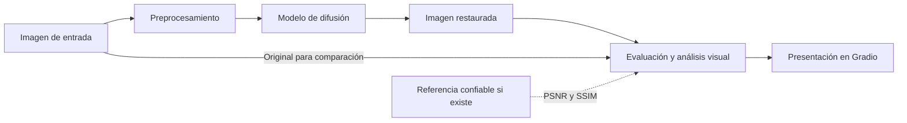

# AstroRestore AI

Aplicación en desarrollo para la restauración y el análisis de imágenes astronómicas mediante modelos de difusión e inteligencia artificial.

Proyecto académico correspondiente al **Trabajo Integrador N.º 2** de la materia **Procesamiento Digital de Imágenes e Introducción a Visión por Computadora**, de la **Tecnicatura Superior en Ciencia de Datos e Inteligencia Artificial**.

- **Sub-tarea seleccionada:** B — Eliminación de ruido y desenfoque (*denoising/deblurring*).
- **Foco exclusivo del MVP:** reducción de ruido (*denoising*). La corrección de desenfoque queda fuera del alcance inicial.
- **Estado actual:** estructura modular, interfaz Gradio con carga de imágenes y prueba de difusión imagen a imagen. La generación de ruido controlado, la evaluación de reducción de ruido y el análisis visual están **pendientes de implementación**. El checklist de esta etapa se detalla al final.
- **Autora:** Sabrina Sanches, según los metadatos del proyecto.
- **Repositorio central:** [astro-restauracion en GitHub](https://github.com/Sabri-Nang/astro-restauracion).

## 1. Problema que busca resolver

Las fotografías astronómicas pueden conservar ruido asociado al sensor, la temperatura y las condiciones de adquisición incluso después de la alineación y el apilamiento. Los filtros agresivos pueden eliminar estrellas tenues y estructuras difusas de nebulosas o galaxias junto con el ruido.

Las herramientas generativas plantean otro problema: pueden introducir detalles plausibles que no correspondan a la observación original. Una imagen visualmente más atractiva no constituye, por sí sola, una observación científicamente más confiable.

AstroRestore AI propone explorar la reducción de ruido y ofrecer herramientas para examinar los cambios introducidos por la IA, especialmente antes de utilizar las imágenes con fines educativos o de divulgación.

## 2. Objetivos generales y específicos

### Objetivo general

Desarrollar una aplicación que permita reducir el ruido de imágenes astronómicas mediante un modelo de difusión preentrenado de Hugging Face, incorporando herramientas de comparación y análisis para evaluar las modificaciones introducidas por el procesamiento.

El proyecto busca estudiar hasta qué punto las transformaciones conservan la información astronómica original, además de explorar la mejora de la apariencia visual.

### Objetivos específicos

- Evaluar un modelo preentrenado para reducción de ruido sin entrenar un modelo desde cero.
- Permitir la carga de imágenes PNG o TIFF y el ajuste de la intensidad de restauración.
- Facilitar la comparación entre imagen original y procesada mediante vistas antes/después, un deslizador y mapas de diferencias.
- Como mejora opcional, calcular PSNR y SSIM cuando exista una referencia confiable.
- Como mejora opcional, comparar el modelo con un filtro bilateral de OpenCV como línea base clásica.
- Incorporar un modelo de visión que analice ambas imágenes y describa modificaciones y posibles artefactos.
- Comunicar las limitaciones del procesamiento generativo y favorecer experimentos reproducibles.

Estos objetivos no representan funcionalidades ya implementadas ni garantías de conservación de información.

## 3. Diseño Centrado en el Usuario — Persona Julia

### Perfil y contexto tecnológico

**Julia tiene 34 años**, es profesora de Física en una escuela secundaria, aficionada a la astrofotografía y participante activa en talleres de divulgación científica.

Posee conocimientos tecnológicos intermedios-avanzados: utiliza Siril, DeepSkyStacker y Photoshop, puede ejecutar scripts básicos de Python y usar aplicaciones web. No cuenta con conocimientos especializados sobre arquitecturas de aprendizaje profundo ni modelos de difusión.

### Problema y solución actual

Julia dedica varias horas a capturar y procesar fotografías del cielo nocturno. Utiliza Siril o DeepSkyStacker para alinear y apilar sus tomas y luego aplica filtros de reducción de ruido, ajustes de contraste y modificaciones del histograma.

El proceso requiere tiempo y ajustes manuales para decidir cuánto ruido eliminar sin perder información relevante. Le preocupa borrar estrellas tenues o estructuras difusas, y también presentar detalles generados artificialmente como si fueran observaciones verificadas en sus clases y talleres.

### Frustraciones

- Pérdida de detalles astronómicos al aplicar filtros agresivos.
- Falta de transparencia de las herramientas generativas.
- Tiempo excesivo dedicado al procesamiento manual.
- Dificultad para distinguir estructuras reales de posibles artefactos.
- Incertidumbre sobre la confiabilidad de las imágenes empleadas en divulgación científica.

### Objetivos de Julia

- Reducir el ruido y preservar, en la medida de lo posible, estrellas y estructuras originales.
- Reducir el tiempo de procesamiento.
- Comparar visualmente la imagen original con la restaurada.
- Identificar regiones modificadas por la IA.
- Comprender las limitaciones del resultado antes de utilizarlo con fines educativos.

### Contexto de uso previsto

Desde su computadora personal, después de una sesión de observación o mientras prepara material educativo, Julia cargaría una imagen previamente procesada y apilada, seleccionaría la intensidad y ejecutaría la restauración. Luego compararía ambas imágenes, consultaría el mapa de diferencias y revisaría el análisis visual y sus advertencias antes de decidir si comparte el resultado.

Este recorrido describe la experiencia final propuesta. Actualmente está disponible una prueba técnica de imagen a imagen, sin generación de ruido controlado ni análisis visual.

## 4. Solución propuesta

Se propone una aplicación web desarrollada en Gradio que integre carga de imágenes, restauración mediante difusión, comparación, evaluación y descarga del resultado.

El modelo de la prueba inicial es [`stable-diffusion-v1-5/stable-diffusion-v1-5`](https://huggingface.co/stable-diffusion-v1-5/stable-diffusion-v1-5), revisión fija `451f4fe16113bff5a5d2269ed5ad43b0592e9a14`, bajo licencia **CreativeML OpenRAIL-M**. Se utiliza `StableDiffusionImg2ImgPipeline` con scheduler DDIM, pesos `fp16` en formato Safetensors y precisión de ejecución `bfloat16` en CPU o `float16` en CUDA. Se emplea precisión reducida para limitar la memoria de los pesos; su rendimiento depende del hardware.

**No es un modelo especializado en restauración astronómica** y su utilidad para este problema debe demostrarse experimentalmente. El parámetro de intensidad controla la transformación generativa; no expresa directamente cuánto ruido astronómico se elimina. Una intensidad baja no garantiza la conservación de las estructuras originales. La primera prueba de carga e inferencia no equivale a validar el denoising.

La adopción definitiva del modelo dependerá de los resultados de evaluación. Para cumplir el análisis visual obligatorio se prevé [`openai/clip-vit-base-patch32`](https://huggingface.co/openai/clip-vit-base-patch32), arquitectura CLIP ViT-B/32, con licencia MIT del [proyecto CLIP](https://github.com/openai/CLIP/blob/main/LICENSE). Se compararán las afinidades de ambas imágenes con un conjunto fijo de descripciones. Su revisión y funcionamiento se validarán en la fase de análisis; todavía no está integrado. CLIP no genera descripciones libres ni verifica la autenticidad de una imagen.

El análisis visual tendrá carácter descriptivo y exploratorio. Sus observaciones no equivaldrán a una verificación científica de las estructuras restauradas.

## 5. Funcionalidades previstas del MVP

El alcance final comprende las funcionalidades siguientes. La prueba actual permite cargar PNG/TIFF de 8 bits, ajustar parámetros, ejecutar difusión y visualizar la entrada preparada y la salida en la misma pantalla. La eficacia de la reducción de ruido y las demás funciones todavía están pendientes de validación o implementación:

- Cargar imágenes astronómicas PNG o TIFF.
- Aplicar un modelo de difusión preentrenado de Hugging Face para reducción de ruido.
- Ajustar la intensidad de restauración.
- Visualizar las imágenes original y restaurada.
- Compararlas mediante un deslizador antes/después.
- Generar mapas de diferencias.
- Como mejora opcional, calcular métricas de calidad cuando exista una imagen de referencia confiable.
- Analizar las modificaciones mediante un modelo de visión con acceso a ambas imágenes.
- Mostrar advertencias sobre posibles artefactos generativos.
- Descargar la imagen procesada.

## 6. Arquitectura general del sistema

El siguiente diagrama representa el **flujo previsto**, no una arquitectura ya implementada:



Las responsabilidades se distribuyen entre `app.py` y los módulos de `src/` para reutilizar el código localmente y en Google Colab. `src/diffusion.py` implementa la carga diferida del modelo y una prueba imagen a imagen; `analysis.py` y `honesty.py` contienen únicamente documentación de su responsabilidad.

La prueba admite PNG/TIFF de 8 bits por canal, convierte a RGB y reduce la imagen con LANCZOS sin recortar ni ampliar. Ajusta los lados a múltiplos de ocho y limita el mayor a 256 o 512 píxeles; el redondeo puede alterar ligeramente la relación de aspecto. Rechaza imágenes de alta profundidad para evitar una conversión silenciosa. El archivo de origen se conserva. Los futuros mapas y comparaciones utilizarán la misma imagen preparada como referencia, con dimensiones idénticas.

Se verificaron las cabeceras de los seis TIFF descargados: `heic1702a.tif` tiene 16 bits por canal y requiere una copia de trabajo con conversión explícita antes de usar esta prueba. Los otros cinco tienen 8 bits por canal. El tratamiento de alta profundidad se definirá en la fase de preparación y ruido.

### Estructura real del repositorio

```text
astro-restauracion/
├── app.py
├── AGENTS.md
├── .gitignore
├── .python-version
├── pyproject.toml
├── README.md
├── uv.lock
├── src/
│   ├── diffusion.py
│   ├── analysis.py
│   ├── honesty.py
│   └── validation.py
├── assets/
│   └── ejemplos/
│       ├── README.md
│       └── originales/
└── colab/
    └── ejecutar_en_colab.ipynb
```

Existe además un entorno local `.venv/`, excluido del control de versiones. `app.py` construye la interfaz sin cargar modelos; la carga se realiza al solicitar una prueba. La carpeta local `assets/ejemplos/originales/` contiene seis imágenes TIFF de ESA/Hubble, excluidas de Git mediante `.gitignore`; sus fuentes, créditos, licencias e instrucciones de descarga manual están documentados en `assets/ejemplos/README.md`. Esta carpeta y sus imágenes no se obtienen al clonar el repositorio. Los pesos se guardan en `.cache/huggingface/` y los resultados de consola en `outputs/`, ambos ignorados por Git. `AGENTS.md` establece las instrucciones para agentes en todo el repositorio.

## 7. Tecnologías utilizadas y previstas

### Configuración existente

- **Python:** `.python-version` selecciona `3.12`; `pyproject.toml` declara `requires-python = ">=3.12"`.
- **uv:** gestión del entorno y las dependencias, con versiones resueltas en `uv.lock`.
- **Modalidad:** aplicación sin empaquetado instalable, con `tool.uv.package = false`.
- **Proyecto:** `astro-restauracion`, versión `0.1.0`; punto de entrada `app.py`.
- **Control de versiones:** Git y remoto de GitHub configurado.

Las dependencias directas declaradas actualmente son:

- `accelerate>=1.15.0`
- `diffusers>=0.42.1`
- `gradio>=6.31.0`
- `numpy>=2.5.4`
- `pillow>=12.3.0`
- `torch>=2.15.0`
- `transformers>=5.22.2`

PyTorch está declarado como dependencia directa. Pillow, PyTorch y Diffusers se utilizan en la prueba de procesamiento; Gradio integra la interfaz. Las versiones exactas están resueltas en `uv.lock`.

### Uso previsto

- **PyTorch y Hugging Face Diffusers:** inferencia del modelo de difusión.
- **Hugging Face Transformers:** integración del modelo de visión por seleccionar.
- **OpenCV:** procesamiento y filtro bilateral de referencia; pendiente de incorporación a las dependencias.
- **Pillow y NumPy:** lectura y manipulación de imágenes y arreglos.
- **scikit-image:** cálculo de métricas; pendiente de incorporación a las dependencias.
- **Gradio:** interfaz web y presentación de comparaciones.
- **Google Colab:** experimentos que requieran una GPU compatible.
- **Visual Studio Code:** entorno principal de desarrollo.

Se conservan la selección de Python y uv como gestor. Se retiraron el backend `uv_build` y el comando de consola del antiguo paquete para adoptar la estructura solicitada. OpenCV y scikit-image solo serán necesarios si se implementan la línea base y las métricas opcionales.

## 8. Dataset y estrategia de evaluación

Se seleccionaron seis imágenes de observaciones publicadas por ESA/Hubble. Sus archivos se conservan localmente y su procedencia, licencias y créditos se registran en el [README de ejemplos](assets/ejemplos/README.md). Son imágenes de divulgación ya procesadas, no datos crudos ni referencias científicas libres de ruido. Todavía falta definir y ejecutar el protocolo de evaluación sobre este conjunto.

### Evaluación controlada

1. Seleccionar imágenes astronómicas de buena calidad como referencias.
2. Agregar ruido artificial controlado, documentando su tipo, intensidad y semilla.
3. Procesar las versiones ruidosas mediante difusión; opcionalmente, incorporar el filtro bilateral como línea base.
4. Mostrar juntas la referencia preparada, la versión con ruido y la salida del modelo. Comenzar con inspección visual de estrellas y estructuras difusas y mapas de diferencias; opcionalmente calcular PSNR (*Peak Signal-to-Noise Ratio*) y SSIM (*Structural Similarity Index*).

El ruido artificial se utilizará exclusivamente para evaluar la restauración; no implica generar imágenes astronómicas nuevas. Se deberá registrar la escala de valores empleada en las métricas y mantener condiciones comparables entre métodos. La evaluación controlada no garantiza que el comportamiento se generalice a todo ruido de adquisición real.

### Evaluación con imágenes ruidosas reales

Se procesarán imágenes que ya contengan ruido y se compararán visualmente los resultados, los mapas de diferencias y las observaciones del modelo de visión para identificar posibles artefactos.

Sin una referencia confiable, no se reportarán PSNR o SSIM como evidencia de recuperación de la señal original ni se podrá verificar de manera concluyente la autenticidad de todos los detalles restaurados. Un mapa de diferencias muestra dónde cambió la imagen, pero no determina si esos cambios son correctos.

### Línea base clásica y reproducibilidad

Como mejora opcional, se podrá implementar un **filtro bilateral de OpenCV** para comparar un método tradicional con el modelo de difusión, sin asumir que la difusión ofrecerá mejores resultados.

Se prevé registrar imágenes de origen, degradaciones sintéticas, parámetros del filtro, identificador y revisión del modelo, intensidad de restauración, semillas, versiones y entorno de ejecución. Esto complementará el archivo de dependencias `uv.lock`.

**Todavía no hay una evaluación de reducción de ruido ni métricas de calidad.** La prueba técnica de inferencia se ejecutó y registra parámetros y salida localmente; no debe presentarse como un resultado de restauración validado.

## 9. Hardware y entorno de ejecución

Equipo disponible, según la información del proyecto:

- **Sistema operativo:** Windows.
- **GPU:** AMD Radeon RX 580 2048SP.
- **VRAM dedicada:** 8 GB.
- **RAM:** 16 GB.
- **Python de desarrollo:** 3.12.
- **IDE:** Visual Studio Code.
- **Gestor de dependencias:** uv.

### Limitaciones de ejecución local

La GPU AMD no permite utilizar directamente una distribución de PyTorch destinada a GPU NVIDIA mediante CUDA. El soporte de aceleración AMD depende de la combinación de GPU, sistema operativo y versiones del entorno. La RX 580 no figura en la [matriz de compatibilidad de Radeon para PyTorch en Windows con ROCm 7.2.1](https://rocmdocs.amd.com/projects/radeon-ryzen/en/latest/docs/compatibility/compatibilityrad/windows/windows_compatibility.html); esta referencia no garantiza compatibilidad con otras versiones.

El proyecto no incluye una configuración validada de aceleración para este equipo. Los 8 GB de VRAM no garantizan que un pipeline sea compatible o pueda ejecutarse con cualquier resolución. Se completó una prueba en CPU con PyTorch `2.15.0+cpu` y precisión `bfloat16`: entrada preparada de 256 × 192 píxeles y dos pasos efectivos de DDIM. La inferencia midió 174,832 segundos y la carga con pesos ya descargados, 18,127 segundos. Son tiempos de esa ejecución, no una estimación general. Un intento inicial en `float32` falló por falta de memoria; la configuración final utiliza precisión reducida.

El desarrollo principal se realizará localmente en VS Code, con GitHub como repositorio central. Para experimentos que requieran GPU se utiliza Google Colab, sujeto a disponibilidad de recursos y compatibilidad de las versiones. El notebook `colab/ejecutar_en_colab.ipynb` incluye preparación, comprobación de CUDA, prueba de difusión y lanzamiento de la interfaz. La autora registró una prueba de inferencia en T4; la autora confirmó que la aplicación funciona desde el enlace público de Gradio. El enlace local corresponde al servidor remoto de Colab.

## 10. Instalación y ejecución

### Requisitos

- Python 3.12 para reproducir la versión seleccionada en `.python-version`.
- uv disponible en la terminal.
- Para utilizar las imágenes de ejemplo, descargar los TIFF manualmente según la [documentación de ejemplos](assets/ejemplos/README.md). No están incluidos en Git ni se requiere Git LFS.
- Una copia del repositorio y acceso a las dependencias, mediante red o caché local.

Desde la raíz del repositorio, sincronizar el entorno respetando el archivo de bloqueo:

```powershell
uv sync --locked
```

Ejecutar la aplicación desde la raíz:

```powershell
uv run app.py
```

Gradio muestra una dirección local en la terminal. Abrirla en el navegador, subir un PNG o TIFF de 8 bits y pulsar **Ejecutar prueba de difusión**. La primera prueba descarga varios GB de pesos; las siguientes reutilizan la caché. Se muestran la entrada preparada, la salida generativa y los parámetros. Detener el servidor con `Ctrl+C`. También puede utilizarse `uv run --locked python app.py` para exigir el archivo de bloqueo actualizado. El comando exacto `uv run app.py` se verificó con HTTP 200, control de subida, botón de proceso y ambos paneles de comparación. El comando anterior `astro-restauracion` fue retirado al eliminar el paquete anidado.

### Prueba técnica por consola

Después de descargar `potw1803a.tif` según las instrucciones de ejemplos:

```powershell
uv run --locked python -m src.diffusion --input assets/ejemplos/originales/potw1803a.tif --output-dir outputs/prueba_diffusion --device cpu --steps 4 --strength 0.5 --size 256
```

Este comando solicita dos pasos efectivos con DDIM y guarda `entrada_preparada.png`, `salida.png` y `parametros.json`. Este último registra modelo, revisión, licencia, semilla, parámetros, dimensiones, SHA-256 de la entrada, versiones y tiempos medidos. Los archivos quedan excluidos de Git. La semilla facilita repetir el experimento en un entorno equivalente, sin garantizar igualdad bit a bit entre hardware o versiones distintas.

La prueba usa una imagen publicada sin agregarle ruido artificial: verifica integración e inferencia. La evaluación de denoising será un experimento posterior. `--device auto` selecciona CUDA cuando está disponible y CPU en caso contrario; también se puede solicitar `--device cuda` en un entorno compatible.

### Verificación realizada

En el entorno local existente, con uv `0.12.3`, se verificaron satisfactoriamente los siguientes comandos utilizando la caché disponible:

```powershell
uv sync --locked --offline
uv run --locked --offline python -c "from app import create_app; print(type(create_app()).__name__)"
```

La sincronización respeta `uv.lock`; el segundo comando comprueba la construcción de la interfaz sin iniciar un servidor. La opción `--offline` requiere las dependencias en caché; esta comprobación no equivale a validar una instalación desde cero ni la inferencia en GPU.

El **11 de noviembre de 2026** se verificó además el comando de prueba técnica con `potw1803a.tif`, semilla 42, intensidad 0,5 y cuatro pasos configurados (dos efectivos). Se cargó la revisión fijada de Stable Diffusion 1.5 y se generó una salida de 256 × 192 píxeles sin bloqueo del filtro de seguridad. La ejecución utilizó Windows 11, Python 3.12.10, PyTorch 2.15.0 en CPU, Diffusers 0.42.1, Transformers 5.22.2 y Pillow 12.3.0.

Los artefactos locales son [entrada preparada](outputs/prueba_diffusion/entrada_preparada.png), [salida de prueba](outputs/prueba_diffusion/salida.png) y [registro de parámetros](outputs/prueba_diffusion/parametros.json). No se publican en Git; esos enlaces solo funcionan después de ejecutar la prueba localmente. La entrada tiene SHA-256 `9bc563fef8171c749cc455ad9b0b140652cd26c28187eff4983686bf74f147a2`. La prueba usa una derivada de la imagen acreditada a **NASA, ESA, and J. Comerford (University of Colorado-Boulder)**; la conversión, el redimensionamiento y la salida generativa son modificaciones del proyecto. No se agregó ruido sintético ni se midió eficacia de restauración.

### Validación de cinco imágenes — etapa 2

Con los cinco TIFF de 8 bits descargados según el [registro de ejemplos](assets/ejemplos/README.md), ejecutar:

```powershell
uv run --locked python -m src.validation --device auto
```

La validación procesa `potw1803a.tif`, `potw1428a.tif`, `heic0503a.tif`, `heic1520a.tif` y `potw1408a.tif`, con semilla 42, cuatro pasos configurados, intensidad 0,5 y tamaño máximo 256. Excluye `heic1702a.tif` porque es de 16 bits por canal. Puede solicitarse `--device cuda` si existe una GPU compatible o `--device cpu` para ejecutarla localmente; esta última opción puede tardar varios minutos por imagen.

Se reutiliza el modelo en memoria y se crea una carpeta por imagen en `outputs/etapa2/`, con entrada preparada, salida, parámetros y `comparacion.png` (entrada a la izquierda y salida a la derecha). `resumen.json` se actualiza después de cada caso y solo marca la ejecución completa cuando hay cinco resultados correctos con hashes de entrada diferentes. Se registran errores individuales sin declararlos como pruebas exitosas. Los resultados permanecen locales, excluidos de Git.

Esta comprobación acredita el procesamiento técnico de cinco imágenes distintas. No mide reducción de ruido ni demuestra autenticidad científica; las comparaciones deben revisarse visualmente.

### Resultados registrados de la etapa 2

El 11 de noviembre de 2026 se completaron cinco ejecuciones en CPU con PyTorch 2.15.0, precisión bfloat16, Python 3.12.10, Diffusers 0.42.1, semilla 42, intensidad 0,5 y dos pasos efectivos de DDIM. Cada caso tiene una entrada distinta, original intacto y salida no uniforme. Se generaron y revisaron las comparaciones contra la entrada preparada, no contra el TIFF a resolución completa.

- **potw1803a.tif:** 256 × 192 píxeles; 161.042 s de inferencia. Cambios notorios en las formas, colores y brillos de las galaxias; no acredita limpieza de ruido.
- **potw1428a.tif:** 256 × 248 píxeles; 222.833 s de inferencia. Aparecen patrones curvos y brillos alargados que no se aprecian en la referencia preparada; cambia la apariencia del cúmulo.
- **heic0503a.tif:** 248 × 248 píxeles; 223.288 s de inferencia. Se alteran las estructuras del polvo y la distribución de colores y brillos alrededor de V838 Mon.
- **heic1520a.tif:** 256 × 168 píxeles; 137.070 s de inferencia. Se modifican y engrosan filamentos; aparecen trazos curvos distintos de los de la referencia preparada.
- **potw1408a.tif:** 256 × 120 píxeles; 102.478 s de inferencia. Cambian numerosos brillos puntuales y las formas y colores de la nebulosidad; no se puede afirmar conservación de detalles.

Los tiempos pertenecen a estas ejecuciones locales; no describen el rendimiento de Colab ni son un benchmark general. La prueba de T4 documentada más abajo se realizó por separado sobre una imagen.

**Resultado técnico:** cinco casos correctos, cinco hashes de entrada diferentes y comparaciones visuales disponibles. **Resultado visual:** se observaron alteraciones importantes en todos los casos; estas salidas no demuestran mejora de denoising ni fidelidad científica. La intensidad 0,5 se utilizó para una prueba técnica corta, no como parámetro recomendado de restauración. Estos ejemplos se conservan como material de fallos para la etapa 3.

Artefactos locales: [resumen de resultados](outputs/etapa2/resumen.json) y [comparaciones de los cinco casos](outputs/etapa2/comparaciones.png). Cada subcarpeta contiene `entrada_preparada.png`, `salida.png`, `comparacion.png` y `parametros.json`. Están excluidos de Git; los enlaces funcionan después de ejecutar la validación. Los créditos, fuentes y condiciones de las imágenes se conservan en el [registro de ejemplos](assets/ejemplos/README.md).

### Ejecución en Colab

1. Abrir [Google Colab](https://colab.research.google.com/) y seleccionar **Archivo → Subir notebook** para cargar la copia local de `colab/ejecutar_en_colab.ipynb`. Esta opción permite usar el notebook actualizado aunque aún no esté publicado en GitHub.
2. En **Entorno de ejecución → Cambiar tipo de entorno de ejecución**, seleccionar GPU (por ejemplo T4, si está disponible) y conectar. Los recursos dependen de la disponibilidad de Colab.
3. Ejecutar la preparación: se comprueba `nvidia-smi`, se clona el código publicado en GitHub, se registra su revisión y se instala uv `0.12.3`. `uv sync --locked --python 3.12` crea el entorno del proyecto; el kernel del notebook y ese entorno son independientes.
4. Ejecutar primero la celda auxiliar `ejecutar_con_salida`, que transmite los mensajes de los subprocesos a la salida del notebook, y después la comprobación de PyTorch. Debe mostrar Python 3.12, GPU y VRAM. Si CUDA no está disponible, el notebook se detiene para evitar ejecutar la prueba involuntariamente en CPU.
5. Ejecutar la celda del selector **Subir TIFF**, seleccionar el archivo local `assets/ejemplos/originales/potw1803a.tif` y esperar a que termine la transferencia. Después, ejecutar la celda de prueba. El selector usa `ipywidgets.FileUpload`, alternativa recomendada para [Colab desde VS Code](https://github.com/googlecolab/colab-vscode/wiki/Known-Issues-and-Workarounds#filesupload-and-filesupload_file), donde `google.colab.files.upload()` no está soportado. La preparación instala ipywidgets 8.1.7 en el kernel del notebook, separado del entorno uv de la aplicación. Se verifica el SHA-256 y se reutiliza el archivo si ya está disponible en la sesión. La descarga directa desde ESA/Hubble puede responder **HTTP 403**; queda como opción mediante `ORIGEN_IMAGEN = 'descargar'`, utilizando el archivo del selector si falla la conexión. Se emplean la misma semilla 42, cuatro pasos configurados, intensidad 0,5 y tamaño máximo 256 que en CPU. Se muestran la entrada preparada, la salida y los tiempos reales; no se presupone una mejora de rendimiento ni de calidad.
6. Descargar el ZIP de resultados mediante la celda correspondiente antes de finalizar la sesión. Incluye las imágenes y el registro con revisión del proyecto y hardware GPU.
7. Opcionalmente, ejecutar la última celda para abrir Gradio mediante un enlace público temporal y subir imágenes propias. **La celda permanece ejecutándose mientras el servidor está activo**; esperar el enlace `https://...gradio.live` en su salida y abrirlo en el navegador. El modelo se vuelve a cargar en el proceso de la interfaz, reutilizando los pesos descargados. Interrumpir la celda al terminar; el auxiliar detiene también los procesos secundarios en Colab.

El notebook clona el código que ya está publicado en GitHub; los cambios locales de la aplicación deberán publicarse para que estén disponibles en Colab. Los TIFF locales no se transfieren automáticamente al entorno remoto. La prueba solicita únicamente la imagen indicada y rechaza un archivo cuyo SHA-256 no coincida.

El [nivel gratuito de Colab](https://research.google.com/colaboratory/faq.html) puede finalizar sesiones cuyo uso principal sea una interfaz web externa; se prioriza la prueba interactiva dentro del notebook. Los resultados temporales se pierden al eliminarse el entorno. La descarga automática falló con HTTP 403 y se incorporó la subida mediante ipywidgets. No se realizó ninguna publicación automática.

**Prueba GPU registrada por la autora el 11 de noviembre de 2026:** las salidas conservadas del notebook muestran una Tesla T4, Python 3.12.3, dispositivo `cuda:0` y precisión `float16`. Con la misma entrada y parámetros de la prueba CPU, se registraron **45,825 segundos de carga** y **2,294 segundos de inferencia**, y se mostraron las dos imágenes. La ejecución local en CPU había medido 174,832 segundos de inferencia. Estos valores corresponden a dos ejecuciones en entornos y precisiones distintos; no constituyen un benchmark general ni una evaluación de denoising. La autora confirmó posteriormente el acceso y funcionamiento de la interfaz desde su enlace público. La salida en vivo de subprocesos se añadió después para que los registros y el enlace sean visibles desde VS Code.

## 11. Alcance y limitaciones

### Incluido en el alcance previsto del MVP

- Reducción de ruido en imágenes astronómicas PNG o TIFF.
- Uso de un modelo de difusión preentrenado de Hugging Face.
- Modelo de visión para análisis comparativo.
- Comparación antes/después y mapas de diferencias.
- Como mejora opcional, métricas de evaluación con referencia confiable.
- Interfaz Gradio y descarga del resultado.
- Documentación y reproducibilidad experimental.

### Fuera del alcance inicial

- Entrenamiento de modelos desde cero.
- Superresolución.
- Reconstrucción de regiones faltantes.
- Procesamiento de archivos FITS.
- Corrección de desenfoque.
- Verificación astrométrica automática.
- Garantía de autenticidad científica de las estructuras restauradas.

### Interpretación de los resultados futuros

La restauración visual y la verificación científica son tareas distintas. El procesamiento generativo puede alterar o inventar estructuras; ni la inspección visual, ni un modelo de visión, ni una mejora en PSNR o SSIM prueban por sí solos la autenticidad astronómica de cada detalle. La imagen original deberá conservarse como referencia para la comparación.

## 12. Estado actual del desarrollo

### Implementado o configurado

- Estructura con `app.py`, los tres módulos de `src/`, `assets/ejemplos/` y `colab/`.
- Metadatos de versión y autoría en `pyproject.toml`.
- Selección local de Python 3.12 y requisito de Python `>=3.12`.
- Gestión con uv sin empaquetado instalable y archivo `uv.lock`.
- Dependencias directas enumeradas en la sección de tecnologías.
- Interfaz Gradio con subida de PNG/TIFF, parámetros y comparación de entrada preparada y salida.
- Carga diferida de Stable Diffusion 1.5 con revisión fijada y prueba imagen a imagen.
- Exportación por consola de entrada preparada, salida y parámetros reproducibles.
- Módulos de análisis y diferencias preparados, sin procesamiento implementado.
- Notebook de Colab con una prueba GPU registrada por la autora y acceso a Gradio desde el enlace público confirmado por ella.
- Instrucciones para agentes en `AGENTS.md` y registro previsto de permisos de imágenes.
- Exclusión del entorno virtual y archivos generados mediante `.gitignore`.
- Remoto GitHub configurado.

### Pendiente de implementación o validación

- Generación reproducible de ruido y comparación de referencia, imagen ruidosa y salida.
- Evaluación de la eficacia de Stable Diffusion para este problema; no se garantiza que sea adecuado.
- Análisis con CLIP y mapas de diferencias.
- Filtro bilateral y métricas como mejoras opcionales.
- Compatibilidad de ejecución local, uso de GPU y reutilización en Colab.
- Pruebas del procesamiento y resultados experimentales.

### Observaciones de consistencia

El nombre público **AstroRestore AI** convive con el nombre técnico del proyecto `astro-restauracion`. Se eliminó el antiguo paquete `src/astro_restauracion/` y su comando de saludo para adoptar la disposición solicitada. Se preservaron autoría, versión, selección de Python y dependencias directas; la descripción de `pyproject.toml` ahora refleja el objetivo del proyecto. El archivo `uv.lock` se actualizó para representar la aplicación sin empaquetado.

## 13. Plan según las etapas del docente

Las fechas siguientes corresponden al cronograma propuesto por el docente. Las verificaciones registradas en este repositorio se realizaron el 11 de noviembre de 2026; no se atribuyen retrospectivamente a las fechas previstas.

### Etapa 1 — Fundamentos (4–5 de noviembre) — completada

- [x] Persona Julia definida y documentada.
- [x] Proyecto, problema y alcance declarados: sub-tarea B, con denoising como foco del MVP.
- [x] Repositorio creado, estructurado y publicado con historial de commits.
- [x] Entorno Python 3.12 y uv funcionando.
- [x] Hardware y limitaciones documentados; modelo cargado e imagen de prueba generada en CPU y en una T4 de Colab.

**Evidencia:** registros locales de la prueba CPU y salidas de la prueba T4 conservadas en el notebook. El modelo tiene revisión y licencia identificadas. No se entrenó un modelo desde cero.

### Etapa 2 — Prototipo básico (6–9 de noviembre) — completada el 11 de noviembre de 2026

- [x] Interfaz Gradio con carga de PNG/TIFF de 8 bits.
- [x] Procesamiento real con Stable Diffusion 1.5.
- [x] Entrada preparada y salida en la misma pantalla, sin modificar el archivo de origen.
- [x] Arranque con el comando exacto `uv run app.py`, verificado por HTTP.
- [x] Aplicación accesible en Colab desde el enlace público, según confirmación de la autora.
- [x] Commits pequeños que muestran la evolución y las correcciones.
- [x] Pruebas técnicas completas con cinco imágenes distintas y revisión de sus comparaciones; registro local en `outputs/etapa2/resumen.json`.

**Criterio de cierre:** cinco ejecuciones correctas sobre entradas distintas, con salida y registro por caso. Se verifican dimensiones, salidas no uniformes, hashes y comparación visual. El procesamiento básico acredita la integración del modelo; no se presenta como reducción de ruido demostrada. La generación de ruido, el análisis visual y la comparación triple no son prerrequisitos para cerrar esta etapa.

**Entregable:** aplicación que procesa imágenes mediante `uv run app.py`, ejecución alternativa en Colab y resultados reproducibles de las cinco pruebas mediante `src/validation.py`.

### Etapa 3 — Análisis visual y honestidad (10–13 de noviembre) — pendiente

La prioridad es integrar CLIP ViT-B/32 y un informe comprensible para Julia. El informe combinará las afinidades con descripciones fijas y una explicación de los parámetros aplicados, sin atribuir a CLIP capacidad para certificar autenticidad o describir por sí solo todos los cambios.

- [ ] Integrar el análisis de imágenes original y procesada con un modelo de Hugging Face.
- [ ] Mostrar un informe en lenguaje natural y comunicar sus límites.
- [ ] Documentar ejemplos reales de aciertos y de fallos o alteraciones de estructuras.
- [x] Mantener elementos de honestidad ya disponibles: comparación, control de intensidad y advertencias de reconstrucción.
- [ ] Incorporar, si aporta claridad, un mapa de diferencias en `honesty.py`.

**Experimento acotado de ruido:** conservar el TIFF y preparar una referencia común; agregar inicialmente un nivel de ruido gaussiano con NumPy y una semilla propia. Procesar esa versión manteniendo fija la semilla del modelo y comparar **referencia preparada → imagen ruidosa → salida procesada**. Registrar dimensiones, canales, normalización, saturación y parámetros. Cambiar un parámetro por vez al explorar pasos e intensidad. Esto evalúa el modelo preentrenado; no lo entrena. La referencia publicada no es una observación científica perfecta y el ruido sintético no representa todo ruido real.

Para una imagen que ya tiene ruido, sin referencia limpia, mostrar entrada y salida sin inventar una referencia. Si el modelo borra o inventa detalles, registrar el fallo y revisar su adecuación. El mapa de diferencias indica modificaciones, no autenticidad.

**Criterio de cierre:** carga → difusión → análisis visual → resultados, con explicaciones comprensibles y ejemplos documentados. El análisis visual es obligatorio para la entrega final; las métricas y una línea base clásica son opcionales.

### Etapa 4 — Documentación y demo (14–16 de noviembre) — pendiente

- [ ] Mejorar mensajes, errores y estados de carga donde todavía sea necesario.
- [ ] Completar el README según el template del docente, incluyendo modelos, revisiones, licencias y hardware probado.
- [ ] Incorporar capturas y ejemplos reales de uso.
- [ ] Justificar decisiones desde HAI e identificar decisiones de la autora y propuestas del agente.
- [ ] Completar la sección **Qué es real y qué es inventado** y las limitaciones conocidas.
- [ ] Probar instalación y ejecución desde una copia nueva del repositorio, localmente o en Colab.
- [ ] Grabar y enlazar la demo de cinco minutos: problema, uso completo, resultados y reflexión sobre la reconstrucción.
- [ ] Revisar todos los requisitos técnicos y documentales obligatorios.

**Criterio de cierre:** otra persona puede seguir el README y completar el pipeline, con documentación y video accesibles. Los resultados deben ser observados y registrados, nunca supuestos.

### Etapa 5 — Contingencia y buffer (17–18 de noviembre) — reservada

Resolver errores finales, completar el formulario de entrega con tiempo y preparar la defensa de las decisiones y conceptos aplicados. No agregar funciones complejas, cambiar los modelos principales ni rehacer el proyecto durante esta etapa.

### Estrategia de trabajo

Mantener siempre una versión que funcione. Priorizar difusión y análisis, honestidad sobre las modificaciones, documentación y demo. PSNR, SSIM, LPIPS, filtros clásicos, múltiples modelos, historial, lotes y despliegue público son opcionales. Evitar bloqueos técnicos de más de dos horas: simplificar tamaño o alcance, buscar alternativas y consultar al docente o al grupo cuando corresponda. Antes de ampliar el alcance, revisar: **si se entrega hoy, ¿cumple los requisitos obligatorios?**
