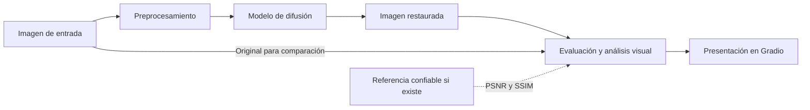

# AstroRestore AI

Aplicación en desarrollo para la restauración y el análisis de imágenes astronómicas mediante modelos de difusión e inteligencia artificial.

Proyecto académico correspondiente al **Trabajo Integrador N.º 2** de la materia **Procesamiento Digital de Imágenes e Introducción a Visión por Computadora**, de la **Tecnicatura Superior en Ciencia de Datos e Inteligencia Artificial**.

- **Sub-tarea seleccionada:** B — Eliminación de ruido y desenfoque (*denoising/deblurring*).
- **Foco exclusivo del MVP:** reducción de ruido (*denoising*). La corrección de desenfoque queda fuera del alcance inicial.
- **Estado actual:** estructura modular e interfaz Gradio informativa. La restauración, comparación, evaluación y análisis visual están **pendientes de implementación**.
- **Autora:** Sabrina Sanches, según los metadatos del proyecto.
- **Repositorio central:** [astro-restauracion en GitHub](https://github.com/Sabri-Nang/astro-restauracion).

## 1. Problema que busca resolver

Las fotografías astronómicas pueden conservar ruido asociado al sensor, la temperatura y las condiciones de adquisición incluso después de la alineación y el apilamiento. Los filtros agresivos pueden eliminar estrellas tenues y estructuras difusas de nebulosas o galaxias junto con el ruido.

Las herramientas generativas plantean otro problema: pueden introducir detalles plausibles que no correspondan a la observación original. Una imagen visualmente más atractiva no constituye, por sí sola, una observación científicamente más confiable.

AstroRestore AI propone explorar la reducción de ruido y ofrecer herramientas para examinar los cambios introducidos por la IA, especialmente antes de utilizar las imágenes con fines educativos o de divulgación.

## 2. Objetivos generales y específicos

### Objetivo general

Desarrollar una aplicación que permita reducir el ruido de imágenes astronómicas mediante un modelo de difusión preentrenado de Hugging Face, incorporando herramientas de comparación y análisis para evaluar las modificaciones introducidas por el procesamiento.

El proyecto busca estudiar hasta qué punto las transformaciones conservan la información astronómica original, además de explorar la mejora de la apariencia visual.

### Objetivos específicos

- Evaluar un modelo preentrenado para reducción de ruido sin entrenar un modelo desde cero.
- Permitir la carga de imágenes PNG o TIFF y el ajuste de la intensidad de restauración.
- Facilitar la comparación entre imagen original y procesada mediante vistas antes/después, un deslizador y mapas de diferencias.
- Calcular PSNR y SSIM cuando exista una referencia confiable.
- Comparar el modelo con un filtro bilateral de OpenCV como línea base clásica.
- Incorporar un modelo de visión que analice ambas imágenes y describa modificaciones y posibles artefactos.
- Comunicar las limitaciones del procesamiento generativo y favorecer experimentos reproducibles.

Estos objetivos no representan funcionalidades ya implementadas ni garantías de conservación de información.

## 3. Diseño Centrado en el Usuario — Persona Julia

### Perfil y contexto tecnológico

**Julia tiene 34 años**, es profesora de Física en una escuela secundaria, aficionada a la astrofotografía y participante activa en talleres de divulgación científica.

Posee conocimientos tecnológicos intermedios-avanzados: utiliza Siril, DeepSkyStacker y Photoshop, puede ejecutar scripts básicos de Python y usar aplicaciones web. No cuenta con conocimientos especializados sobre arquitecturas de aprendizaje profundo ni modelos de difusión.

### Problema y solución actual

Julia dedica varias horas a capturar y procesar fotografías del cielo nocturno. Utiliza Siril o DeepSkyStacker para alinear y apilar sus tomas y luego aplica filtros de reducción de ruido, ajustes de contraste y modificaciones del histograma.

El proceso requiere tiempo y ajustes manuales para decidir cuánto ruido eliminar sin perder información relevante. Le preocupa borrar estrellas tenues o estructuras difusas, y también presentar detalles generados artificialmente como si fueran observaciones verificadas en sus clases y talleres.

### Frustraciones

- Pérdida de detalles astronómicos al aplicar filtros agresivos.
- Falta de transparencia de las herramientas generativas.
- Tiempo excesivo dedicado al procesamiento manual.
- Dificultad para distinguir estructuras reales de posibles artefactos.
- Incertidumbre sobre la confiabilidad de las imágenes empleadas en divulgación científica.

### Objetivos de Julia

- Reducir el ruido y preservar, en la medida de lo posible, estrellas y estructuras originales.
- Reducir el tiempo de procesamiento.
- Comparar visualmente la imagen original con la restaurada.
- Identificar regiones modificadas por la IA.
- Comprender las limitaciones del resultado antes de utilizarlo con fines educativos.

### Contexto de uso previsto

Desde su computadora personal, después de una sesión de observación o mientras prepara material educativo, Julia cargaría una imagen previamente procesada y apilada, seleccionaría la intensidad y ejecutaría la restauración. Luego compararía ambas imágenes, consultaría el mapa de diferencias y revisaría el análisis visual y sus advertencias antes de decidir si comparte el resultado.

Este recorrido describe la experiencia propuesta; todavía no está disponible en el código.

## 4. Solución propuesta

Se propone una aplicación web desarrollada en Gradio que integre carga de imágenes, restauración mediante difusión, comparación, evaluación y descarga del resultado.

El candidato inicial es `stable-diffusion-v1-5/stable-diffusion-v1-5`, que se evaluaría mediante un pipeline de imagen a imagen (*image-to-image*) con intensidad baja. **No es un modelo especializado en restauración astronómica** y su utilidad para este problema debe demostrarse experimentalmente. Una intensidad baja no garantiza la conservación de las estructuras originales.

La selección definitiva dependerá de la disponibilidad, licencia, compatibilidad con el entorno y resultados de evaluación. También está pendiente seleccionar el modelo de visión para el análisis comparativo.

El análisis visual tendrá carácter descriptivo y exploratorio. Sus observaciones no equivaldrán a una verificación científica de las estructuras restauradas.

## 5. Funcionalidades previstas del MVP

Todas las siguientes funcionalidades están **pendientes de implementación**:

- Cargar imágenes astronómicas PNG o TIFF.
- Aplicar un modelo de difusión preentrenado de Hugging Face para reducción de ruido.
- Ajustar la intensidad de restauración.
- Visualizar las imágenes original y restaurada.
- Compararlas mediante un deslizador antes/después.
- Generar mapas de diferencias.
- Calcular métricas de calidad cuando exista una imagen de referencia confiable.
- Analizar las modificaciones mediante un modelo de visión con acceso a ambas imágenes.
- Mostrar advertencias sobre posibles artefactos generativos.
- Descargar la imagen procesada.

## 6. Arquitectura general del sistema

El siguiente diagrama representa el **flujo previsto**, no una arquitectura ya implementada:



Las responsabilidades se distribuyen entre `app.py` y los módulos de `src/` para reutilizar el código localmente y en Google Colab. Los módulos de procesamiento contienen únicamente documentación de su responsabilidad; todavía no implementan funciones.

El preprocesamiento deberá definir cómo manejar dimensiones, canales, profundidad de bits y normalización. Los mapas de diferencias requerirán imágenes comparables; PSNR y SSIM se calcularán contra una referencia confiable, no simplemente contra la entrada ruidosa. El modelo de visión recibirá la imagen original y la restaurada para describir cambios.

### Estructura real del repositorio

```text
astro-restauracion/
├── app.py
├── AGENTS.md
├── .gitignore
├── .python-version
├── pyproject.toml
├── README.md
├── uv.lock
├── src/
│   ├── diffusion.py
│   ├── analysis.py
│   └── honesty.py
├── assets/
│   └── ejemplos/
│       ├── README.md
│       └── originales/
└── colab/
    └── ejecutar_en_colab.ipynb
```

Existe además un entorno local `.venv/`, excluido del control de versiones. `app.py` construye una interfaz informativa sin cargar modelos. La carpeta local `assets/ejemplos/originales/` contiene seis imágenes TIFF de ESA/Hubble, excluidas de Git mediante `.gitignore`; sus fuentes, créditos, licencias e instrucciones de descarga manual están documentados en `assets/ejemplos/README.md`. Esta carpeta y sus imágenes no se obtienen al clonar el repositorio. `AGENTS.md` establece las instrucciones para agentes en todo el repositorio.

## 7. Tecnologías utilizadas y previstas

### Configuración existente

- **Python:** `.python-version` selecciona `3.12`; `pyproject.toml` declara `requires-python = ">=3.12"`.
- **uv:** gestión del entorno y las dependencias, con versiones resueltas en `uv.lock`.
- **Modalidad:** aplicación sin empaquetado instalable, con `tool.uv.package = false`.
- **Proyecto:** `astro-restauracion`, versión `0.1.0`; punto de entrada `app.py`.
- **Control de versiones:** Git y remoto de GitHub configurado.

Las dependencias directas declaradas actualmente son:

- `accelerate>=1.15.0`
- `diffusers>=0.42.1`
- `gradio>=6.31.0`
- `numpy>=2.5.4`
- `pillow>=12.3.0`
- `transformers>=5.22.2`

Estas declaraciones preparan el entorno; el código actual todavía no utiliza esas bibliotecas para procesar imágenes. **PyTorch (`torch`) está incluido en `uv.lock` como dependencia transitiva de Accelerate**, pero no está declarado como dependencia directa.

### Uso previsto

- **PyTorch y Hugging Face Diffusers:** inferencia del modelo de difusión.
- **Hugging Face Transformers:** integración del modelo de visión por seleccionar.
- **OpenCV:** procesamiento y filtro bilateral de referencia; pendiente de incorporación a las dependencias.
- **Pillow y NumPy:** lectura y manipulación de imágenes y arreglos.
- **scikit-image:** cálculo de métricas; pendiente de incorporación a las dependencias.
- **Gradio:** interfaz web y presentación de comparaciones.
- **Google Colab:** experimentos que requieran una GPU compatible.
- **Visual Studio Code:** entorno principal de desarrollo.

Se conservan la selección de Python, uv como gestor y las dependencias directas. Se retiraron el backend `uv_build` y el comando de consola del antiguo paquete para adoptar la estructura solicitada. La declaración directa de PyTorch y la incorporación de las bibliotecas faltantes deberán resolverse durante la implementación.

## 8. Dataset y estrategia de evaluación

Se prevé utilizar imágenes astronómicas reales de datasets públicos. **Todavía no se seleccionó ni incorporó un dataset al repositorio**. Quedan pendientes su procedencia, licencia, criterios de selección, formatos y condiciones de uso.

### Evaluación controlada

1. Seleccionar imágenes astronómicas de buena calidad como referencias.
2. Agregar ruido artificial controlado, documentando su tipo, intensidad y semilla.
3. Procesar las versiones ruidosas mediante difusión y mediante el filtro bilateral.
4. Comparar los resultados con la referencia utilizando PSNR (*Peak Signal-to-Noise Ratio*), SSIM (*Structural Similarity Index*), mapas de diferencias e inspección visual de estrellas y estructuras difusas.

El ruido artificial se utilizará exclusivamente para evaluar la restauración; no implica generar imágenes astronómicas nuevas. Se deberá registrar la escala de valores empleada en las métricas y mantener condiciones comparables entre métodos. La evaluación controlada no garantiza que el comportamiento se generalice a todo ruido de adquisición real.

### Evaluación con imágenes ruidosas reales

Se procesarán imágenes que ya contengan ruido y se compararán visualmente los resultados, los mapas de diferencias y las observaciones del modelo de visión para identificar posibles artefactos.

Sin una referencia confiable, no se reportarán PSNR o SSIM como evidencia de recuperación de la señal original ni se podrá verificar de manera concluyente la autenticidad de todos los detalles restaurados. Un mapa de diferencias muestra dónde cambió la imagen, pero no determina si esos cambios son correctos.

### Línea base clásica y reproducibilidad

Se implementará un **filtro bilateral de OpenCV** para comparar un método tradicional con el modelo de difusión, sin asumir que la difusión ofrecerá mejores resultados.

Se prevé registrar imágenes de origen, degradaciones sintéticas, parámetros del filtro, identificador y revisión del modelo, intensidad de restauración, semillas, versiones y entorno de ejecución. Esto complementará el archivo de dependencias `uv.lock`.

**No hay experimentos, métricas ni resultados de restauración disponibles en el repositorio actual.**

## 9. Hardware y entorno de ejecución

Equipo disponible, según la información del proyecto:

- **Sistema operativo:** Windows.
- **GPU:** AMD Radeon RX 580 2048SP.
- **VRAM dedicada:** 8 GB.
- **RAM:** 16 GB.
- **Python de desarrollo:** 3.12.
- **IDE:** Visual Studio Code.
- **Gestor de dependencias:** uv.

### Limitaciones de ejecución local

La GPU AMD no permite utilizar directamente una distribución de PyTorch destinada a GPU NVIDIA mediante CUDA. El soporte de aceleración AMD depende de la combinación de GPU, sistema operativo y versiones del entorno. La RX 580 no figura en la [matriz de compatibilidad de Radeon para PyTorch en Windows con ROCm 7.2.1](https://rocmdocs.amd.com/projects/radeon-ryzen/en/latest/docs/compatibility/compatibilityrad/windows/windows_compatibility.html); esta referencia no garantiza compatibilidad con otras versiones.

El proyecto no incluye una configuración validada de aceleración para este equipo. Los 8 GB de VRAM no garantizan que un pipeline sea compatible o pueda ejecutarse con cualquier resolución. La inferencia en CPU queda pendiente de validación y podría resultar lenta; no hay tiempos de ejecución medidos.

El desarrollo principal se realizará localmente en VS Code, con GitHub como repositorio central. Para experimentos que requieran GPU se contempla Google Colab, sujeto a disponibilidad de recursos y compatibilidad de las versiones. El notebook `colab/ejecutar_en_colab.ipynb` incluye un procedimiento inicial de preparación, comprobación de CUDA y lanzamiento de la interfaz; su ejecución en Colab todavía no fue validada.

## 10. Instalación y ejecución

### Requisitos

- Python 3.12 para reproducir la versión seleccionada en `.python-version`.
- uv disponible en la terminal.
- Para utilizar las imágenes de ejemplo, descargar los TIFF manualmente según la [documentación de ejemplos](assets/ejemplos/README.md). No están incluidos en Git ni se requiere Git LFS.
- Una copia del repositorio y acceso a las dependencias, mediante red o caché local.

Desde la raíz del repositorio, sincronizar el entorno respetando el archivo de bloqueo:

```powershell
uv sync --locked
```

Ejecutar la aplicación desde la raíz:

```powershell
uv run --locked python app.py
```

Gradio muestra una dirección local en la terminal. Abrirla en el navegador para consultar la pantalla inicial. Detener el servidor con `Ctrl+C`. La interfaz es informativa: no permite procesar imágenes ni carga modelos. El comando anterior `astro-restauracion` fue retirado al eliminar el paquete anidado.

### Verificación realizada

En el entorno local existente, con uv `0.12.3`, se verificaron satisfactoriamente los siguientes comandos utilizando la caché disponible:

```powershell
uv sync --locked --offline
uv run --locked --offline python -c "from app import create_app; print(type(create_app()).__name__)"
```

La sincronización respeta `uv.lock`; el segundo comando comprueba la construcción de la interfaz sin iniciar un servidor. La opción `--offline` requiere las dependencias en caché; esta comprobación no equivale a validar una instalación desde cero, la descarga de modelos ni la inferencia en GPU.

### Ejecución prevista en Colab

Abrir `colab/ejecutar_en_colab.ipynb` en Google Colab y ejecutar las celdas en orden. El notebook clona la versión disponible en GitHub, instala uv y sincroniza el entorno con Python 3.12. Los cambios locales deberán publicarse antes de que el notebook pueda utilizarlos. La última celda solicita un enlace público temporal de Gradio; detenerla al terminar. No se realizó ninguna publicación automática ni se validó este procedimiento en Colab.

## 11. Alcance y limitaciones

### Incluido en el alcance previsto del MVP

- Reducción de ruido en imágenes astronómicas PNG o TIFF.
- Uso de un modelo de difusión preentrenado de Hugging Face.
- Modelo de visión para análisis comparativo.
- Comparación antes/después y mapas de diferencias.
- Métricas de evaluación con referencia confiable.
- Interfaz Gradio y descarga del resultado.
- Documentación y reproducibilidad experimental.

### Fuera del alcance inicial

- Entrenamiento de modelos desde cero.
- Superresolución.
- Reconstrucción de regiones faltantes.
- Procesamiento de archivos FITS.
- Corrección de desenfoque.
- Verificación astrométrica automática.
- Garantía de autenticidad científica de las estructuras restauradas.

### Interpretación de los resultados futuros

La restauración visual y la verificación científica son tareas distintas. El procesamiento generativo puede alterar o inventar estructuras; ni la inspección visual, ni un modelo de visión, ni una mejora en PSNR o SSIM prueban por sí solos la autenticidad astronómica de cada detalle. La imagen original deberá conservarse como referencia para la comparación.

## 12. Estado actual del desarrollo

### Implementado o configurado

- Estructura con `app.py`, los tres módulos de `src/`, `assets/ejemplos/` y `colab/`.
- Metadatos de versión y autoría en `pyproject.toml`.
- Selección local de Python 3.12 y requisito de Python `>=3.12`.
- Gestión con uv sin empaquetado instalable y archivo `uv.lock`.
- Dependencias directas enumeradas en la sección de tecnologías.
- Interfaz Gradio informativa construida por `create_app()` en `app.py`.
- Módulos de difusión, análisis y diferencias preparados, sin procesamiento implementado.
- Notebook inicial de Colab, pendiente de validación en ese entorno.
- Instrucciones para agentes en `AGENTS.md` y registro previsto de permisos de imágenes.
- Exclusión del entorno virtual y archivos generados mediante `.gitignore`.
- Remoto GitHub configurado.

### Pendiente de implementación o validación

- Las funcionalidades de procesamiento del MVP, incluidos carga de imágenes, preprocesamiento, inferencia, comparación, análisis y métricas, y sus controles en la interfaz.
- Selección de datasets y modelos definitivos.
- Filtro bilateral y protocolo experimental reproducible.
- Incorporación de OpenCV y scikit-image y revisión de la declaración de PyTorch.
- Compatibilidad de ejecución local, uso de GPU y reutilización en Colab.
- Pruebas del procesamiento y resultados experimentales.

### Observaciones de consistencia

El nombre público **AstroRestore AI** convive con el nombre técnico del proyecto `astro-restauracion`. Se eliminó el antiguo paquete `src/astro_restauracion/` y su comando de saludo para adoptar la disposición solicitada. Se preservaron autoría, versión, selección de Python y dependencias directas; la descripción de `pyproject.toml` ahora refleja el objetivo del proyecto. El archivo `uv.lock` se actualizó para representar la aplicación sin empaquetado.

## 13. Plan de trabajo por fases

### Fase 1 — Base del proyecto y prueba del modelo (etapa actual)

- [x] Persona Julia definida y documentada.
- [x] Proyecto, problema y alcance declarados.
- [x] Repositorio creado, estructurado y publicado con historial de commits.
- [x] Entorno Python 3.12 y uv funcionando.
- [x] Modelo de difusión cargado y una imagen de prueba generada: ejecución real en CPU verificada el 11 de noviembre de 2026; entrada, salida y parámetros conservados en `outputs/prueba_diffusion/`.

**Criterio de cierre:** cargar la revisión fijada de Stable Diffusion y guardar una salida no bloqueada por el filtro de seguridad, junto con la entrada preparada y sus parámetros. Esto no demuestra reducción de ruido.

### Fase 2 — Ruido sintético controlado

Conservar el archivo descargado y preparar una referencia de trabajo común. Agregar inicialmente ruido gaussiano con NumPy, con intensidad y semilla independientes de la semilla de difusión. Mostrar y exportar la referencia y la imagen ruidosa, manteniendo idénticas dimensiones, escala y canales. La referencia de trabajo será la imagen antes de agregar ruido, no una observación científica perfecta. Documentar normalización, saturación y parámetros; otros tipos de ruido quedan para después.

**Criterio de cierre:** repetir la degradación con los mismos parámetros produce la misma imagen ruidosa y nunca modifica el archivo de origen.

### Fase 3 — Limpieza experimental y comparación triple en Gradio

Conectar la imagen ruidosa con difusión y mostrar **referencia preparada → imagen con ruido → salida procesada** en la misma pantalla. Permitir ajustar la intensidad, repetir semillas y descargar las imágenes y parámetros. Ofrecer también un modo para subir una imagen ya ruidosa: en ese caso no hay referencia limpia disponible y se muestran entrada y salida sin inventar una referencia.

**Criterio de cierre:** una carga propia completa el recorrido hasta la salida, con comparación y explicación de qué operaciones se aplicaron. Evaluar si el modelo reduce ruido sin borrar o inventar demasiados detalles; si falla, revisar el modelo antes de afirmar que restaura.

### Fase 4 — Análisis visual y honestidad

Integrar CLIP ViT-B/32 de Hugging Face con descripciones fijas, comparar resultados de entrada y salida y explicar sus puntuaciones como afinidades relativas. Implementar el mapa de diferencias y avisos claros en `honesty.py`. Explicar las modificaciones en lenguaje comprensible y separar cambios observados de afirmaciones no verificables.

**Criterio de cierre:** carga → difusión → análisis visual → resultados en una sola aplicación. CLIP no se usa como detector de detalles inventados ni como medida de calidad científica.

### Fase 5 — Reproducibilidad y entrega académica

Verificar el procedimiento desde una copia nueva y ejecutar el notebook en Colab con GPU disponible. Completar el README con modelos, revisiones, licencias, hardware realmente probado, capturas de uso, decisiones justificadas desde HAI, sección **Qué es real y qué es inventado**, limitaciones y participación del agente frente a las decisiones de la autora. Grabar la demo de cinco minutos con resultados reales.

**Criterio de cierre:** otra persona puede seguir el README y completar el pipeline; están cubiertos los requisitos técnicos y documentales obligatorios. PSNR, SSIM, línea base clásica, historial, lotes y despliegue público se consideran mejoras opcionales posteriores.
