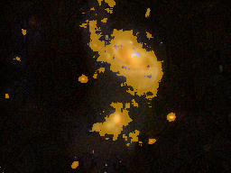
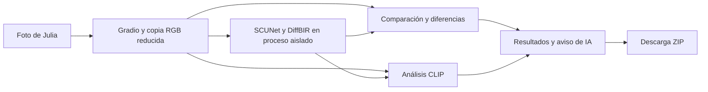

# AstroRestore AI

> Aplicación experimental para explorar la reducción de ruido en imágenes astronómicas y revisar los cambios introducidos por IA.

## Descripción

El ruido dificulta apreciar estrellas tenues y estructuras difusas en fotografías astronómicas. Aplicar filtros o reconstrucciones generativas puede mejorar su apariencia y, al mismo tiempo, borrar información o agregar detalles que no estaban registrados. AstroRestore AI permite explorar ese problema conservando el original y haciendo visibles las modificaciones.

La aplicación está pensada para Julia, profesora de Física y aficionada a la astrofotografía. En Colab integra DiffBIR v2 para limpiar y reconstruir imágenes, CLIP para ofrecer un análisis descriptivo y una interfaz Gradio para comparar, revisar zonas modificadas y descargar el resultado con un aviso de reconstrucción. El recorrido anterior SD 1.5 + Tile se conserva como alternativa local.

El MVP se limita a **reducción de ruido**, dentro de la sub-tarea B del trabajo. DiffBIR fue la tubería con difusión con mejores métricas globales entre las probadas en un caso, pero empeoró frente a SCUNet solo y alteró estructuras locales. **Esa mejora global no demuestra un aporte favorable de la difusión ni autenticidad científica.** Su integración en Gradio está implementada para probarla con fotos propias; la inferencia real del ensayo ya existe, pero el recorrido integrado nuevo con CLIP y proceso persistente todavía debe ejecutarse en Colab. Capturas y video siguen pendientes.

## Persona Usuaria

**Nombre:** Julia, 34 años, profesora de Física y aficionada a la astrofotografía.

**Contexto:** prepara clases y talleres de divulgación; utiliza Siril, DeepSkyStacker y Photoshop, sin especialización en modelos generativos.

**Problema:** necesita revisar fotografías con ruido sin borrar estrellas tenues ni presentar estructuras generadas como observaciones reales.

**Solución:** cargar una foto, distinguir limpieza y reconstrucción, comparar las mismas regiones y consultar advertencias antes de compartirla. DiffBIR utiliza una configuración fija. La mejora de reducción de ruido todavía debe demostrarse en más casos.

## Demo

**Pendiente:** capturas o GIF de la interfaz actual y enlace al video de cinco minutos. No se presentan imágenes de resultados como capturas de la aplicación.

Como evidencia disponible, el [ensayo real con Tile y CLIP](assets/ejemplos/etapa3_tile/README.md) conserva entrada, salida, comparación, análisis y atribución. La autora confirmó el funcionamiento de una versión anterior de Gradio desde el enlace público de Colab; falta registrar el recorrido completo de la interfaz actual. El video deberá mostrar el problema, la carga, el procesamiento real, la comparación y una reflexión sobre los detalles reconstruidos; si se recorta la espera en edición, debe indicarse.

## Qué es real y qué es inventado

**Restaurar no es recuperar.** El archivo cargado se conserva intacto. Para comparar, se prepara una copia RGB reducida. La difusión reconstruye píxeles a partir de esa copia y de patrones aprendidos: puede alterar colores, borrar estrellas o generar texturas plausibles. No recupera información perdida con garantía ni separa dato e invención píxel a píxel.

**Cómo lo ve Julia.** Las tres imágenes de la misma ejecución aparecen juntas: foto cargada (copia reducida), limpieza intermedia y reconstrucción con IA. El comparador comienza por limpieza frente a reconstrucción; también permite revisar entrada frente a limpieza y entrada frente a resultado final. La leyenda identifica izquierda y derecha, y el amarillo siempre corresponde al par seleccionado. Marca modificaciones, incluidos ruido alterado o detalles perdidos: no detecta invenciones. Una región sin marca tampoco garantiza fidelidad. Lo nuevo respecto de la entrada se trata como **no verificado**, no como un descubrimiento. CLIP ofrece una lectura general secundaria y no localiza invenciones ni mide limpieza.



*Derivada del ensayo guardado, sin nueva inferencia; no es una captura de interfaz. Crédito: NASA, ESA, and J. Comerford (University of Colorado-Boulder), [ESA/Hubble potw1803a](https://esahubble.org/images/potw1803a/), [CC BY 4.0](https://creativecommons.org/licenses/by/4.0/). Captura real de la nueva interfaz: pendiente.*

**Advertencia:** «Tu original se conserva. Esta imagen fue reconstruida por IA y puede contener detalles generados o haber perdido otros. Revisá los cambios antes de compartirla». La interfaz aclara que la limpieza no está demostrada. El ZIP incluye una copia con la banda **Reconstruida con IA**, además de la salida sin marcas.

**Fallo concreto.** En `heic1520a.tif`, etapa 2, intensidad 0,5, se observaron filamentos engrosados y trazos distintos de la entrada. En el ensayo Tile versionado, PSNR y SSIM empeoran frente a conservar la imagen ruidosa. Estos resultados no se consideran estructuras verificadas.

**Verificación y riesgo.** Lo real pertenece a la escena; lo ficticio fue generado; lo creíble parece natural; lo verificable necesita evidencia independiente. Comparar permite localizar cambios; confirmar estructuras exige otras observaciones. Julia debe identificar la intervención al usar el resultado en clase. No utilizarlo como descubrimiento, medición, archivo histórico fiel o prueba periodística. Rostros, textos, matrículas y documentos quedan fuera del alcance: los detalles generados no son identificaciones ni transcripciones. Ni CLIP ni las métricas prueban autenticidad.

## Características

- Carga de imágenes astronómicas PNG o TIFF compatibles, conservando el archivo original.
- Procesamiento con DiffBIR v2 en Colab: SCUNet → SD 2.1 + IRControlNet, sin entrenamiento ni superresolución de salida.
- Comparación antes/después y vista opcional de la primera limpieza para revisar el aporte de la reconstrucción.
- Configuración DiffBIR fija en la interfaz; SD 1.5 + Tile mantiene su control de intensidad en la alternativa local.
- Capa amarilla de cambios para revisar y mapa absoluto de diferencias en la descarga.
- Análisis de ambas imágenes con CLIP e informe orientativo en español.
- ZIP con original, entrada preparada, salida sin marcas, primera limpieza SCUNet, condición reducida, resaltado, copia identificada como IA, informe, parámetros y hashes.
- Reintento del informe y la descarga sin repetir difusión.
- Laboratorio independiente, seis pares gaussianos reproducibles y evaluación PSNR/SSIM por consola cuando existe referencia. [Catálogo de ruido](assets/ruido_gaussiano/README.md).

## Tecnologías Utilizadas

**Entorno:** Python 3.12, uv, aplicación sin empaquetado instalable y dependencias bloqueadas en `uv.lock`.

**Interfaz:** Gradio **6.31.0**.

**Modelos de IA:**

- **Motor de la app en Colab:** [DiffBIR v2](https://github.com/XPixelGroup/DiffBIR), revisión `5c2d6c177c3f2965e6d33a32931248d242ef7b3d`, SCUNet-PSNR y SD 2.1 Base + IRControlNet v2. DiffBIR y SCUNet: Apache 2.0; backbone SD 2.1: CreativeML Open RAIL++-M. Fuentes de pesos, revisiones y hashes están en la prueba documentada más abajo. Se ejecuta en un proceso aislado, con Torch 2.2.2 + CUDA 11.8, NumPy 1.26.4 y setuptools 80.9.0; su entorno está bloqueado en `colab/diffbir/uv.lock`.

- [Stable Diffusion 1.5](https://huggingface.co/stable-diffusion-v1-5/stable-diffusion-v1-5), revisión `451f4fe16113bff5a5d2269ed5ad43b0592e9a14`, **CreativeML OpenRAIL-M**: transformación imagen a imagen con DDIM.
- [ControlNet Tile](https://huggingface.co/lllyasviel/control_v11f1e_sd15_tile), revisión `3f877705c37010b7221c3d10743307d6b5b6efac`, **CreativeML OpenRAIL-M**: condicionamiento con la propia imagen de entrada. La referencia del ensayo no se usa para generar.
- [CLIP ViT-B/32](https://huggingface.co/openai/clip-vit-base-patch32), revisión `3d74acf9a28c67741b2f4f2ea7635f0aaf6f0268`, **MIT**: similitudes coseno con seis frases fijas. El informe usa una plantilla; no es una descripción libre ni una verificación científica.

**Procesamiento:** PyTorch **2.15.0**, Diffusers **0.42.1**, Transformers **5.22.2**, Accelerate **1.15.0**, Pillow **12.3.0**, NumPy **2.5.4** y scikit-image **0.26.0**, según `uv.lock`. No se incluye OpenCV ni LPIPS.

**Hardware con el que se probó:** Windows 11, 16 GB de RAM y AMD Radeon RX 580 2048SP de 8 GB; las pruebas locales de difusión utilizaron **CPU**, sin aceleración validada en esa GPU. Se registró por separado una prueba en **Tesla T4 de Colab** con CUDA y `float16`; la RAM de esa sesión no quedó documentada. El ensayo Tile registra CUDA, pero no identifica la GPU concreta.

## Arquitectura del Sistema



`app.py` organiza la interfaz; `src/diffusion.py` prepara la imagen y ejecuta difusión; `src/diffbir_bridge.py` comunica Gradio con un proceso DiffBIR que conserva los modelos entre solicitudes; `src/analysis.py` compara afinidades CLIP; `src/honesty.py` calcula diferencias y advertencias; `src/export.py` conserva imágenes y registros. Los modelos se cargan al procesar, sin descargarlos al importar módulos ni al construir la interfaz. Los entornos de Gradio/CLIP y DiffBIR no se mezclan.

La generación de ruido y las métricas permanecen en un recorrido experimental separado: **referencia preparada → ruido artificial → difusión → comparación contra la referencia**.


### Estructura del proyecto

```text
astro-restauracion/
├── app.py
├── pyproject.toml
├── uv.lock
├── .python-version
├── README.md
├── AGENTS.md
├── .gitignore
├── src/
│   ├── diffusion.py
│   ├── analysis.py
│   ├── honesty.py
│   ├── export.py
│   ├── diffbir_trial.py    # Prueba acotada, separada de la app
│   ├── diffbir_bridge.py   # Motor aislado y persistente para fotos propias
│   └── ...                 # Ruido, experimentos, métricas y validación
├── assets/
│   ├── ejemplos/           # Fuentes, originales locales y evidencia pública
│   ├── ruido_gaussiano/    # Seis pares con registros reproducibles
│   └── interfaz/tema.css
├── colab/
│   ├── ejecutar_en_colab.ipynb
│   ├── preparar_app.py     # ZIP opcional para probar cambios locales
│   └── diffbir/            # pyproject.toml y uv.lock del experimento Linux
├── tests/                 # Comprobaciones sin descargar modelos
└── laboratorio.py         # Herramienta experimental independiente
```

La documentación de uso está en este README. Los README de `assets/` conservan
únicamente procedencia, atribuciones, preparación de datos y evidencia. El
historial de desarrollo queda en Git. `src/export.py`, los módulos experimentales,
el laboratorio y las pruebas siguen siendo utilizados y se conservan. Los
directorios locales `outputs/`, `logs/`, `.cache/` y `.venv/` están ignorados;
todos los registros `.log` se guardan en `logs/`.

## Instalación y Ejecución

### Requisitos

- Git y [uv](https://docs.astral.sh/uv/getting-started/installation/) disponibles en la terminal; entorno Python **3.12** seleccionado por `.python-version`.
- Acceso a internet para instalar dependencias y descargar varios GB de modelos en el primer uso, además de espacio disponible para su caché.
- Para este proyecto se utiliza Colab con GPU T4 cuando está disponible. La ejecución local en CPU es posible, pero lenta; no se validó aceleración con la RX 580.
- La configuración del proyecto no exige un token para los modelos públicos utilizados. No guardar credenciales en el repositorio.
- PNG o TIFF de 8 bits por canal. Los originales de ejemplo son opcionales y se descargan según su [registro de procedencia](assets/ejemplos/README.md).

### Pasos

```powershell
git clone https://github.com/Sabri-Nang/astro-restauracion.git
cd astro-restauracion
uv sync --locked
uv run app.py
```

Abrir la dirección que muestra Gradio, habitualmente `http://127.0.0.1:7860`. Para exigir el bloqueo al ejecutar: `uv run --locked python app.py`. Detener con `Ctrl+C`. La primera inferencia tarda más por la descarga y carga de pesos; las siguientes reutilizan la caché.

Ese comando conserva **SD + Tile** como motor local, compatible con las pruebas CPU anteriores. La nueva versión para Julia se abre en Colab con **DiffBIR**. `ASTRORESTORE_ENGINE=diffbir` selecciona ese motor en el servidor; necesita Linux, CUDA y ambos entornos uv. La interfaz no expone esta configuración técnica a Julia ni cambia de motor automáticamente si falla.

Se comprobó una instalación local en copia nueva para una revisión anterior, commit `13183a8`, con dependencias en caché. No valida automáticamente la revisión actual. La integración DiffBIR tiene pruebas de fotos propias, protocolo persistente, identidad y hashes de resultados, exportación intermedia y recuperación; además se comprobó por HTTP la comparación, el informe, la primera limpieza y el ZIP con imágenes reales guardadas y motor simulado. Eso no equivale a una nueva inferencia ni a revisar la interfaz en un navegador. El recorrido integrado con GPU sigue pendiente en Colab.

### Alternativa: Google Colab

1. Abrir el [notebook integrado en Colab](https://colab.research.google.com/github/Sabri-Nang/astro-restauracion/blob/main/colab/ejecutar_en_colab.ipynb), desde el navegador, y seleccionar GPU T4 si está disponible.
2. Para esta integración elegir `MODO = 'aplicacion'` y `MOTOR = 'diffbir'`. Si el código está publicado, mantener `ORIGEN = 'github'`; para los cambios locales usar el paquete actualizado como se explica a continuación. Las celdas instalan ambos entornos uv, comprueban los imports del checkpoint y CUDA y lanzan Gradio.
3. Abrir el enlace público temporal `https://…gradio.live`. El enlace local apunta a la máquina de Colab. La celda queda ejecutándose mientras el servidor está activo.
4. Subir una imagen compatible y descargar los resultados antes de cerrar la sesión. Los TIFF locales no se transfieren automáticamente; se pueden subir los PNG del [catálogo gaussiano](assets/ruido_gaussiano/README.md).

Para probar cambios sin publicarlos, ejecutar localmente `uv run --locked python colab/preparar_app.py`, subir la copia local de [ejecutar_en_colab.ipynb](colab/ejecutar_en_colab.ipynb) y cambiar a `ORIGEN = 'paquete_local'`; cargar el ZIP generado `outputs/astrorestore_app_colab.zip`. Esta ruta está pensada para el navegador de Colab. Si se actualiza el código, interrumpir el servidor y ejecutar el notebook en una nueva sesión; con cambios locales, regenerar el ZIP. Descargar los resultados antes de cerrar Colab.

## Uso

1. Abrir la dirección local de Gradio o el enlace público de Colab.
2. Subir una foto PNG o TIFF. «8 bits» describe los niveles de color, no los megapíxeles ni el peso: si el archivo tiene mayor profundidad, exportar una copia RGB de 8 bits y conservar el original.
3. En DiffBIR se utiliza una configuración fija: el control `strength` anterior no se presenta como porcentaje de limpieza ni se renombra como otro parámetro. En la alternativa SD/Tile permanece **Cuánto puede cambiar la IA tu foto**, inicialmente 0,10.
4. Pulsar **Procesar y comparar**. La app prepara una copia de hasta 256 píxeles de lado, ejecuta limpieza y difusión, y después CLIP. La primera carga puede tardar varios minutos. El proceso DiffBIR queda disponible para las siguientes fotos; la configuración no cambia entre solicitudes.
5. Ver las tres etapas juntas y empezar por **Limpieza → reconstrucción**. Mover el deslizador sobre la misma región. Elegir otro par actualiza tanto la comparación como las marcas amarillas; se pueden desactivar sin otra inferencia. La limpieza SCUNet también puede modificar detalles. Compararla con la salida incluye los ajustes de tamaño y color posteriores, no únicamente difusión.
6. Revisar puntos luminosos, contornos y fondo. Un detalle nuevo es **no verificado**: para confirmar su presencia se necesita otra observación independiente. La sección secundaria **Lectura orientativa de la foto · no detecta invenciones** contiene el informe CLIP.
7. Descargar el ZIP desde **Descargar imágenes e informe**. Para compartir, usar `para_compartir_con_aviso.png` junto a la entrada. El mapa del ZIP compara entrada y resultado final, independientemente del par elegido en pantalla. Los parámetros completos y las afinidades CLIP están allí. **Reintentar lectura y preparar descarga** evita repetir difusión.

No se ofrecen ejemplos ni registros técnicos en la vista principal. Las capturas del recorrido se incorporarán después de revisar la interfaz real; siguen pendientes.

## Decisiones de Diseño

### Por qué Gradio

Permite cargar archivos, comparar y descargar en una pantalla. Julia puede revisar el resultado sin escribir código. Se retiraron los ejemplos y el registro técnico de la vista principal por decisión de la autora para concentrar el recorrido en su propia foto.

### Revisión centrada en Julia

**Problema observado:** una imagen intermedia aislada bajo «Ver la imagen antes de reconstruir detalles» obliga a recordar las otras vistas y puede confundirse con una nueva acción. No permite atribuir visualmente los cambios a cada tramo del proceso. El rediseño presenta las etapas juntas, con nombres estables y comparaciones por pares. Los resultados se ocultan hasta terminar y se limpian al cambiar la foto o iniciar otra prueba.

**Referencias de diseño:** [NN/g, reconocimiento frente a recuerdo](https://www.nngroup.com/articles/recognition-and-recall/), fundamenta mantener las alternativas visibles. [NASA, imágenes crudas y procesadas](https://science.nasa.gov/solar-system/multimedia/what-are-raw-images/), y [ESA/Hubble, procesamiento de imágenes](https://esahubble.org/projects/hiddentreasures/imageprocessing/), distinguen datos, representación e intervención. Se adopta esa separación para explicar las etapas; no se equipara su procesamiento científico con nuestra reconstrucción generativa. Es una revisión documental y heurística, no un benchmark de rendimiento ni un estudio realizado con usuarias.

**Historias de usuario y criterios:**

- Como Julia, quiero saber cuál es mi entrada y cuáles son las salidas de IA: veo las tres etapas identificadas, del mismo tamaño y de una misma ejecución; la copia reducida no se presenta como una observación auténtica certificada.
- Como Julia, quiero revisar qué cambió después de la limpieza: el par inicial es limpieza/reconstrucción; izquierda, derecha y amarillo se refieren siempre a esas mismas imágenes. Cambiar la vista no ejecuta modelos. Si falta la imagen intermedia, se informa y se identifica la comparación total utilizada.
- Como Julia, quiero mostrar un resultado en clase sin atribuirle un descubrimiento: veo que «modificado» no significa «inventado», que «sin marcas» no significa «real», y encuentro una copia identificada con IA para compartir junto a la entrada.

**Flujo:** cargar → procesar una vez → reconocer las etapas → comparar limpieza/reconstrucción → revisar el cambio total y la limpieza si hace falta → consultar la lectura opcional → descargar y compartir con aviso. No se exige abrir el informe CLIP para entender los límites del resultado. La configuración DiffBIR sigue fija.

**Validación pendiente con Julia:** comprobar si identifica sin ayuda la entrada, la limpieza y la reconstrucción; si entiende qué dos imágenes está comparando; y si explica por qué una marca amarilla no prueba una invención. Revisar teclado y móvil en Colab y registrar una captura real. Las pruebas automáticas no validan comprensión ni usabilidad con personas.

### Por qué Stable Diffusion 1.5 y ControlNet Tile

Se adoptó SD 1.5 como prueba img2img por su integración con Diffusers y entradas pequeñas; Tile condicionó el resultado con la entrada, pero no mejoró frente a conservar la foto ruidosa. Se conserva esa variante para comparación e historial. DiffBIR pasó a la aplicación de Colab por su mejor resultado global en el caso probado, manteniendo visibles sus alteraciones. La limpieza se compara directamente con la reconstrucción porque obtuvo mayor fidelidad que el resultado final en ese ensayo. No se declara adecuado para todas las imágenes ni especializado en astronomía.

### Por qué CLIP como análisis descriptivo

Compara las imágenes con frases fijas sin entrenar un modelo adicional. La revisión, el preprocesamiento y las frases están fijados; el informe explica sus límites. No se utiliza para identificar estructuras reales ni medir limpieza. Se comparan embeddings normalizados con seis frases en inglés, sin softmax. CLIP usa CPU en float32 y recorte central a 224 píxeles; el informe muestra las dos frases con mayor afinidad y conserva los valores exactos en el ZIP.

### Principios de Human-AI Interaction aplicados

- **Transparencia:** aviso de reconstrucción, conservación del original y registro reproducible en el ZIP.
- **Control:** comparación, resaltado desactivable y vista de la primera limpieza. DiffBIR mantiene fijos 50 pasos, semilla 42 y control IRControlNet 1; no se confunde ese control con el strength img2img anterior. SD/Tile conserva su intensidad ajustable y el laboratorio sus controles técnicos.
- **Explicabilidad:** lenguaje comprensible para el informe y la leyenda de cambios; las cifras técnicas quedan en la descarga.
- **Honestidad sobre lo generado:** las marcas no se presentan como detector de invenciones; se documentan fallos y se identifica la copia para compartir.
- **Manejo de errores:** mensajes de formato o profundidad incompatible, progreso, aviso ante bloqueos y reintento del análisis sin otra difusión. La revisión visual y de accesibilidad sigue pendiente.

## Conceptos de Procesamiento Digital Aplicados

- **RGB y profundidad de color:** lectura, conversión y validación en `src/diffusion.py`. Se rechazan entradas de más de 8 bits para evitar pérdida silenciosa.
- **Interpolación:** reducción LANCZOS sin recorte ni ampliación, con dimensiones múltiplos de ocho; puede cambiar ligeramente la relación de aspecto.
- **Ruido gaussiano aditivo:** muestras independientes por píxel y canal en RGB normalizado, con semilla, recorte y cuantización registrados en `src/noise.py`. No simula de forma calibrada un sensor astronómico.
- **Diferencias y filtrado espacial:** diferencia absoluta media RGB, escala fija 0–255 y promedio local de 5 × 5 para el resaltado amarillo en `src/honesty.py`.
- **Reconstrucción generativa:** SD/Tile usa img2img con DDIM; DiffBIR usa sampler spaced y condicionamiento de su primera limpieza, sin asumir recuperación de señal.
- **Comparación cuantitativa:** PSNR y SSIM en `src/evaluation.py`, únicamente con referencia confiable para el ensayo.

## Uso de Agentes de IA

- **Herramienta:** Codex, con instrucciones del repositorio en [AGENTS.md](AGENTS.md), para inspección, propuestas, implementación, comprobaciones y documentación.
- **Decisiones de la autora:** caso astronómico, persona Julia, foco en ruido, avance por etapas y commits pequeños. Tras evaluar Tile solicitó una prueba de DiffBIR y su incorporación al recorrido de Julia. También solicitó simplificar la interfaz, conservar los originales y resaltar cambios. Las publicaciones se realizan únicamente con su autorización explícita.
- **Propuestas del agente y revisión:** generación gaussiana reproducible, diferencias en escala fija, integración de modelos, pruebas automatizadas y registros. Se contrastaron las propuestas con ejecuciones y artefactos compartidos por la autora, documentando resultados desfavorables.
- **Opciones pospuestas:** cambio a SDXL, varios modelos y filtro bilateral. No se presentan como evaluadas ni descartadas por resultados que no existen. La aceptación de cambios no reemplaza la revisión visual de la interfaz actual ni la reflexión personal de la autora.

## Limitaciones Conocidas

- DiffBIR mejora métricas globales en el único caso evaluado, pero altera galaxias y empeora frente a su etapa SCUNet. SD/Tile, conservado como alternativa, no superó la entrada ruidosa. Ninguno garantiza conservar estrellas ni contornos.
- El resultado tiene como máximo **256 píxeles de lado** en la app. No conserva la resolución completa; la entrada debe tener al menos 64 píxeles por lado.
- La app admite PNG/TIFF de hasta 8 bits por canal. Las copias de mayor profundidad necesitan conversión explícita fuera de la interfaz, con pérdida de precisión tonal.
- Las pruebas CPU de etapa 2 tardaron aproximadamente **102–223 segundos de inferencia por imagen** con dos pasos efectivos. Una prueba separada T4 registró **2,294 segundos**. Son ensayos históricos de SD sin Tile; no predicen la duración actual de Tile + CLIP ni incluyen la primera descarga.
- CLIP compara frases y puede omitir bordes por su recorte central. Sus afinidades no son probabilidades de calidad ni un diagnóstico científico.
- La evaluación de restauración abarca un caso gaussiano; las cinco nuevas copias están preparadas, sin restauración evaluada. El ruido sintético no representa todo ruido real.
- El pipeline oficial DiffBIR no incluye el filtro de contenido de SD/Tile; esta diferencia queda en sus registros. El filtro de SD/Tile permanece activo cuando se utiliza esa variante. Colab depende de recursos y sesiones temporales.
- Quedan fuera FITS, desenfoque, superresolución, entrenamiento, identificación de personas y verificación astrométrica. No usar resultados como evidencia científica, histórica o periodística.

## Métricas de Calidad (opcional)

**PSNR** mide parecido entre píxeles; **SSIM**, similitud de estructura. Valores mayores indican más parecido con la referencia, no mayor autenticidad. Se calculan por consola para el ensayo sintético, comparando contra la imagen preparada **antes** de añadir ruido. No se calculan sobre una foto real sin referencia confiable. **LPIPS no está implementado.**

En `potw1803a`, la entrada ruidosa obtuvo **31,2381 dB / 0,637538** (PSNR/SSIM); Tile a intensidad 0,10 obtuvo **28,4258 dB / 0,552753**. Para Julia, significa que esa reconstrucción se alejó más de la referencia que la propia entrada ruidosa. No demuestra limpieza, y no permite generalizar a todas las imágenes o modelos. Tile a intensidad 0,15 también empeoró ambas métricas; 0,20 y 0,25 quedaron bloqueadas. Los controles VAE mostraron cambios incluso sin ejecutar difusión. Los registros originales y el ejemplo público se conservan sin atribuirles resultados nuevos.


La evaluación utiliza RGB publicado normalizado a [0, 1], `data_range=1`, SSIM
gaussiano con ventana 11 × 11 y sigma 1,5, por canales y covarianza poblacional.
Verifica hashes y dimensiones; no alinea ni ajusta el contraste. El ensayo
gaussiano agrega media 0, sigma 0,03 y semilla 123 después de reducir la imagen.
La referencia publicada puede contener ruido propio: solo define el objetivo
de esta degradación artificial.

Para verificar el proyecto sin descargar pesos ni ejecutar inferencias:

```powershell
uv run --locked python -m unittest discover -s tests -v
```

La validación técnica de cinco imágenes se conserva en `src/validation.py` y no
debe confundirse con demostrar reducción de ruido. Para investigación, el
laboratorio se abre con `uv run laboratorio.py`; los comandos de preparación,
reproducción y evaluación están disponibles con `--help` en `src.experiment`,
`src.noise_assets` y `src.evaluation`.

### Prueba acotada de DiffBIR v2 — ejecución completa en un caso

El experimento controlado con el [código oficial de DiffBIR](https://github.com/XPixelGroup/DiffBIR), revisión `5c2d6c177c3f2965e6d33a32931248d242ef7b3d`, evalúa únicamente el par conservado de `potw1803a`: sigma 0,03, semilla de ruido 123 y 256 × 192. **La ejecución completa quedó guardada en el [notebook compartido por la autora](https://colab.research.google.com/drive/1vW7TnjBkn7vfzi9VFE-8Z55BYg83E1Ya#scrollTo=ejecutar-diffbir)**, con GPU T4, 50 pasos y estado `completado_pendiente_revision_visual`. Sus parámetros se usan ahora en la integración Gradio; esa app procesa fotos propias sin buscar esta referencia ni calcular métricas contra ella. El ensayo y la aplicación son recorridos distintos.

La revisión del notebook confirmó el final del muestreo y examinó las imágenes. Se recuperaron los cinco paneles RGB de su lámina PNG, sin reescalado: referencia, ruido, SCUNet y condición reducida conservan los mismos píxeles que los archivos ya verificados. Se recalcularon PSNR/SSIM globales y de los cuatro recortes; coinciden con las salidas guardadas dentro de 1e-12. Los bytes PNG recodificados pueden diferir por compresión o metadata; el SHA del archivo final original todavía debe comprobarse contra el ZIP. [Registro de esta revisión local](outputs/prueba_diffusion/revision_notebook_20261116/revision.json).

- Entrada ruidosa: **31,2381 dB / 0,637538** (PSNR/SSIM).
- SCUNet nativo: **35,4260 dB / 0,839822**.
- DiffBIR final: **32,4664 dB / 0,793575**; mejora global de **1,2283 dB / 0,156037** frente a la entrada, pero pérdida de **2,9597 dB / 0,046247** frente a SCUNet.
- Galaxia superior: el resultado final baja a **26,3997 dB / 0,724564**, frente a **30,4902 dB / 0,835860** de la entrada ruidosa. La revisión visual muestra trazos espirales más regulares y distintos de los de la referencia publicada.

**Interpretación:** la tubería completa supera globalmente a la entrada, pero no se demuestra un beneficio incremental de su etapa generativa: SCUNet solo es más cercano a la referencia. La mejora del fondo no compensa científicamente una estructura reconstruida de forma incorrecta. El resultado final incluye difusión, remuestreo y corrección wavelet; no se atribuye toda la diferencia a un único componente. Una imagen, una semilla y una configuración no validan generalización ni autenticidad. El historial de intentos parciales queda resumido a continuación; sus archivos se conservan sin reescribirlos.

El 16 de noviembre de 2026 se recibió `outputs/prueba_diffusion/prueba_diffbir.zip`, SHA-256 `11b9716b662628de8c26ac3db7550133a6f35a68d86ff8ea5f07cbd1530c9c54`, desde una Tesla T4 con Torch 2.2.2 + CUDA 11.8. Se verificaron los hashes de siete PNG, la identidad de referencia y entrada y se recalcularon métricas globales y de los cuatro recortes, coincidentes con el registro dentro de 1e-12:

- Entrada ruidosa: PSNR **31,2381 dB**, SSIM **0,637538**.
- SCUNet nativo: PSNR **35,4260 dB**, SSIM **0,839822**; mejora de **4,1880 dB** y **0,202285** de SSIM. El error cuadrático medio baja aproximadamente **61,88 %** frente a la referencia; no significa que se haya eliminado ese porcentaje del ruido.
- Condición ampliada y reducida de nuevo: PSNR **35,3917 dB**, SSIM **0,839229**, ligeramente inferior a SCUNet nativo.
- DiffBIR final: **sin archivo ni métricas**. El registro quedó en `ejecutando`, con difusión marcada como no ejecutada. El log termina durante la carga de la etapa 2 y no incluye traceback ni código de salida; no permite confirmar falta de RAM ni otra causa.

Los recortes muestran menos grano y también suavizado de estructuras; las cuatro regiones mejoran sus métricas con SCUNet, sin demostrar conservación científica de cada detalle ni generalización. La [revisión local](outputs/prueba_diffusion/revision_20261116T143040687517Z/revision.json) conserva la comprobación sin modificar el ZIP ni el registro original. Estos artefactos son locales y no se descargan al clonar.

Se añadió carga CPU con `mmap` cuando el checkpoint lo admite, evitando cargar todos sus storages en RAM al abrirlo, según la [guía de PyTorch](https://docs.pytorch.org/tutorials/recipes/recipes/module_load_state_dict_tips.html). Se guardan fases de carga, lecturas de RAM Linux y código de salida desde el proceso padre. Una salida compatible con SIGKILL no se diagnostica automáticamente como OOM. Si el hijo termina antes de escribir su `finally`, el notebook identifica el resultado parcial; una interrupción manual detiene su grupo de procesos. Un segundo intento falló antes de ejecutar SCUNet porque Torch 2.2 exige `str` en lugar de `Path` para `mmap`; se corrigió ese argumento y se agregó una comprobación de compatibilidad. La ejecución completa posterior utilizó la corrección; no se garantiza memoria suficiente para otros tamaños o configuraciones.

En otro intento parcial recibido el 16 de noviembre, SCUNet volvió a terminar y sus PNG coinciden con los del primer ensayo. La etapa SD 2.1 falló al abrir el checkpoint: `ModuleNotFoundError: No module named 'pkg_resources'`, código de salida **1**, sin difusión final. Esta vez sí hay una causa registrada y no se atribuye a RAM. Se incorporó `setuptools==80.9.0` al proyecto y bloqueo aislados, y una comprobación de `pkg_resources` y `ModelCheckpoint` antes de construir los modelos. El [código de setuptools 80.9.0](https://github.com/pypa/setuptools/tree/v80.9.0/pkg_resources) conserva esa API heredada. La ejecución posterior verificó esos imports y completó difusión. [Revisión local del ZIP parcial recibido](outputs/prueba_diffusion/revision_20261116T152202983278Z/revision.json), excluida de Git.

1. Ejecutar localmente `uv run --locked python colab/preparar_app.py` para generar el ZIP actualizado.
2. Subir la copia local de `colab/ejecutar_en_colab.ipynb` al navegador de Colab, seleccionar GPU T4 y detener otros servidores. En la primera celda elegir `ORIGEN = 'paquete_local'` y `MODO = 'prueba_diffbir'`. Subir `outputs/astrorestore_app_colab.zip` cuando lo solicite. Cuando estos cambios estén publicados, se puede usar `ORIGEN = 'github'`.
3. Ejecutar las celdas en orden. El modo experimental instala **su propio entorno uv para Linux y Python 3.12**, con Torch 2.2.2 + CUDA 11.8 y NumPy 1.26.4, definidos en `colab/diffbir/pyproject.toml` y `uv.lock`. El entorno y el bloqueo de la app se conservan. La celda de Gradio se omite; la última celda ejecuta DiffBIR.
4. Revisar `comparacion.png`, `recortes.png` y `resultado.json`, y descargar `prueba_diffbir.zip`. El ZIP también se conserva si hay un fallo con resultados parciales; la ejecución no se declara completa por terminar una celda. Los logs se guardan en `logs/` y se incluyen bajo ese directorio dentro del ZIP.

**Configuración inicial:** DiffBIR **v2** para denoising, SCUNet-PSNR seguido de SD **2.1 Base + IRControlNet v2**, 50 pasos, sampler `spaced`, CFG 4, semilla 42, captioner desactivado y prompt positivo vacío. Control IRControlNet **1**, sin aumento adicional de ruido y precisión `fp16`, con atención SDP y particionado de VAE/difusión. Ese control **no equivale a `strength=1` de SD img2img**. Es una configuración inicial basada en la ruta oficial; su calidad y memoria deben comprobarse en la sesión real.

**Comparaciones conservadas:** entrada ruidosa, SCUNet a resolución nativa, condición interna ampliada, condición reducida de nuevo y salida final. DiffBIR amplía internamente a lado mínimo 512 antes de la difusión, realiza corrección de color wavelet y devuelve 256 × 192 mediante reducción bicúbica. No se entrega superresolución. Se conserva la condición float original entre etapas; los PNG para evaluación se recortan y truncan a 8 bits como la salida oficial. La referencia se usa solo para evaluar, nunca como entrada o condición del modelo.

La evaluación repite PSNR/SSIM y los cuatro recortes de fondo, galaxias y fuente puntual. Registra cada etapa, diferencias frente a la entrada y frente a SCUNet, hashes, GPU, VRAM, versiones y tiempos. Si SCUNet mejora y el resultado final empeora, se documentará ese resultado; las diferencias finales incluyen también remuestreo y corrección wavelet. Las pruebas automatizadas verifican el protocolo con imágenes simuladas, no la eficacia de DiffBIR ni su instalación completa en Colab.

**Fuentes de pesos:** SCUNet-PSNR desde la release oficial de KAIR v1.0 (SHA-256 esperado fijado desde la descarga real recibida; la release no publica digest propio); IRControlNet desde [lxq007/DiffBIR-v2](https://huggingface.co/lxq007/DiffBIR-v2), revisión `fd6263503564bfbfa156665a90832e1b729434f4`; SD 2.1 desde el [respaldo de terceros ckpt/stable-diffusion-2-1-base](https://huggingface.co/ckpt/stable-diffusion-2-1-base), revisión `80b44465963d65d12b35d07a2ea789545df260b9`. El enlace original de Stability AI respondió 401 al preparar la prueba; no se sustituye por el checkpoint ZSNR de v2.1. Los tres pesos se verifican contra tamaño y SHA-256 fijos antes de cargarlos. Los pesos suman unos 6,7 GB, además del entorno, cachés y memoria de ejecución; no están en Git ni se descargan al generar el paquete.

DiffBIR y SCUNet identifican Apache 2.0 en sus proyectos; el backbone SD 2.1 mantiene CreativeML Open RAIL++-M. No se atribuye una única licencia a todos los componentes. El pipeline oficial de DiffBIR no incluye el filtro de contenido de nuestra app; se registra esa diferencia sin modificar el filtro de SD/Tile. La imagen y sus derivadas conservan el crédito y CC BY 4.0 del [ejemplo original](assets/ejemplos/README.md).

## Trabajo Futuro

- [ ] Ejecutar y documentar el recorrido completo de la interfaz actual en Colab; revisar teclado, contraste y móvil.
- [ ] Incorporar capturas reales, enlazar el video de cinco minutos y completar la reflexión de la autora.
- [ ] Revalidar las instrucciones de la revisión actual desde una instalación nueva y completar la revisión de entrega.
- [ ] Elegir la licencia del código y agregar su archivo.
- [ ] Ampliar la evaluación de restauración a las seis imágenes y casos reales, manteniendo referencias y semillas comparables.
- [ ] Después de la entrega, investigar calidad y una línea base clásica opcional antes de agregar complejidad.

## Reflexiones y Aprendizajes

El desarrollo permitió distinguir una inferencia correcta de una reducción de ruido demostrada. Las cinco pruebas técnicas produjeron imágenes, pero sus alteraciones y los ensayos posteriores mostraron que una salida convincente puede perder fidelidad. También quedó registrada la diferencia entre tener VRAM disponible y contar con aceleración compatible; Colab permitió realizar las pruebas GPU.

**Reflexión personal de la autora: pendiente.** Sabrina completará con sus propias palabras qué aprendió, qué desafíos enfrentó, cómo revisó las propuestas del agente y cómo cambió su mirada sobre una imagen reconstruida. No se atribuye una experiencia personal todavía no registrada.

## Recursos y Referencias

- [Consigna y materiales del docente](https://colab.research.google.com/drive/1PjBnThBhDF8x5gYSmbROR_vO7y7AUltV#scrollTo=1racjP4M9DZH).
- [Stable Diffusion 1.5](https://huggingface.co/stable-diffusion-v1-5/stable-diffusion-v1-5), [ControlNet Tile](https://huggingface.co/lllyasviel/control_v11f1e_sd15_tile) y [CLIP ViT-B/32](https://huggingface.co/openai/clip-vit-base-patch32).
- [Diffusers img2img](https://huggingface.co/docs/diffusers/using-diffusers/img2img), [DDIM](https://huggingface.co/docs/diffusers/api/schedulers/ddim) y [licencia de CLIP](https://github.com/openai/CLIP/blob/main/LICENSE).
- [Gradio](https://www.gradio.app/docs), [uv](https://docs.astral.sh/uv/) y [métricas de scikit-image](https://scikit-image.org/docs/stable/api/skimage.metrics.html).
- [Procedencia de imágenes](assets/ejemplos/README.md), [catálogo gaussiano](assets/ruido_gaussiano/README.md) y [evidencia real de Tile y CLIP](assets/ejemplos/etapa3_tile/README.md).

## Autor

**Sabrina Sanches**

Estudiante de Tecnicatura Superior en Ciencia de Datos e Inteligencia Artificial — IFTS 24.

Materia: Procesamiento Digital de Imágenes e Introducción a Visión por Computadora.

Año: 2026.

[GitHub](https://github.com/Sabri-Nang) · [Repositorio](https://github.com/Sabri-Nang/astro-restauracion).

## Licencia

**Código:** pendiente de elección por la autora y de incorporar un archivo de licencia. No se declara MIT, Apache u otra licencia sin esa decisión.

**Modelos:** SD 1.5 y ControlNet Tile, CreativeML OpenRAIL-M; CLIP, MIT; DiffBIR y SCUNet, Apache 2.0 en sus proyectos; backbone SD 2.1, CreativeML Open RAIL++-M. Sus condiciones son independientes de las del código.

**Imágenes:** conservar fuentes, créditos, CC BY 4.0 y modificaciones según el [registro de ejemplos](assets/ejemplos/README.md). Los TIFF originales, pesos y credenciales no se versionan; sí se incluyen los PNG públicos documentados de ruido y evidencia.

---

**Trabajo Integrador N.º 2 — IFTS 24 — 2026**
