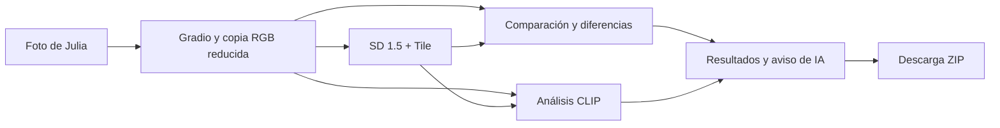

# AstroRestore AI

> Aplicación experimental para explorar la reducción de ruido en imágenes astronómicas y revisar los cambios introducidos por IA.

## Descripción

El ruido dificulta apreciar estrellas tenues y estructuras difusas en fotografías astronómicas. Aplicar filtros o reconstrucciones generativas puede mejorar su apariencia y, al mismo tiempo, borrar información o agregar detalles que no estaban registrados. AstroRestore AI permite explorar ese problema conservando el original y haciendo visibles las modificaciones.

La aplicación está pensada para Julia, profesora de Física y aficionada a la astrofotografía. Integra Stable Diffusion 1.5 con ControlNet Tile para transformar imágenes, CLIP para ofrecer un análisis descriptivo y una interfaz Gradio para comparar, revisar zonas modificadas y descargar el resultado con un aviso de reconstrucción.

El MVP se limita a **reducción de ruido**, dentro de la sub-tarea B del trabajo. Es un prototipo funcional, pero **ninguna configuración evaluada demostró mayor fidelidad que conservar la entrada ruidosa**. Las etapas 1 y 2 están completadas, la etapa 3 implementada y documentada y la etapa 4 en curso. Capturas, video y revisión de la interfaz actual en Colab siguen pendientes. [Plan por etapas](docs/plan_de_trabajo.md).

## Persona Usuaria

**Nombre:** Julia, 34 años, profesora de Física y aficionada a la astrofotografía.

**Contexto:** prepara clases y talleres de divulgación; utiliza Siril, DeepSkyStacker y Photoshop, sin especialización en modelos generativos.

**Problema:** necesita revisar fotografías con ruido sin borrar estrellas tenues ni presentar estructuras generadas como observaciones reales.

**Solución:** cargar una foto, controlar cuánto puede cambiar la IA, comparar las mismas regiones y consultar advertencias antes de compartirla. La mejora de reducción de ruido todavía debe demostrarse.

[Perfil completo, objetivos y alcance](docs/fundamentos_y_persona.md).

## Demo

**Pendiente:** capturas o GIF de la interfaz actual y enlace al video de cinco minutos. No se presentan imágenes de resultados como capturas de la aplicación.

Como evidencia disponible, el [ensayo real con Tile y CLIP](assets/ejemplos/etapa3_tile/README.md) conserva entrada, salida, comparación, análisis y atribución. La autora confirmó el funcionamiento de una versión anterior de Gradio desde el enlace público de Colab; falta registrar el recorrido completo de la interfaz actual. [Guion y comprobaciones para la demo](docs/entrega_etapa4.md).

## Qué es real y qué es inventado

**Restaurar no es recuperar.** El archivo cargado se conserva intacto. Para comparar, se prepara una copia RGB reducida. La difusión reconstruye píxeles a partir de esa copia y de patrones aprendidos: puede alterar colores, borrar estrellas o generar texturas plausibles. No recupera información perdida con garantía ni separa dato e invención píxel a píxel.

**Cómo lo ve Julia.** El deslizador compara entrada y reconstrucción. Las zonas amarillas señalan cambios locales para revisar; pueden desactivarse sin otra inferencia. También pueden marcar ruido modificado o detalles perdidos: no detectan invenciones. Una región sin marca tampoco garantiza fidelidad. El informe CLIP orienta la revisión y no mide cuánto ruido se eliminó.


*Derivada del ensayo guardado, sin nueva inferencia; no es una captura de interfaz. Crédito: NASA, ESA, and J. Comerford (University of Colorado-Boulder), [ESA/Hubble potw1803a](https://esahubble.org/images/potw1803a/), [CC BY 4.0](https://creativecommons.org/licenses/by/4.0/). Captura real de la nueva interfaz: pendiente.*

**Advertencia:** «Tu original se conserva. Esta imagen fue reconstruida por IA y puede contener detalles generados o haber perdido otros. Revisá los cambios antes de compartirla». La interfaz aclara que la limpieza no está demostrada. El ZIP incluye una copia con la banda **Reconstruida con IA**, además de la salida sin marcas.

**Fallo concreto.** En `heic1520a.tif`, etapa 2, intensidad 0,5, se observaron filamentos engrosados y trazos distintos de la entrada. En el ensayo Tile versionado, PSNR y SSIM empeoran frente a conservar la imagen ruidosa. Estos resultados no se consideran estructuras verificadas.

**Verificación y riesgo.** Lo real pertenece a la escena; lo ficticio fue generado; lo creíble parece natural; lo verificable necesita evidencia independiente. Comparar permite localizar cambios; confirmar estructuras exige otras observaciones. Julia debe identificar la intervención al usar el resultado en clase. No utilizarlo como descubrimiento, medición, archivo histórico fiel o prueba periodística. Rostros, textos, matrículas y documentos quedan fuera del alcance: los detalles generados no son identificaciones ni transcripciones. Ni CLIP ni las métricas prueban autenticidad.

## Características

- Carga de imágenes astronómicas PNG o TIFF compatibles, conservando el archivo original.
- Procesamiento img2img con Stable Diffusion 1.5 + ControlNet Tile, sin entrenamiento ni superresolución.
- Control de intensidad y comparación antes/después mediante deslizador.
- Capa amarilla de cambios para revisar y mapa absoluto de diferencias en la descarga.
- Análisis de ambas imágenes con CLIP e informe orientativo en español.
- ZIP con original, entrada preparada, salida sin marcas, resaltado, copia identificada como IA, informe, parámetros y hashes.
- Reintento del informe y la descarga sin repetir difusión.
- Laboratorio independiente, seis pares gaussianos reproducibles y evaluación PSNR/SSIM por consola cuando existe referencia. [Catálogo de ruido](assets/ruido_gaussiano/README.md).

## Tecnologías Utilizadas

**Entorno:** Python 3.12, uv, aplicación sin empaquetado instalable y dependencias bloqueadas en `uv.lock`.

**Interfaz:** Gradio **6.31.0**.

**Modelos de IA:**

- [Stable Diffusion 1.5](https://huggingface.co/stable-diffusion-v1-5/stable-diffusion-v1-5), revisión `451f4fe16113bff5a5d2269ed5ad43b0592e9a14`, **CreativeML OpenRAIL-M**: transformación imagen a imagen con DDIM.
- [ControlNet Tile](https://huggingface.co/lllyasviel/control_v11f1e_sd15_tile), revisión `3f877705c37010b7221c3d10743307d6b5b6efac`, **CreativeML OpenRAIL-M**: condicionamiento con la propia imagen de entrada. La referencia del ensayo no se usa para generar.
- [CLIP ViT-B/32](https://huggingface.co/openai/clip-vit-base-patch32), revisión `3d74acf9a28c67741b2f4f2ea7635f0aaf6f0268`, **MIT**: similitudes coseno con seis frases fijas. El informe usa una plantilla; no es una descripción libre ni una verificación científica.

**Procesamiento:** PyTorch **2.15.0**, Diffusers **0.42.1**, Transformers **5.22.2**, Accelerate **1.15.0**, Pillow **12.3.0**, NumPy **2.5.4** y scikit-image **0.26.0**, según `uv.lock`. No se incluye OpenCV ni LPIPS.

**Hardware con el que se probó:** Windows 11, 16 GB de RAM y AMD Radeon RX 580 2048SP de 8 GB; las pruebas locales de difusión utilizaron **CPU**, sin aceleración validada en esa GPU. Se registró por separado una prueba en **Tesla T4 de Colab** con CUDA y `float16`; la RAM de esa sesión no quedó documentada. El ensayo Tile registra CUDA, pero no identifica la GPU concreta. [Entorno y mediciones detalladas](docs/arquitectura_tecnica.md).

## Arquitectura del Sistema



`app.py` organiza la interfaz; `src/diffusion.py` prepara la imagen y ejecuta difusión; `src/analysis.py` compara afinidades CLIP; `src/honesty.py` calcula diferencias y advertencias; `src/export.py` conserva imágenes y registros. Los modelos se cargan al procesar, sin descargarlos al importar módulos.

La generación de ruido y las métricas permanecen en un recorrido experimental separado: **referencia preparada → ruido artificial → difusión → comparación contra la referencia**. [Estructura completa y responsabilidades](docs/arquitectura_tecnica.md).

## Instalación y Ejecución

### Requisitos

- Git y [uv](https://docs.astral.sh/uv/getting-started/installation/) disponibles en la terminal; entorno Python **3.12** seleccionado por `.python-version`.
- Acceso a internet para instalar dependencias y descargar varios GB de modelos en el primer uso, además de espacio disponible para su caché.
- Para este proyecto se utiliza Colab con GPU T4 cuando está disponible. La ejecución local en CPU es posible, pero lenta; no se validó aceleración con la RX 580.
- La configuración del proyecto no exige un token para los modelos públicos utilizados. No guardar credenciales en el repositorio.
- PNG o TIFF de 8 bits por canal. Los originales de ejemplo son opcionales y se descargan según su [registro de procedencia](assets/ejemplos/README.md).

### Pasos

```powershell
git clone https://github.com/Sabri-Nang/astro-restauracion.git
cd astro-restauracion
uv sync --locked
uv run app.py
```

Abrir la dirección que muestra Gradio, habitualmente `http://127.0.0.1:7860`. Para exigir el bloqueo al ejecutar: `uv run --locked python app.py`. Detener con `Ctrl+C`. La primera inferencia tarda más por la descarga y carga de pesos; las siguientes reutilizan la caché.

Se comprobó una instalación local en copia nueva para una revisión anterior y el recorrido HTTP de la interfaz actual con modelos simulados. Eso no equivale a otra inferencia ni a una revisión visual completa. [Verificación y límites](docs/verificacion_etapa4.md).

### Alternativa: Google Colab

1. Abrir el [notebook integrado en Colab](https://colab.research.google.com/github/Sabri-Nang/astro-restauracion/blob/main/colab/app_integrada.ipynb), desde el navegador, y seleccionar GPU T4 si está disponible.
2. Para usar el código publicado, cambiar la primera celda a `ORIGEN = 'github'`. Ejecutar las celdas en orden: clonado, instalación con uv y Python 3.12, comprobación de CUDA y lanzamiento de Gradio.
3. Abrir el enlace público temporal `https://…gradio.live`. El enlace local apunta a la máquina de Colab. La celda queda ejecutándose mientras el servidor está activo.
4. Subir una imagen compatible y descargar los resultados antes de cerrar la sesión. Los TIFF locales no se transfieren automáticamente; se pueden subir los PNG del [catálogo gaussiano](assets/ruido_gaussiano/README.md).

Para probar cambios sin publicarlos, ejecutar localmente `uv run --locked python colab/preparar_app.py`, subir la copia local de [app_integrada.ipynb](colab/app_integrada.ipynb) y mantener `ORIGEN = 'paquete_local'`; cargar el ZIP generado `outputs/astrorestore_app_colab.zip`. Esta ruta está pensada para el navegador de Colab. [Guía detallada e historial de la alternativa para VS Code](docs/instalacion_detallada.md).

## Uso

1. Abrir la dirección local de Gradio o el enlace público de Colab.
2. Subir una foto PNG o TIFF. «8 bits» describe los niveles de color, no los megapíxeles ni el peso: si el archivo tiene mayor profundidad, exportar una copia RGB de 8 bits y conservar el original.
3. Ajustar **Cuánto puede cambiar la IA tu foto**, inicialmente 0,10. Aumentarlo permite más transformación; no indica un porcentaje de ruido eliminado.
4. Pulsar **Procesar y comparar**. La app prepara una copia de hasta 256 píxeles de lado, ejecuta difusión y después CLIP.
5. Mover el deslizador y alternar **Resaltar las zonas modificadas en amarillo**. Revisar estrellas, fondo y contornos, junto con el informe orientativo.
6. Descargar el ZIP desde **Guardar resultado con informe**. Los parámetros completos y las afinidades CLIP están allí. Si el análisis falla tras generar la imagen, **Reintentar informe y descarga** evita repetir difusión.

No se ofrecen ejemplos ni registros técnicos en la vista principal. Las capturas del recorrido se incorporarán después de revisar la interfaz real; siguen pendientes.

## Decisiones de Diseño

### Por qué Gradio

Permite cargar archivos, comparar y descargar en una pantalla. Julia puede revisar el resultado sin escribir código. Se retiraron los ejemplos y el registro técnico de la vista principal por decisión de la autora para concentrar el recorrido en su propia foto.

### Por qué Stable Diffusion 1.5 y ControlNet Tile

Se adoptó SD 1.5 como prueba img2img por su integración con Diffusers y la posibilidad de usar precisión reducida y entradas pequeñas. Tile condiciona la transformación con la entrada. Se mantiene provisionalmente para completar la entrega con los resultados desfavorables documentados: no es un modelo especializado en astronomía ni una configuración de limpieza validada. La optimización de calidad queda pendiente.

### Por qué CLIP como análisis descriptivo

Compara las imágenes con frases fijas sin entrenar un modelo adicional. La revisión, el preprocesamiento y las frases están fijados; el informe explica sus límites. No se utiliza para identificar estructuras reales ni medir limpieza. [Método y validación](docs/analisis_visual.md).

### Principios de Human-AI Interaction aplicados

- **Transparencia:** aviso de reconstrucción, conservación del original y registro reproducible en el ZIP.
- **Control:** intensidad ajustable, comparación y resaltado que puede desactivarse. Pasos, semilla y tamaño son fijos en esta interfaz; el laboratorio mantiene sus controles aparte.
- **Explicabilidad:** lenguaje comprensible para el informe y la leyenda de cambios; las cifras técnicas quedan en la descarga.
- **Honestidad sobre lo generado:** las marcas no se presentan como detector de invenciones; se documentan fallos y se identifica la copia para compartir.
- **Manejo de errores:** mensajes de formato o profundidad incompatible, progreso, aviso ante bloqueos y reintento del análisis sin otra difusión. La revisión visual y de accesibilidad sigue pendiente.

## Conceptos de Procesamiento Digital Aplicados

- **RGB y profundidad de color:** lectura, conversión y validación en `src/diffusion.py`. Se rechazan entradas de más de 8 bits para evitar pérdida silenciosa.
- **Interpolación:** reducción LANCZOS sin recorte ni ampliación, con dimensiones múltiplos de ocho; puede cambiar ligeramente la relación de aspecto.
- **Ruido gaussiano aditivo:** muestras independientes por píxel y canal en RGB normalizado, con semilla, recorte y cuantización registrados en `src/noise.py`. No simula de forma calibrada un sensor astronómico.
- **Diferencias y filtrado espacial:** diferencia absoluta media RGB, escala fija 0–255 y promedio local de 5 × 5 para el resaltado amarillo en `src/honesty.py`.
- **Reconstrucción generativa:** difusión img2img con DDIM y condicionamiento Tile; se estudia su adecuación como restauración, sin asumir recuperación de señal.
- **Comparación cuantitativa:** PSNR y SSIM en `src/evaluation.py`, únicamente con referencia confiable para el ensayo.

## Uso de Agentes de IA

- **Herramienta:** Codex, con instrucciones del repositorio en [AGENTS.md](AGENTS.md), para inspección, propuestas, implementación, comprobaciones y documentación.
- **Decisiones de la autora:** caso astronómico, persona Julia, foco en ruido, avance por etapas, commits pequeños y continuidad provisional con Tile. Solicitó simplificar la interfaz, conservar los originales y resaltar cambios; aprobó las modificaciones antes de publicarlas.
- **Propuestas del agente y revisión:** generación gaussiana reproducible, diferencias en escala fija, integración de modelos, pruebas automatizadas y registros. Se contrastaron las propuestas con ejecuciones y artefactos compartidos por la autora, documentando resultados desfavorables.
- **Opciones pospuestas:** cambio a SDXL, varios modelos y filtro bilateral. No se presentan como evaluadas ni descartadas por resultados que no existen. La aceptación de cambios no reemplaza la revisión visual de la interfaz actual ni la reflexión personal de la autora.

[Registro ampliado de la colaboración](docs/fundamentos_y_persona.md).

## Limitaciones Conocidas

- No se demostró reducción de ruido con mejor fidelidad en el caso evaluado. Puede borrar estrellas, cambiar contornos y generar texturas.
- El resultado tiene como máximo **256 píxeles de lado** en la app. No conserva la resolución completa; la entrada debe tener al menos 64 píxeles por lado.
- La app admite PNG/TIFF de hasta 8 bits por canal. Las copias de mayor profundidad necesitan conversión explícita fuera de la interfaz, con pérdida de precisión tonal.
- Las pruebas CPU de etapa 2 tardaron aproximadamente **102–223 segundos de inferencia por imagen** con dos pasos efectivos. Una prueba separada T4 registró **2,294 segundos**. Son ensayos históricos de SD sin Tile; no predicen la duración actual de Tile + CLIP ni incluyen la primera descarga.
- CLIP compara frases y puede omitir bordes por su recorte central. Sus afinidades no son probabilidades de calidad ni un diagnóstico científico.
- La evaluación de restauración abarca un caso gaussiano; las cinco nuevas copias están preparadas, sin restauración evaluada. El ruido sintético no representa todo ruido real.
- El filtro de seguridad puede bloquear salidas; permanece activo. Colab depende de recursos y sesiones temporales.
- Quedan fuera FITS, desenfoque, superresolución, entrenamiento, identificación de personas y verificación astrométrica. No usar resultados como evidencia científica, histórica o periodística.

## Métricas de Calidad (opcional)

**PSNR** mide parecido entre píxeles; **SSIM**, similitud de estructura. Valores mayores indican más parecido con la referencia, no mayor autenticidad. Se calculan por consola para el ensayo sintético, comparando contra la imagen preparada **antes** de añadir ruido. No se calculan sobre una foto real sin referencia confiable. **LPIPS no está implementado.**

En `potw1803a`, la entrada ruidosa obtuvo **31,2381 dB / 0,637538** (PSNR/SSIM); Tile a intensidad 0,10 obtuvo **28,4258 dB / 0,552753**. Para Julia, significa que esa reconstrucción se alejó más de la referencia que la propia entrada ruidosa. No demuestra limpieza, y no permite generalizar a todas las imágenes o modelos. [Método, barridos, recortes y comandos](docs/experimentos_y_evaluacion.md).

## Trabajo Futuro

- [ ] Ejecutar y documentar el recorrido completo de la interfaz actual en Colab; revisar teclado, contraste y móvil.
- [ ] Incorporar capturas reales, enlazar el video de cinco minutos y completar la reflexión de la autora.
- [ ] Revalidar las instrucciones de la revisión actual desde una instalación nueva y completar la revisión de entrega.
- [ ] Elegir la licencia del código y agregar su archivo.
- [ ] Ampliar la evaluación de restauración a las seis imágenes y casos reales, manteniendo referencias y semillas comparables.
- [ ] Después de la entrega, investigar calidad y una línea base clásica opcional antes de agregar complejidad.

[Cronograma, criterios de cierre y contingencia](docs/plan_de_trabajo.md).

## Reflexiones y Aprendizajes

El desarrollo permitió distinguir una inferencia correcta de una reducción de ruido demostrada. Las cinco pruebas técnicas produjeron imágenes, pero sus alteraciones y los ensayos posteriores mostraron que una salida convincente puede perder fidelidad. También quedó registrada la diferencia entre tener VRAM disponible y contar con aceleración compatible; Colab permitió realizar las pruebas GPU.

**Reflexión personal de la autora: pendiente.** Sabrina completará con sus propias palabras qué aprendió, qué desafíos enfrentó, cómo revisó las propuestas del agente y cómo cambió su mirada sobre una imagen reconstruida. No se atribuye una experiencia personal todavía no registrada.

## Recursos y Referencias

- [Consigna y materiales del docente](https://colab.research.google.com/drive/1PjBnThBhDF8x5gYSmbROR_vO7y7AUltV#scrollTo=1racjP4M9DZH).
- [Stable Diffusion 1.5](https://huggingface.co/stable-diffusion-v1-5/stable-diffusion-v1-5), [ControlNet Tile](https://huggingface.co/lllyasviel/control_v11f1e_sd15_tile) y [CLIP ViT-B/32](https://huggingface.co/openai/clip-vit-base-patch32).
- [Diffusers img2img](https://huggingface.co/docs/diffusers/using-diffusers/img2img), [DDIM](https://huggingface.co/docs/diffusers/api/schedulers/ddim) y [licencia de CLIP](https://github.com/openai/CLIP/blob/main/LICENSE).
- [Gradio](https://www.gradio.app/docs), [uv](https://docs.astral.sh/uv/) y [métricas de scikit-image](https://scikit-image.org/docs/stable/api/skimage.metrics.html).
- [Documentación complementaria e índice](docs/README.md), [procedencia de imágenes](assets/ejemplos/README.md) y [catálogo gaussiano](assets/ruido_gaussiano/README.md).

## Autor

**Sabrina Sanches**

Estudiante de Tecnicatura Superior en Ciencia de Datos e Inteligencia Artificial — IFTS 24.

Materia: Procesamiento Digital de Imágenes e Introducción a Visión por Computadora.

Año: 2026.

[GitHub](https://github.com/Sabri-Nang) · [Repositorio](https://github.com/Sabri-Nang/astro-restauracion).

## Licencia

**Código:** pendiente de elección por la autora y de incorporar un archivo de licencia. No se declara MIT, Apache u otra licencia sin esa decisión.

**Modelos:** SD 1.5 y ControlNet Tile, CreativeML OpenRAIL-M; CLIP, MIT. Sus condiciones son independientes de las del código.

**Imágenes:** conservar fuentes, créditos, CC BY 4.0 y modificaciones según el [registro de ejemplos](assets/ejemplos/README.md). Los TIFF originales, pesos y credenciales no se versionan; sí se incluyen los PNG públicos documentados de ruido y evidencia.

---

**Trabajo Integrador N.º 2 — IFTS 24 — 2026**
