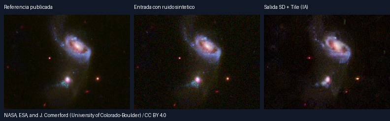

# Ejemplo real: SD + Tile y análisis CLIP

Fuente: [ESA/Hubble, potw1803a](https://esahubble.org/images/potw1803a/). Crédito: **NASA, ESA, and J. Comerford (University of Colorado-Boulder)**. Imagen y derivadas bajo [CC BY 4.0](https://creativecommons.org/licenses/by/4.0/), conforme a las [condiciones de ESA/Hubble](https://esahubble.org/copyright/). Estas modificaciones por IA no están avaladas por sus autores.

La referencia preparada de 256 × 192 RGB está en [ruido_gaussiano](../../ruido_gaussiano/potw1803a_sigma0.03_seed123_size256/). Se agregó ruido gaussiano sigma 0,03, PCG64 y semilla 123. `entrada_ruidosa.png` conserva ese archivo. `salida_tile.png` es la salida real del ensayo Colab, intensidad 0,10, 30 pasos configurados, 3 efectivos, semilla 42, DDIM, guidance 1, condición Tile igual a la entrada ruidosa y fuerza 1. No se volvió a ejecutar difusión para preparar este ejemplo.

[resultado_tile.json](resultado_tile.json) conserva el registro histórico original, incluidas las revisiones fijas de ambos modelos, precisión, entorno, parámetros y procedencia. Sus campos de evaluación pendiente describen el estado del ensayo al generarlo; la evaluación posterior está en el README principal. Los nombres de archivo históricos pueden diferir de los nombres de esta copia.

**Acierto técnico:** salida válida, comparación, mapa y análisis real de ambas imágenes. [analisis_clip.json](analisis_clip.json) guarda afinidades, frases, revisión, preprocesamiento, entorno y hashes de las dos imágenes; [informe_clip.md](informe_clip.md) presenta el informe en español. CLIP se ejecutó localmente en CPU sobre estas imágenes el 15 de noviembre de 2026. El mapa es la media RGB redondeada de diferencias absolutas, escala fija 0–255; la lámina solo agrega títulos y crédito a imágenes sin escalar.

**Fallo de restauración:** la entrada ruidosa tiene PSNR 31,2381 dB y SSIM 0,637538; la salida Tile tiene PSNR 28,4258 dB y SSIM 0,552753 contra la misma referencia sintética. La comparación muestra cambios en texturas y contornos. No se afirma que haya eliminado más ruido ni conservado detalles reales. Los bloqueos en intensidades 0,20 y 0,25 están documentados en el README principal; no se fabrican imágenes de esos casos.

**Límite del análisis:** la afinidad con la frase de textura granulada baja apenas, mientras suben otras como estructuras difusas. Eso no contradice las métricas: son medidas diferentes y CLIP no es un evaluador de denoising. No se asignan umbrales de éxito ni una interpretación científica a cambios pequeños de afinidad. No hay un acierto de limpieza validado para mostrar.

## Vista de revisión para Julia

[zonas_para_revisar.png](zonas_para_revisar.png) aplica una capa amarilla a la salida real ya preservada, sin nueva difusión ni nuevo análisis CLIP. Usa diferencias RGB absolutas y promedio local de 5 × 5, umbral fijo 12 sobre 255 y opacidad 0,6. Señala zonas modificadas, no invenciones detectadas; puede incluir ruido modificado o detalle perdido. No cambia salida_tile.png ni la entrada. La nueva derivada conserva los créditos y la licencia indicados arriba.
