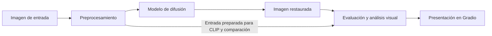

# Arquitectura técnica y entorno

Detalle de componentes, modelos, dependencias y estructura. La instalación y el recorrido de la persona usuaria están resumidos en el README principal. Los tiempos registrados corresponden a ensayos históricos, no a una predicción del rendimiento de la interfaz actual.

## Tecnologías Utilizadas

### Configuración existente

- **Python:** `.python-version` selecciona `3.12`; `pyproject.toml` declara `requires-python = ">=3.12"`.
- **uv:** gestión del entorno y las dependencias, con versiones resueltas en `uv.lock`.
- **Modalidad:** aplicación sin empaquetado instalable, con `tool.uv.package = false`.
- **Proyecto:** `astro-restauracion`, versión `0.1.0`; punto de entrada `app.py`.
- **Control de versiones:** Git y remoto de GitHub configurado.

Las dependencias directas declaradas actualmente son:

- `accelerate>=1.15.0`
- `diffusers>=0.42.1`
- `gradio>=6.31.0`
- `numpy>=2.5.4`
- `pillow>=12.3.0`
- `scikit-image>=0.26.0`
- `torch>=2.15.0`
- `transformers>=5.22.2`

PyTorch está declarado como dependencia directa. Pillow, PyTorch y Diffusers se utilizan en la prueba de procesamiento; Gradio integra la interfaz. Las versiones exactas están resueltas en `uv.lock`.

### Uso previsto

- **PyTorch y Hugging Face Diffusers:** inferencia del modelo de difusión.
- **Hugging Face Transformers:** CLIP ViT-B/32 integrado, carga diferida en CPU y preprocesamiento PIL fijo.
- **OpenCV:** procesamiento y filtro bilateral de referencia; pendiente de incorporación a las dependencias.
- **Pillow y NumPy:** lectura y manipulación de imágenes y arreglos.
- **scikit-image:** cálculo de PSNR y SSIM con referencia sintética, integrado como dependencia y disponible por consola.
- **Gradio:** interfaz web y presentación de comparaciones.
- **Google Colab:** experimentos que requieran una GPU compatible.
- **Visual Studio Code:** entorno principal de desarrollo.

Se conservan la selección de Python y uv como gestor. Se retiraron el backend `uv_build` y el comando de consola del antiguo paquete para adoptar la estructura solicitada. scikit-image ya se incorporó para las métricas; OpenCV queda pendiente para la línea base opcional.

### Modelos de IA

La aplicación web de Gradio integra carga de imágenes, difusión, comparación, análisis CLIP y descarga. La evaluación con referencia se ejecuta por separado, desde consola o notebook.

El modelo de la prueba inicial es [`stable-diffusion-v1-5/stable-diffusion-v1-5`](https://huggingface.co/stable-diffusion-v1-5/stable-diffusion-v1-5), revisión fija `451f4fe16113bff5a5d2269ed5ad43b0592e9a14`, bajo licencia **CreativeML OpenRAIL-M**. Se utiliza `StableDiffusionImg2ImgPipeline` con scheduler DDIM, pesos `fp16` en formato Safetensors y precisión de ejecución `bfloat16` en CPU o `float16` en CUDA. Se emplea precisión reducida para limitar la memoria de los pesos; su rendimiento depende del hardware.

La variante agrega [`lllyasviel/control_v11f1e_sd15_tile`](https://huggingface.co/lllyasviel/control_v11f1e_sd15_tile), revisión `3f877705c37010b7221c3d10743307d6b5b6efac`, bajo **CreativeML OpenRAIL-M** según su ficha. Usa `StableDiffusionControlNetImg2ImgPipeline` con la misma imagen ruidosa como entrada y condición, sin acceso a la referencia para generar. El checkpoint oficial ofrece `diffusion_pytorch_model.bin`, sin variante Safetensors en esa revisión; se carga desde el repositorio oficial fijado y queda en la caché excluida de Git. La implementación se verificó inicialmente sin descargar pesos, mediante simulaciones; posteriormente la autora compartió una ejecución real de Colab, revisada mediante sus imágenes y registros. Su incorporación no garantiza conservación de estructuras ni mejora de denoising.

**No es un modelo especializado en restauración astronómica** y su utilidad para este problema debe demostrarse experimentalmente. El parámetro de intensidad controla la transformación generativa; no expresa directamente cuánto ruido astronómico se elimina. Una intensidad baja no garantiza la conservación de las estructuras originales. La primera prueba de carga e inferencia no equivale a validar el denoising.

Se integra [`openai/clip-vit-base-patch32`](https://huggingface.co/openai/clip-vit-base-patch32), revisión `3d74acf9a28c67741b2f4f2ea7635f0aaf6f0268`, bajo licencia MIT del [proyecto CLIP](https://github.com/openai/CLIP/blob/main/LICENSE). Compara similitudes coseno con seis frases fijas en inglés. El informe en español utiliza una plantilla determinista, sin generar descripciones libres ni verificar autenticidad. [Método, límites y validación](analisis_visual.md).

El análisis visual es descriptivo y exploratorio. Sus afinidades no son medidas de ruido eliminado ni probabilidades de calidad. El recorte central estándar puede omitir los bordes.

### Hardware con el que se probó

Equipo disponible, según la información del proyecto:

- **Sistema operativo:** Windows.
- **GPU:** AMD Radeon RX 580 2048SP.
- **VRAM dedicada:** 8 GB.
- **RAM:** 16 GB.
- **Python de desarrollo:** 3.12.
- **IDE:** Visual Studio Code.
- **Gestor de dependencias:** uv.

#### Limitaciones de ejecución local

La GPU AMD no permite utilizar directamente una distribución de PyTorch destinada a GPU NVIDIA mediante CUDA. El soporte de aceleración AMD depende de la combinación de GPU, sistema operativo y versiones del entorno. La RX 580 no figura en la [matriz de compatibilidad de Radeon para PyTorch en Windows con ROCm 7.2.1](https://rocmdocs.amd.com/projects/radeon-ryzen/en/latest/docs/compatibility/compatibilityrad/windows/windows_compatibility.html); esta referencia no garantiza compatibilidad con otras versiones.

El proyecto no incluye una configuración validada de aceleración para este equipo. Los 8 GB de VRAM no garantizan que un pipeline sea compatible o pueda ejecutarse con cualquier resolución. Se completó una prueba en CPU con PyTorch `2.15.0+cpu` y precisión `bfloat16`: entrada preparada de 256 × 192 píxeles y dos pasos efectivos de DDIM. La inferencia midió 174,832 segundos y la carga con pesos ya descargados, 18,127 segundos. Son tiempos de esa ejecución, no una estimación general. Un intento inicial en `float32` falló por falta de memoria; la configuración final utiliza precisión reducida.

El desarrollo principal se realizará localmente en VS Code, con GitHub como repositorio central. Para experimentos que requieran GPU se utiliza Google Colab, sujeto a disponibilidad de recursos y compatibilidad de las versiones. El notebook `colab/ejecutar_en_colab.ipynb` incluye preparación, comprobación de CUDA, prueba de difusión y lanzamiento de la interfaz. La autora registró una prueba de inferencia en T4; la autora confirmó que la aplicación funciona desde el enlace público de Gradio. El enlace local corresponde al servidor remoto de Colab.

## Arquitectura del Sistema

Flujo implementado en la interfaz; la evaluación con referencia se mantiene en los experimentos por consola:



Las responsabilidades se distribuyen entre `app.py` y los módulos de `src/` para reutilizar el código localmente y en Google Colab. `src/diffusion.py` implementa la carga diferida del modelo y una prueba imagen a imagen; `src/honesty.py` calcula el mapa absoluto, su amplificación visual opcional y centraliza las advertencias. `laboratorio.py` contiene una interfaz experimental independiente; la interfaz de Julia permanece en `app.py`. `src/noise.py` genera ruido gaussiano y `src/experiment.py` prepara el ensayo y ejecuta su restauración bajo petición. `src/analysis.py` implementa CLIP y el informe; `src/export.py` conserva las imágenes y registros de la descarga. Los modelos se cargan solo al procesar, no al importar módulos.

La prueba admite PNG/TIFF de 8 bits por canal, convierte a RGB y reduce la imagen con LANCZOS sin recortar ni ampliar. Ajusta los lados a múltiplos de ocho y limita el mayor a 256 o 512 píxeles; el redondeo puede alterar ligeramente la relación de aspecto. Rechaza imágenes de alta profundidad para evitar una conversión silenciosa. El archivo de origen se conserva. El deslizador y el mapa comparan esa entrada preparada con la salida, con dimensiones idénticas.

El mapa en escala de grises calcula, por píxel, la media de las diferencias absolutas de los tres canales RGB y la redondea a 8 bits. Usa enteros con signo para evitar desbordamientos y una escala fija de 0 a 255, sin amplificar el contraste por imagen: negro significa ausencia de cambios y blanco, diferencia máxima. Rechaza modos distintos de RGB y tamaños diferentes, sin convertir ni redimensionar silenciosamente. No distingue ruido eliminado, detalles perdidos o estructuras inventadas y no mide la eficacia del denoising. Los componentes de comparación se entregan en PNG para evitar pérdidas de compresión.

Se verificaron las cabeceras de los seis TIFF descargados: `heic1702a.tif` tiene 16 bits por canal y requiere una copia de trabajo con conversión explícita antes de usar esta prueba. Los otros cinco tienen 8 bits por canal. La copia gaussiana de `heic1702a` ya tiene conversión explícita a RGB de 8 bits documentada en el catálogo; la app sigue rechazando originales de mayor profundidad.

### Estructura real del repositorio

```text
astro-restauracion/
├── app.py
├── laboratorio.py
├── AGENTS.md
├── .gitignore
├── .python-version
├── pyproject.toml
├── README.md
├── uv.lock
├── src/
│   ├── diffusion.py
│   ├── export.py
│   ├── analysis.py
│   ├── honesty.py
│   ├── validation.py
│   ├── noise.py
│   ├── experiment.py
│   ├── evaluation.py
│   ├── noise_assets.py
│   └── diagnostics.py
├── assets/
│   ├── interfaz/tema.css
│   ├── ejemplos/
│   │   ├── README.md
│   │   ├── etapa3_tile/
│   │   └── originales/
│   └── ruido_gaussiano/
│       ├── README.md
│       ├── heic0503a_sigma0.03_seed123_size256/
│       ├── heic1520a_sigma0.03_seed123_size256/
│       ├── heic1702a_sigma0.03_seed123_size256/
│       ├── potw1408a_sigma0.03_seed123_size256/
│       ├── potw1428a_sigma0.03_seed123_size256/
│       └── potw1803a_sigma0.03_seed123_size256/
│           ├── referencia_preparada.png
│           ├── entrada_ruidosa.png
│           ├── experimento.json
│           └── reproduccion.json
├── tests/
│   ├── test_image_formats.py
│   ├── test_analysis.py
│   ├── test_workflow.py
│   ├── test_honesty.py
│   ├── test_noise.py
│   ├── test_laboratorio.py
│   ├── test_evaluation.py
│   ├── test_controlnet.py
│   ├── test_noise_assets.py
│   └── test_diagnostics.py
├── docs/
│   └── README.md (índice de la documentación complementaria)
└── colab/
    ├── app_integrada.ipynb
    ├── preparar_app.py
    ├── ejecutar_en_colab.ipynb
    ├── experimento_ruido_gaussiano.ipynb
    ├── laboratorio_ruido.ipynb
    ├── experimento_controlnet_tile.ipynb
    ├── controles_sigma0_vae.ipynb
    └── preparar_controlnet.py
```

Las comprobaciones de diferencias e integración están en `tests/test_honesty.py`; el ruido, sus estadísticas, recorte y registros se comprueban en `tests/test_noise.py`. Se ejecutan desde la raíz con `uv run --locked python -m unittest discover -s tests -v`; no descargan pesos ni ejecutan inferencias. El laboratorio y la ganancia visual se comprueban en `tests/test_laboratorio.py`. Estas pruebas son independientes de las cinco ejecuciones técnicas de etapa 2 registradas por `src/validation.py`.

La suite completa cuenta con **62 pruebas**. Las ocho de `tests/test_evaluation.py` verifican identidad, error conocido de un nivel RGB, escala fija, tamaños incompatibles, hashes de referencia y salida, exclusión de casos bloqueados y conservación de registros. `tests/test_controlnet.py` y `tests/test_noise_assets.py` agregan once comprobaciones del pipeline y su revisión fija, condicionamiento con la entrada ruidosa, parámetros fijos, bloqueos, reproducción y protección de archivos. Las ocho de `tests/test_diagnostics.py` verifican posterior VAE determinista o muestreado, semilla, ausencia de UNet/scheduler en el control VAE, filtro activo y trazabilidad del protocolo sigma cero. Estas pruebas no descargan pesos ni evalúan la eficacia del modelo. Las cuatro pruebas adicionales cubren similitudes conocidas, entradas incompatibles, recuperación de CLIP sin repetir difusión e integridad del ZIP.

La revisión posterior centrada en Julia agregó siete pruebas hasta alcanzar ese total de 62: profundidad de PNG/TIFF, informe comprensible, resaltado y controles de la vista de usuario. También amplió las comprobaciones de integridad del ZIP. El [registro de etapa 4](verificacion_etapa4.md) distingue la instalación limpia anterior de la revisión posterior; estas pruebas no se volvieron a ejecutar para trasladar la documentación.

Existe además un entorno local `.venv/`, excluido del control de versiones. `app.py` construye la interfaz sin cargar modelos; la carga se realiza al solicitar una prueba. La carpeta local `assets/ejemplos/originales/` contiene seis imágenes TIFF de ESA/Hubble, excluidas de Git mediante `.gitignore`; sus fuentes, créditos, licencias e instrucciones de descarga manual están documentados en `assets/ejemplos/README.md`. Esta carpeta y sus imágenes no se obtienen al clonar el repositorio. Los pesos se guardan en `.cache/huggingface/`, las imágenes y parámetros de las pruebas en `outputs/` y todos los archivos `.log` del proyecto en `logs/`. Las tres carpetas están ignoradas por Git. Guardar los nuevos registros de ejecución en `logs/`. `AGENTS.md` establece las instrucciones para agentes en todo el repositorio.

[Volver al README principal](../README.md).
